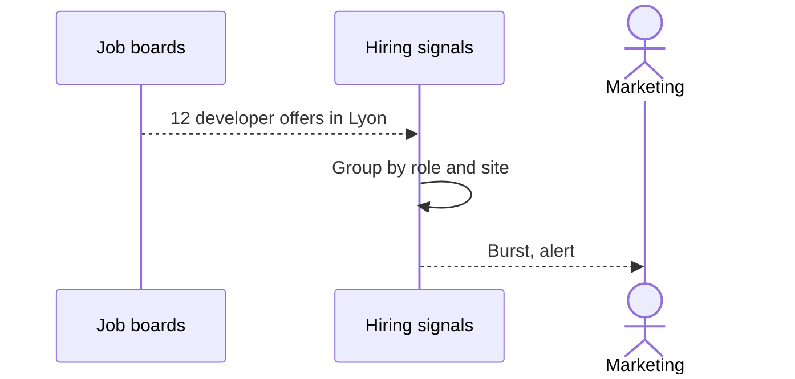

🏠 [Specs](../../../../README.md) › 🧩 [Functional capabilities](../../../README.md) ›
🔭 [F17 Competitive analysis](../../README.md) › 📝 [Use cases](../README.md) ›
📝 [Use cases: FL-F17-02 Collect signals](README.md) › 📝 UC-F17-04 Follow job offers

# 📝 UC-F17-04 Follow job offers

**Status:** ✅ specified

## Summary

Marketing follows competitors' job offers grouped by role and site, as a signal of strategy, never about people.

## Personas

- [U12 Marketing](../../../../01-users/personas/u12-marketing.md)
- [U13 Owner](../../../../01-users/personas/u13-owner.md)

## Goal

Read where competitors invest.

## Trigger

The collection schedule.

## Frequency

Weekly.

## Preconditions

- Jobs are a followed signal.

## Postconditions

- Success: offers grouped with trends.
- Failure: none collected.

## Main flow

1. simple-ERP collects public job offers of each competitor.
2. It groups them by role and site (BR-F17-04).
3. Marketing opens Hiring signals (S-F17-04).
4. They read trends; a hiring burst fires an alert (BR-F17-10).

## Alternative flows

- 4a. Compare two competitors.

## Error flows

- 1e. A job board refuses collection: skipped, reported.
- Any step: a service does not answer; the call is retried first (BR-F3-32), then the message follows the error pattern
  (D122) and what was typed stays on the screen.

## Business rules

- [BR-F17-04 No profiling of individual people](../../business-rules/br-f17-04-no-profiling-of-people.md)
- [BR-F17-10 Alerts have thresholds](../../business-rules/br-f17-10-alerts-have-thresholds.md)

## Entities

- [E-F17-04 Job signal](../../data/e-f17-04-job-signal.md)

## Permissions

Owner and marketing.

## Notifications

- Followers on a hiring burst.

## Audit events

Collections.

## AI involvement

The AI assistant comments the trend.

## API, MCP and A2A exposure

Through T5 and T6 with the caller's rights (BR-F3-34).

## Screens

- [S-F17-04 Hiring signals](../../screens/02-collect-signals/s-f17-04-hiring-signals.md)

## Flowchart

See [FL-F17-02 Collect signals](../../flows/fl-f17-02-collect-signals.md#flowchart).

## Sequence diagram

## Acceptance criteria

1. **Given** 12 developer offers in Lyon in November **when** grouped **then** a burst alert fires once.
2. **Given** an offer naming a recruiter **when** stored **then** no person is stored.
3. **Given** a refused board **when** collected **then** it is reported.

## Non-functional notes

D408's targets ([Performance](../../../../05-non-functional/performance.md)): 95 % of screens within 1 second; lists
paged on the server, the first page within 1 second; reports within 5 seconds or in the background.

## Regulatory references

Collection rules of the France country pack:
[CR-FR-192 Trade secrets](../../../../10-country-packs/france/trade/cr-fr-192-trade-secrets.md),
[CR-FR-193 Database producer's right](../../../../10-country-packs/france/trade/cr-fr-193-database-producer-right.md),
[CR-FR-196 Legitimate interest needs a documented balance](../../../../10-country-packs/france/data-protection/cr-fr-196-legitimate-interest-balancing.md),
[CR-FR-198 Comparative advertising](../../../../10-country-packs/france/consumer/cr-fr-198-comparative-advertising.md),
[CR-FR-060 Copyrighted standards and text mining](../../../../10-country-packs/france/ai-and-recording/cr-fr-060-text-and-data-mining-opt-out.md),
[CR-FR-052 Personal data kept no longer than needed](../../../../10-country-packs/france/data-protection/cr-fr-052-storage-limitation.md),
[CR-FR-051 Access and erasure requests](../../../../10-country-packs/france/data-protection/cr-fr-051-access-and-erasure.md).

## Related use cases

- [UC-F17-15 Get alerts on changes](../04-alerts-and-sharing/uc-f17-15-get-alerts-on-changes.md)

## Open questions

None.

---

⬅️ [UC-F17-03 Track products and prices](uc-f17-03-track-products-and-prices.md) · ⬆️ [Up](README.md) ·
➡️ [UC-F17-05 Follow tenders won](uc-f17-05-follow-tenders-won.md)
