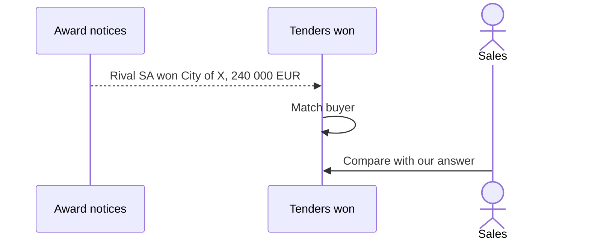

🏠 [Specs](../../../../README.md) › 🧩 [Functional capabilities](../../../README.md) ›
🔭 [F17 Competitive analysis](../../README.md) › 📝 [Use cases](../README.md) ›
📝 [Use cases: FL-F17-02 Collect signals](README.md) › 📝 UC-F17-05 Follow tenders won

# 📝 UC-F17-05 Follow tenders won

**Status:** ✅ specified

## Summary

Sales and the owner follow the public contracts won by competitors from award notices, matched to buyers, with amounts,
and close the loop of the tender watch.

## Personas

- [U03 Sales](../../../../01-users/personas/u03-sales.md)
- [U13 Owner](../../../../01-users/personas/u13-owner.md)

## Goal

Know who wins which buyers and at what amounts.

## Trigger

Award notices published.

## Frequency

Weekly.

## Preconditions

- Tenders are a followed signal.

## Postconditions

- Success: awards recorded.
- Failure: none read.

## Main flow

1. simple-ERP reads award notices.
2. It matches winners to followed competitors and buyers to F6 customers.
3. Sales open Tenders won (S-F17-05).
4. They compare amounts with the company's own answers.
5. An opportunity of the watch (UC-F17-21) is closed won or lost.

## Alternative flows

- 2a. A buyer that is a customer: shown on its F6 page.

## Error flows

- 1e. A source unreachable: last read kept.
- Any step: a service does not answer; the call is retried first (BR-F3-32), then the message follows the error pattern
  (D122) and what was typed stays on the screen.

## Business rules

- [BR-F17-02 Every fact keeps its source and date](../../business-rules/br-f17-02-every-fact-keeps-its-source.md)
- [BR-F17-13 Tender opportunities matched to the company](../../business-rules/br-f17-13-tender-opportunities-matched-to-the-company.md)

## Entities

- [E-F17-05 Tender award](../../data/e-f17-05-tender-award.md)
- [E-F17-16 Tender opportunity](../../data/e-f17-16-tender-opportunity.md)

## Permissions

Sales and owner.

## Notifications

- Followers on a tender won by a competitor.

## Audit events

Reads.

## AI involvement

The AI assistant summarises.

## API, MCP and A2A exposure

Through T5 and T6 with the caller's rights (BR-F3-34).

## Screens

- [S-F17-05 Tenders won](../../screens/02-collect-signals/s-f17-05-tenders-won.md)

## Flowchart

See [FL-F17-02 Collect signals](../../flows/fl-f17-02-collect-signals.md#flowchart).

## Sequence diagram

## Acceptance criteria

1. **Given** Rival SA wins City of X for 240 000.00 EUR **when** read **then** the award shows with source and date.
2. **Given** City of X is an F6 customer **when** matched **then** it shows on its page.
3. **Given** our opportunity for that tender **when** the award is read **then** it closes lost to Rival SA.

## Non-functional notes

D408's targets ([Performance](../../../../05-non-functional/performance.md)): 95 % of screens within 1 second; lists
paged on the server, the first page within 1 second; reports within 5 seconds or in the background.

## Regulatory references

Collection rules of the France country pack:
[CR-FR-192 Trade secrets](../../../../10-country-packs/france/trade/cr-fr-192-trade-secrets.md),
[CR-FR-193 Database producer's right](../../../../10-country-packs/france/trade/cr-fr-193-database-producer-right.md),
[CR-FR-196 Legitimate interest needs a documented balance](../../../../10-country-packs/france/data-protection/cr-fr-196-legitimate-interest-balancing.md),
[CR-FR-198 Comparative advertising](../../../../10-country-packs/france/consumer/cr-fr-198-comparative-advertising.md),
[CR-FR-060 Copyrighted standards and text mining](../../../../10-country-packs/france/ai-and-recording/cr-fr-060-text-and-data-mining-opt-out.md),
[CR-FR-052 Personal data kept no longer than needed](../../../../10-country-packs/france/data-protection/cr-fr-052-storage-limitation.md),
[CR-FR-051 Access and erasure requests](../../../../10-country-packs/france/data-protection/cr-fr-051-access-and-erasure.md).

## Related use cases

- [UC-F17-21 Watch tenders to answer](../05-tender-watch/uc-f17-21-watch-tenders-to-answer.md)
- [UC-F17-14 Analyse wins and losses](../03-analyse-and-arm-sales/uc-f17-14-analyse-wins-and-losses.md)

## Open questions

None.

---

⬅️ [UC-F17-04 Follow job offers](uc-f17-04-follow-job-offers.md) · ⬆️ [Up](README.md) ·
➡️ [UC-F17-06 Follow patents, trademarks and designs](uc-f17-06-follow-patents-trademarks-and-designs.md)
