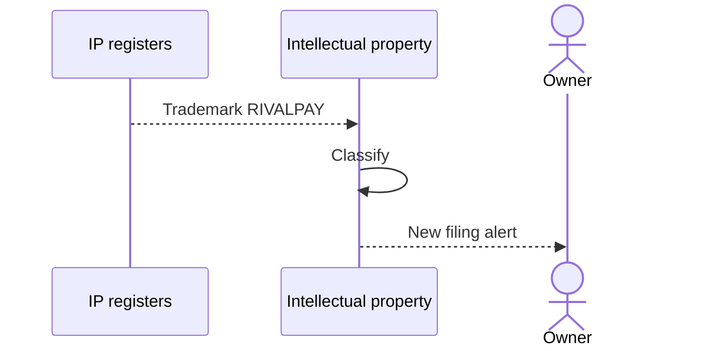

🏠 [Specs](../../../../README.md) › 🧩 [Functional capabilities](../../../README.md) ›
🔭 [F17 Competitive analysis](../../README.md) › 📝 [Use cases](../README.md) ›
📝 [Use cases: FL-F17-02 Collect signals](README.md) › 📝 UC-F17-06 Follow patents, trademarks and designs

# 📝 UC-F17-06 Follow patents, trademarks and designs

**Status:** ✅ specified

## Summary

The owner follows competitors' new patents, trademarks and designs from public registers, classified, with alerts on new
filings.

## Personas

- [U13 Owner](../../../../01-users/personas/u13-owner.md)

## Goal

Know what competitors protect.

## Trigger

Registers updated.

## Frequency

Weekly.

## Preconditions

- Filings are a followed signal.

## Postconditions

- Success: filings recorded.
- Failure: none read.

## Main flow

1. SimpleERP reads the public registers.
2. It records each filing with source and date (BR-F17-02).
3. It classifies them by kind and field.
4. The owner opens Intellectual property (S-F17-06); new ones fire an alert.

## Alternative flows

- 3a. A filing close to the company's own mark is highlighted.

## Error flows

- 1e. A register unreachable: last read kept.
- Any step: a service does not answer; the call is retried first (BR-F3-32), then the message follows the error pattern
  (D122) and what was typed stays on the screen.

## Business rules

- [BR-F17-02 Every fact keeps its source and date](../../business-rules/br-f17-02-every-fact-keeps-its-source.md)

## Entities

- [E-F17-06 IP filing](../../data/e-f17-06-ip-filing.md)

## Permissions

Owner and marketing.

## Notifications

- The owner on a new filing.

## Audit events

Reads.

## AI involvement

The AI assistant summarises a filing.

## API, MCP and A2A exposure

Through T5 and T6 with the caller's rights (BR-F3-34).

## Screens

- [S-F17-06 Intellectual property](../../screens/02-collect-signals/s-f17-06-intellectual-property.md)

## Flowchart

See [FL-F17-02 Collect signals](../../flows/fl-f17-02-collect-signals.md#flowchart).

## Sequence diagram

## Acceptance criteria

1. **Given** RIVALPAY filed on 2026-09-01 **when** read **then** it shows with its register link.
2. **Given** a mark close to ours **when** read **then** it is highlighted.
3. **Given** a register down **when** read **then** the last read date shows.

## Non-functional notes

D408's targets ([Performance](../../../../05-non-functional/performance.md)): 95 % of screens within 1 second; lists
paged on the server, the first page within 1 second; reports within 5 seconds or in the background.

## Regulatory references

Collection rules of the France country pack:
[CR-FR-192 Trade secrets](../../../../10-country-packs/france/trade/cr-fr-192-trade-secrets.md),
[CR-FR-193 Database producer's right](../../../../10-country-packs/france/trade/cr-fr-193-database-producer-right.md),
[CR-FR-196 Legitimate interest needs a documented balance](../../../../10-country-packs/france/data-protection/cr-fr-196-legitimate-interest-balancing.md),
[CR-FR-198 Comparative advertising](../../../../10-country-packs/france/consumer/cr-fr-198-comparative-advertising.md),
[CR-FR-060 Copyrighted standards and text mining](../../../../10-country-packs/france/ai-and-recording/cr-fr-060-text-and-data-mining-opt-out.md),
[CR-FR-052 Personal data kept no longer than needed](../../../../10-country-packs/france/data-protection/cr-fr-052-storage-limitation.md),
[CR-FR-051 Access and erasure requests](../../../../10-country-packs/france/data-protection/cr-fr-051-access-and-erasure.md).

## Related use cases

- [UC-F17-15 Get alerts on changes](../04-alerts-and-sharing/uc-f17-15-get-alerts-on-changes.md)

## Open questions

None.

---

⬅️ [UC-F17-05 Follow tenders won](uc-f17-05-follow-tenders-won.md) · ⬆️ [Up](README.md) ·
➡️ [UC-F17-07 Follow customer reviews and ratings](uc-f17-07-follow-customer-reviews-and-ratings.md)
