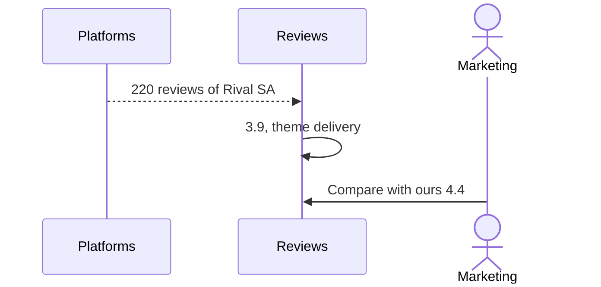

🏠 [Specs](../../../../README.md) › 🧩 [Functional capabilities](../../../README.md) ›
🔭 [F17 Competitive analysis](../../README.md) › 📝 [Use cases](../README.md) ›
📝 [Use cases: FL-F17-02 Collect signals](README.md) › 📝 UC-F17-07 Follow customer reviews and ratings

# 📝 UC-F17-07 Follow customer reviews and ratings

**Status:** ✅ specified

## Summary

Marketing follows competitors' public reviews and ratings by platform, with themes and sentiment, next to the company's
own.

## Personas

- [U12 Marketing](../../../../01-users/personas/u12-marketing.md)

## Goal

Know what customers say of competitors.

## Trigger

The collection schedule.

## Frequency

Weekly.

## Preconditions

- Reviews are a followed signal; platforms allow it.

## Postconditions

- Success: digests per platform.
- Failure: refused platforms reported.

## Main flow

1. simple-ERP collects public reviews within the platform's terms.
2. It computes ratings, themes and sentiment, without reviewers' names (BR-F17-04).
3. Marketing opens Reviews (S-F17-07).
4. They compare with the company's own.

## Alternative flows

- 4a. A theme rising for a competitor fires an alert.

## Error flows

- 1e. A platform forbids collection: skipped.
- Any step: a service does not answer; the call is retried first (BR-F3-32), then the message follows the error pattern
  (D122) and what was typed stays on the screen.

## Business rules

- [BR-F17-04 No profiling of individual people](../../business-rules/br-f17-04-no-profiling-of-people.md)
- [BR-F17-03 Sites' terms and robots rules respected](../../business-rules/br-f17-03-terms-and-robots-respected.md)

## Entities

- [E-F17-07 Review digest](../../data/e-f17-07-review-digest.md)

## Permissions

Marketing and owner.

## Notifications

- Followers on a rising theme.

## Audit events

Collections.

## AI involvement

The AI assistant extracts themes.

## API, MCP and A2A exposure

Through T5 and T6 with the caller's rights (BR-F3-34).

## Screens

- [S-F17-07 Reviews](../../screens/02-collect-signals/s-f17-07-reviews.md)

## Flowchart

See [FL-F17-02 Collect signals](../../flows/fl-f17-02-collect-signals.md#flowchart).

## Sequence diagram

## Acceptance criteria

1. **Given** 220 reviews of Rival SA **when** digested **then** 3.9 and the theme "delivery" show.
2. **Given** a reviewer's name **when** stored **then** it is not kept.
3. **Given** a platform that forbids it **when** collected **then** it is skipped.

## Non-functional notes

D408's targets ([Performance](../../../../05-non-functional/performance.md)): 95 % of screens within 1 second; lists
paged on the server, the first page within 1 second; reports within 5 seconds or in the background.

## Regulatory references

Collection rules of the France country pack:
[CR-FR-192 Trade secrets](../../../../10-country-packs/france/trade/cr-fr-192-trade-secrets.md),
[CR-FR-193 Database producer's right](../../../../10-country-packs/france/trade/cr-fr-193-database-producer-right.md),
[CR-FR-196 Legitimate interest needs a documented balance](../../../../10-country-packs/france/data-protection/cr-fr-196-legitimate-interest-balancing.md),
[CR-FR-198 Comparative advertising](../../../../10-country-packs/france/consumer/cr-fr-198-comparative-advertising.md),
[CR-FR-060 Copyrighted standards and text mining](../../../../10-country-packs/france/ai-and-recording/cr-fr-060-text-and-data-mining-opt-out.md),
[CR-FR-052 Personal data kept no longer than needed](../../../../10-country-packs/france/data-protection/cr-fr-052-storage-limitation.md),
[CR-FR-051 Access and erasure requests](../../../../10-country-packs/france/data-protection/cr-fr-051-access-and-erasure.md).

## Related use cases

- [UC-F17-24 Feed battle cards from call topics](../07-sales-enablement/uc-f17-24-feed-battle-cards-from-call-topics.md)
- [UC-F17-25 Report share of voice and the price-index trend](../06-price-intelligence/uc-f17-25-report-share-of-voice-and-the-price-index-trend.md)

## Open questions

None.

---

⬅️ [UC-F17-06 Follow patents, trademarks and designs](uc-f17-06-follow-patents-trademarks-and-designs.md) ·
⬆️ [Up](README.md) ·
➡️ [UC-F17-08 Follow news, press and social media](uc-f17-08-follow-news-press-and-social-media.md)
