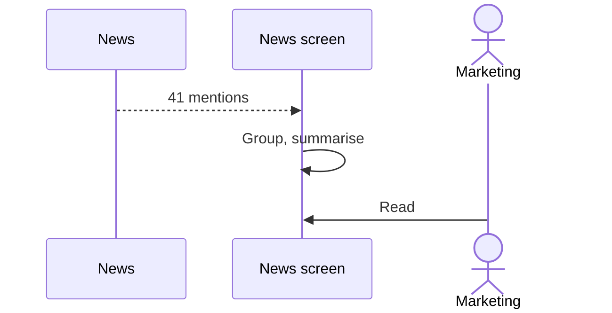

🏠 [Specs](../../../../README.md) › 🧩 [Functional capabilities](../../../README.md) ›
🔭 [F17 Competitive analysis](../../README.md) › 📝 [Use cases](../README.md) ›
📝 [Use cases: FL-F17-02 Collect signals](README.md) › 📝 UC-F17-08 Follow news, press and social media

# 📝 UC-F17-08 Follow news, press and social media

**Status:** ✅ specified

## Summary

Marketing follows news, press and social-media mentions of competitors, summarised with links, which feed the share of
voice.

## Personas

- [U12 Marketing](../../../../01-users/personas/u12-marketing.md)

## Goal

Know what is said about competitors.

## Trigger

The collection schedule.

## Frequency

Daily.

## Preconditions

- News is a followed signal.

## Postconditions

- Success: mentions summarised.
- Failure: none.

## Main flow

1. simple-ERP reads news and social media within their terms.
2. It summarises each mention with link and date.
3. Marketing opens News (S-F17-08).
4. Important mentions fire alerts; all count in the share of voice (UC-F17-25).

## Alternative flows

- 2a. Duplicates of the same story are grouped.

## Error flows

- 1e. A source blocked: reported.
- Any step: a service does not answer; the call is retried first (BR-F3-32), then the message follows the error pattern
  (D122) and what was typed stays on the screen.

## Business rules

- [BR-F17-03 Sites' terms and robots rules respected](../../business-rules/br-f17-03-terms-and-robots-respected.md)
- [BR-F17-02 Every fact keeps its source and date](../../business-rules/br-f17-02-every-fact-keeps-its-source.md)

## Entities

- [E-F17-08 Mention](../../data/e-f17-08-mention.md)

## Permissions

Marketing and owner.

## Notifications

- Followers on an important mention.

## Audit events

Collections.

## AI involvement

The AI assistant summarises.

## API, MCP and A2A exposure

Through T5 and T6 with the caller's rights (BR-F3-34).

## Screens

- [S-F17-08 News](../../screens/02-collect-signals/s-f17-08-news.md)

## Flowchart

See [FL-F17-02 Collect signals](../../flows/fl-f17-02-collect-signals.md#flowchart).

## Sequence diagram

## Acceptance criteria

1. **Given** 41 mentions this week **when** read **then** summaries with links show.
2. **Given** 5 articles of one story **when** grouped **then** one entry shows.
3. **Given** the month's mentions **when** the share of voice is computed **then** they count.

## Non-functional notes

D408's targets ([Performance](../../../../05-non-functional/performance.md)): 95 % of screens within 1 second; lists
paged on the server, the first page within 1 second; reports within 5 seconds or in the background.

## Regulatory references

Collection rules of the France country pack:
[CR-FR-192 Trade secrets](../../../../10-country-packs/france/trade/cr-fr-192-trade-secrets.md),
[CR-FR-193 Database producer's right](../../../../10-country-packs/france/trade/cr-fr-193-database-producer-right.md),
[CR-FR-196 Legitimate interest needs a documented balance](../../../../10-country-packs/france/data-protection/cr-fr-196-legitimate-interest-balancing.md),
[CR-FR-198 Comparative advertising](../../../../10-country-packs/france/consumer/cr-fr-198-comparative-advertising.md),
[CR-FR-060 Copyrighted standards and text mining](../../../../10-country-packs/france/ai-and-recording/cr-fr-060-text-and-data-mining-opt-out.md),
[CR-FR-052 Personal data kept no longer than needed](../../../../10-country-packs/france/data-protection/cr-fr-052-storage-limitation.md),
[CR-FR-051 Access and erasure requests](../../../../10-country-packs/france/data-protection/cr-fr-051-access-and-erasure.md).

## Related use cases

- [UC-F17-25 Report share of voice and the price-index trend](../06-price-intelligence/uc-f17-25-report-share-of-voice-and-the-price-index-trend.md)

## Open questions

None.

---

⬅️ [UC-F17-07 Follow customer reviews and ratings](uc-f17-07-follow-customer-reviews-and-ratings.md) ·
⬆️ [Up](README.md) ·
➡️ [UC-F17-09 Follow funding, deals and legal events](uc-f17-09-follow-funding-deals-and-legal-events.md)
