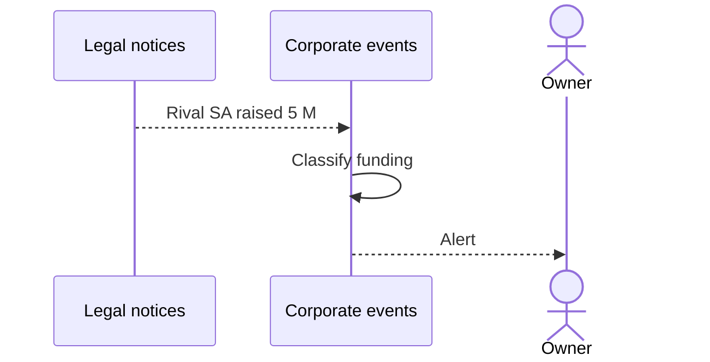

🏠 [Specs](../../../../README.md) › 🧩 [Functional capabilities](../../../README.md) ›
🔭 [F17 Competitive analysis](../../README.md) › 📝 [Use cases](../README.md) ›
📝 [Use cases: FL-F17-02 Collect signals](README.md) › 📝 UC-F17-09 Follow funding, deals and legal events

# 📝 UC-F17-09 Follow funding, deals and legal events

**Status:** ✅ specified

## Summary

The owner follows competitors' fund-raising, acquisitions and insolvency from legal notices and news, classified and
alerted.

## Personas

- [U13 Owner](../../../../01-users/personas/u13-owner.md)

## Goal

Know when a competitor's situation changes.

## Trigger

Legal notices published.

## Frequency

Weekly.

## Preconditions

- Events are a followed signal.

## Postconditions

- Success: events recorded.
- Failure: none.

## Main flow

1. simple-ERP reads legal notices and news.
2. It classifies events: funding, acquisition, insolvency.
3. The owner opens Corporate events (S-F17-09).
4. An insolvency or acquisition fires an urgent alert.

## Alternative flows

- 4a. A competitor's insolvency: its customers in F6 are listed for sales.

## Error flows

- 1e. A source down: last read kept.
- Any step: a service does not answer; the call is retried first (BR-F3-32), then the message follows the error pattern
  (D122) and what was typed stays on the screen.

## Business rules

- [BR-F17-02 Every fact keeps its source and date](../../business-rules/br-f17-02-every-fact-keeps-its-source.md)

## Entities

- [E-F17-08 Mention](../../data/e-f17-08-mention.md)
- [E-F17-02 Company fact](../../data/e-f17-02-company-fact.md)

## Permissions

Owner and marketing.

## Notifications

- The owner on urgent events.

## Audit events

Reads.

## AI involvement

The AI assistant summarises.

## API, MCP and A2A exposure

Through T5 and T6 with the caller's rights (BR-F3-34).

## Screens

- [S-F17-09 Corporate events](../../screens/02-collect-signals/s-f17-09-corporate-events.md)

## Flowchart

See [FL-F17-02 Collect signals](../../flows/fl-f17-02-collect-signals.md#flowchart).

## Sequence diagram

## Acceptance criteria

1. **Given** Rival SA raised 5 M **when** read **then** a funding event shows with source.
2. **Given** an insolvency **when** read **then** an urgent alert fires.
3. **Given** a source down **when** read **then** the last read shows.

## Non-functional notes

D408's targets ([Performance](../../../../05-non-functional/performance.md)): 95 % of screens within 1 second; lists
paged on the server, the first page within 1 second; reports within 5 seconds or in the background.

## Regulatory references

Collection rules of the France country pack:
[CR-FR-192 Trade secrets](../../../../10-country-packs/france/trade/cr-fr-192-trade-secrets.md),
[CR-FR-193 Database producer's right](../../../../10-country-packs/france/trade/cr-fr-193-database-producer-right.md),
[CR-FR-196 Legitimate interest needs a documented balance](../../../../10-country-packs/france/data-protection/cr-fr-196-legitimate-interest-balancing.md),
[CR-FR-198 Comparative advertising](../../../../10-country-packs/france/consumer/cr-fr-198-comparative-advertising.md),
[CR-FR-060 Copyrighted standards and text mining](../../../../10-country-packs/france/ai-and-recording/cr-fr-060-text-and-data-mining-opt-out.md),
[CR-FR-052 Personal data kept no longer than needed](../../../../10-country-packs/france/data-protection/cr-fr-052-storage-limitation.md),
[CR-FR-051 Access and erasure requests](../../../../10-country-packs/france/data-protection/cr-fr-051-access-and-erasure.md).

## Related use cases

- [UC-F17-02 Build a profile from registers and filings](../01-set-up-and-profiles/uc-f17-02-build-a-profile-from-registers-and-filings.md)
- [UC-F17-15 Get alerts on changes](../04-alerts-and-sharing/uc-f17-15-get-alerts-on-changes.md)

## Open questions

None.

---

⬅️ [UC-F17-08 Follow news, press and social media](uc-f17-08-follow-news-press-and-social-media.md) ·
⬆️ [Up](README.md) ·
➡️ [UC-F17-10 Connect paid data providers](../01-set-up-and-profiles/uc-f17-10-connect-paid-data-providers.md)
