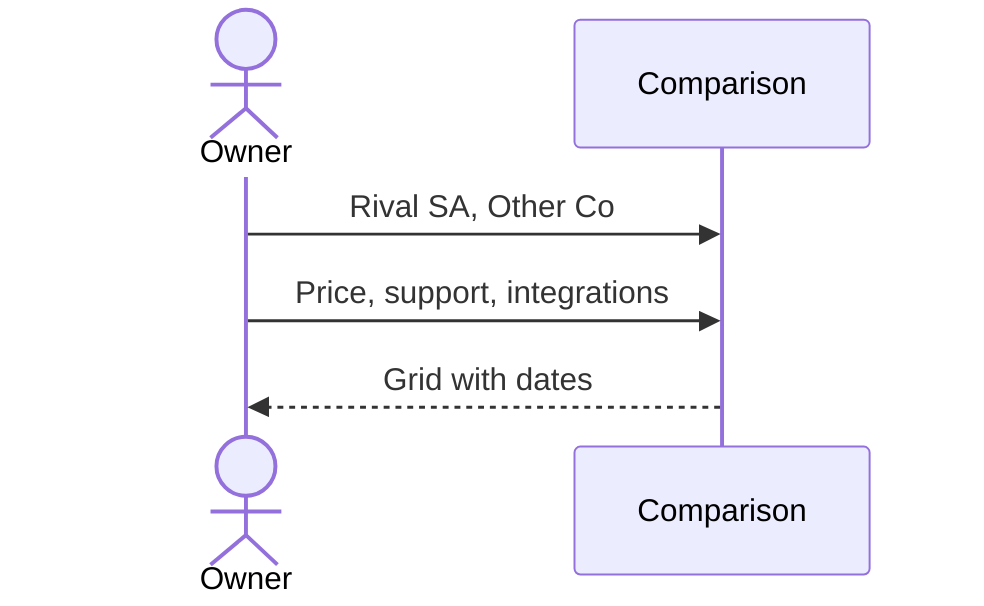

🏠 [Specs](../../../../README.md) › 🧩 [Functional capabilities](../../../README.md) ›
🔭 [F17 Competitive analysis](../../README.md) › 📝 [Use cases](../README.md) ›
📝 [Use cases: FL-F17-03 Analyse and arm sales](README.md) › 📝 UC-F17-11 Compare side by side

# 📝 UC-F17-11 Compare side by side

**Status:** ✅ specified

## Summary

The owner and sales compare offers side by side on verifiable features and prices, like for like, with each value's date
and source.

## Personas

- [U13 Owner](../../../../01-users/personas/u13-owner.md)
- [U03 Sales](../../../../01-users/personas/u03-sales.md)

## Goal

A fair comparison to decide and to sell.

## Trigger

A deal, a price review.

## Frequency

Weekly.

## Preconditions

- Facts exist.

## Postconditions

- Success: a grid saved and shareable.
- Failure: too few facts.

## Main flow

1. The owner opens Comparison (S-F17-11) and picks competitors.
2. They pick criteria (features, prices).
3. simple-ERP fills the grid with dated values (BR-F17-08).
4. They save and share it read-only.

## Alternative flows

- 4a. Reused in advertising: checked against CR-FR-198.

## Error flows

- 3e. A value missing: shown as unknown.
- Any step: a service does not answer; the call is retried first (BR-F3-32), then the message follows the error pattern
  (D122) and what was typed stays on the screen.

## Business rules

- [BR-F17-08 Comparisons are like for like](../../business-rules/br-f17-08-comparisons-are-like-for-like.md)
- [BR-F17-02 Every fact keeps its source and date](../../business-rules/br-f17-02-every-fact-keeps-its-source.md)

## Entities

- [E-F17-03 Price point](../../data/e-f17-03-price-point.md)
- [E-F17-10 Analysis](../../data/e-f17-10-analysis.md)
- [E-F17-17 Price index](../../data/e-f17-17-price-index.md)

## Permissions

Owner and marketing; sales as granted.

## Notifications

- None.

## Audit events

Grids saved and shared.

## AI involvement

The AI assistant fills features from facts with citations.

## API, MCP and A2A exposure

Through T5 and T6 with the caller's rights (BR-F3-34).

## Screens

- [S-F17-11 Comparison](../../screens/03-analyse-and-arm-sales/s-f17-11-comparison.md)

## Flowchart

See [FL-F17-03 Analyse and arm sales](../../flows/fl-f17-03-analyse-and-arm-sales.md#flowchart).

## Sequence diagram

## Acceptance criteria

1. **Given** 2 competitors and 3 criteria **when** built **then** each value shows date and source.
2. **Given** a missing value **when** built **then** it shows unknown.
3. **Given** a grid reused in an ad **when** checked **then** CR-FR-198 applies.

## Non-functional notes

D408's targets ([Performance](../../../../05-non-functional/performance.md)): 95 % of screens within 1 second; lists
paged on the server, the first page within 1 second; reports within 5 seconds or in the background.

## Regulatory references

Collection rules of the France country pack:
[CR-FR-192 Trade secrets](../../../../10-country-packs/france/trade/cr-fr-192-trade-secrets.md),
[CR-FR-193 Database producer's right](../../../../10-country-packs/france/trade/cr-fr-193-database-producer-right.md),
[CR-FR-196 Legitimate interest needs a documented balance](../../../../10-country-packs/france/data-protection/cr-fr-196-legitimate-interest-balancing.md),
[CR-FR-198 Comparative advertising](../../../../10-country-packs/france/consumer/cr-fr-198-comparative-advertising.md),
[CR-FR-060 Copyrighted standards and text mining](../../../../10-country-packs/france/ai-and-recording/cr-fr-060-text-and-data-mining-opt-out.md),
[CR-FR-052 Personal data kept no longer than needed](../../../../10-country-packs/france/data-protection/cr-fr-052-storage-limitation.md),
[CR-FR-051 Access and erasure requests](../../../../10-country-packs/france/data-protection/cr-fr-051-access-and-erasure.md).

## Related use cases

- [UC-F17-23 Suggest price-list changes from the price index](../06-price-intelligence/uc-f17-23-suggest-price-list-changes-from-the-price-index.md)
- [UC-F17-12 Write a sourced SWOT and positioning](uc-f17-12-write-a-sourced-swot-and-positioning.md)

## Open questions

None.

---

⬅️ [UC-F17-10 Connect paid data providers](../01-set-up-and-profiles/uc-f17-10-connect-paid-data-providers.md) ·
⬆️ [Up](README.md) ·
➡️ [UC-F17-12 Write a sourced SWOT and positioning](uc-f17-12-write-a-sourced-swot-and-positioning.md)
