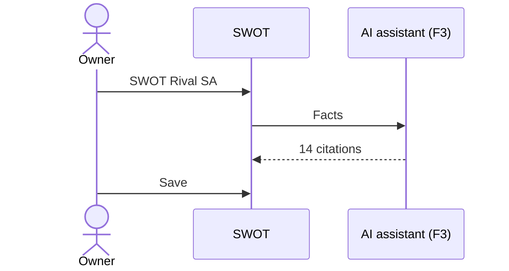

🏠 [Specs](../../../../README.md) › 🧩 [Functional capabilities](../../../README.md) ›
🔭 [F17 Competitive analysis](../../README.md) › 📝 [Use cases](../README.md) ›
📝 [Use cases: FL-F17-03 Analyse and arm sales](README.md) › 📝 UC-F17-12 Write a sourced SWOT and positioning

# 📝 UC-F17-12 Write a sourced SWOT and positioning

**Status:** ✅ specified

## Summary

The owner and marketing ask the AI for a SWOT and a positioning map, read them with citations, mark claims without facts
as opinions, edit and save.

## Personas

- [U13 Owner](../../../../01-users/personas/u13-owner.md)
- [U12 Marketing](../../../../01-users/personas/u12-marketing.md)

## Goal

A sourced strategic view.

## Trigger

A strategy review.

## Frequency

Quarterly.

## Preconditions

- Facts exist.

## Postconditions

- Success: analysis saved.
- Failure: none.

## Main flow

1. The owner opens SWOT and positioning (S-F17-12) and asks.
2. The AI writes it, citing facts (BR-F17-07).
3. Claims without facts are marked as opinions.
4. The owner edits and saves.

## Alternative flows

- 4a. Shared with granted roles.

## Error flows

- 2e. Too few facts: said.
- Any step: a service does not answer; the call is retried first (BR-F3-32), then the message follows the error pattern
  (D122) and what was typed stays on the screen.

## Business rules

- [BR-F17-07 AI summaries cite their facts](../../business-rules/br-f17-07-ai-summaries-cite-facts.md)

## Entities

- [E-F17-10 Analysis](../../data/e-f17-10-analysis.md)

## Permissions

Owner and marketing.

## Notifications

- None.

## Audit events

Analyses saved.

## AI involvement

The AI cites every fact.

## API, MCP and A2A exposure

Through T5 and T6 with the caller's rights (BR-F3-34).

## Screens

- [S-F17-12 SWOT and positioning](../../screens/03-analyse-and-arm-sales/s-f17-12-swot-and-positioning.md)

## Flowchart

See [FL-F17-03 Analyse and arm sales](../../flows/fl-f17-03-analyse-and-arm-sales.md#flowchart).

## Sequence diagram

## Acceptance criteria

1. **Given** 14 facts **when** written **then** each claim cites one.
2. **Given** a claim with no fact **when** written **then** it is marked opinion.
3. **Given** saved **when** shared **then** only granted roles read it.

## Non-functional notes

D408's targets ([Performance](../../../../05-non-functional/performance.md)): 95 % of screens within 1 second; lists
paged on the server, the first page within 1 second; reports within 5 seconds or in the background.

## Regulatory references

Collection rules of the France country pack:
[CR-FR-192 Trade secrets](../../../../10-country-packs/france/trade/cr-fr-192-trade-secrets.md),
[CR-FR-193 Database producer's right](../../../../10-country-packs/france/trade/cr-fr-193-database-producer-right.md),
[CR-FR-196 Legitimate interest needs a documented balance](../../../../10-country-packs/france/data-protection/cr-fr-196-legitimate-interest-balancing.md),
[CR-FR-198 Comparative advertising](../../../../10-country-packs/france/consumer/cr-fr-198-comparative-advertising.md),
[CR-FR-060 Copyrighted standards and text mining](../../../../10-country-packs/france/ai-and-recording/cr-fr-060-text-and-data-mining-opt-out.md),
[CR-FR-052 Personal data kept no longer than needed](../../../../10-country-packs/france/data-protection/cr-fr-052-storage-limitation.md),
[CR-FR-051 Access and erasure requests](../../../../10-country-packs/france/data-protection/cr-fr-051-access-and-erasure.md).

## Related use cases

- [UC-F17-11 Compare side by side](uc-f17-11-compare-side-by-side.md)

## Open questions

None.

---

⬅️ [UC-F17-11 Compare side by side](uc-f17-11-compare-side-by-side.md) · ⬆️ [Up](README.md) ·
➡️ [UC-F17-13 Prepare battle cards for sales](uc-f17-13-prepare-battle-cards-for-sales.md)
