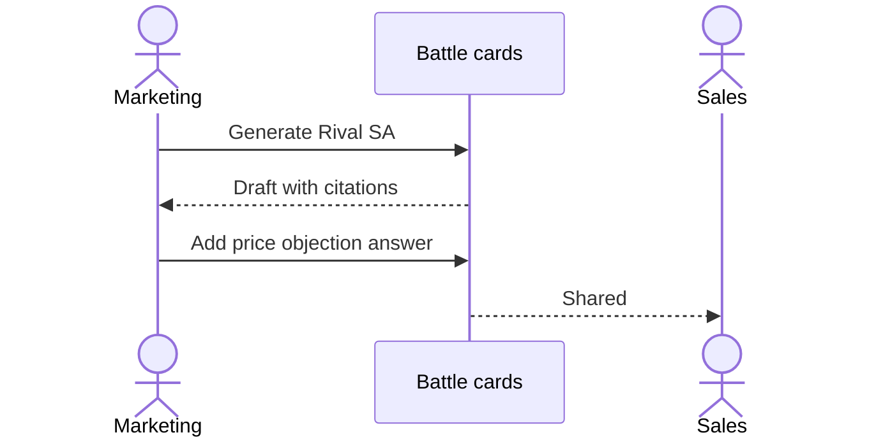

🏠 [Specs](../../../../README.md) › 🧩 [Functional capabilities](../../../README.md) ›
🔭 [F17 Competitive analysis](../../README.md) › 📝 [Use cases](../README.md) ›
📝 [Use cases: FL-F17-03 Analyse and arm sales](README.md) › 📝 UC-F17-13 Prepare battle cards for sales

# 📝 UC-F17-13 Prepare battle cards for sales

**Status:** 🔄 waiting for the owner

## Summary

Marketing prepares one battle card per competitor (strengths, traps, answers), fed by facts, call topics (UC-F17-24) and
wins and losses, and shares it read-only with sales.

## Personas

- [U03 Sales](../../../../01-users/personas/u03-sales.md)

## Goal

Sales ready for each competitor.

## Trigger

A new competitor; an update proposal.

## Frequency

Monthly per card.

## Preconditions

- The competitor is followed.

## Postconditions

- Success: card current and shared.
- Failure: card out of date flagged.

## Main flow

1. Marketing opens Battle cards (S-F17-13) and generates a card.
2. The AI writes it citing facts (BR-F17-07).
3. Marketing reviews and adds the approved proposals from call topics.
4. They share it read-only with sales (BR-F17-09).

## Alternative flows

- 3a. A card older than (Proposed) 90 days is flagged out of date.

## Error flows

- 2e. Too few facts: a short card.
- Any step: a service does not answer; the call is retried first (BR-F3-32), then the message follows the error pattern
  (D122) and what was typed stays on the screen.

## Business rules

- [BR-F17-07 AI summaries cite their facts](../../business-rules/br-f17-07-ai-summaries-cite-facts.md)
- [BR-F17-09 Analyses are confidential by default](../../business-rules/br-f17-09-analyses-are-confidential.md)
- [BR-F17-16 Call topics feed cards without people](../../business-rules/br-f17-16-call-topics-feed-cards-without-people.md)

## Entities

- [E-F17-11 Battle card](../../data/e-f17-11-battle-card.md)
- [E-F17-20 Call topic signal](../../data/e-f17-20-call-topic-signal.md)

## Permissions

Marketing edits; sales read.

## Notifications

- Sales when a card changes or is out of date.

## Audit events

Card versions.

## AI involvement

The AI drafts; marketing approves.

## API, MCP and A2A exposure

Through T5 and T6 with the caller's rights (BR-F3-34).

## Screens

- [S-F17-13 Battle cards](../../screens/03-analyse-and-arm-sales/s-f17-13-battle-cards.md)

## Flowchart

See [FL-F17-03 Analyse and arm sales](../../flows/fl-f17-03-analyse-and-arm-sales.md#flowchart).

## Sequence diagram

## Acceptance criteria

1. **Given** Rival SA's card **when** shared **then** sales read it without editing.
2. **Given** a card 95 days old **when** opened **then** it is flagged out of date.
3. **Given** a proposal approved **when** added **then** the card version changes.

## Non-functional notes

D408's targets ([Performance](../../../../05-non-functional/performance.md)): 95 % of screens within 1 second; lists
paged on the server, the first page within 1 second; reports within 5 seconds or in the background.

## Regulatory references

Collection rules of the France country pack:
[CR-FR-192 Trade secrets](../../../../10-country-packs/france/trade/cr-fr-192-trade-secrets.md),
[CR-FR-193 Database producer's right](../../../../10-country-packs/france/trade/cr-fr-193-database-producer-right.md),
[CR-FR-196 Legitimate interest needs a documented balance](../../../../10-country-packs/france/data-protection/cr-fr-196-legitimate-interest-balancing.md),
[CR-FR-198 Comparative advertising](../../../../10-country-packs/france/consumer/cr-fr-198-comparative-advertising.md),
[CR-FR-060 Copyrighted standards and text mining](../../../../10-country-packs/france/ai-and-recording/cr-fr-060-text-and-data-mining-opt-out.md),
[CR-FR-052 Personal data kept no longer than needed](../../../../10-country-packs/france/data-protection/cr-fr-052-storage-limitation.md),
[CR-FR-051 Access and erasure requests](../../../../10-country-packs/france/data-protection/cr-fr-051-access-and-erasure.md).

## Related use cases

- [UC-F17-24 Feed battle cards from call topics](../07-sales-enablement/uc-f17-24-feed-battle-cards-from-call-topics.md)
- [UC-F17-14 Analyse wins and losses](uc-f17-14-analyse-wins-and-losses.md)

## Open questions

None.

---

⬅️ [UC-F17-12 Write a sourced SWOT and positioning](uc-f17-12-write-a-sourced-swot-and-positioning.md) ·
⬆️ [Up](README.md) · ➡️ [UC-F17-14 Analyse wins and losses](uc-f17-14-analyse-wins-and-losses.md)
