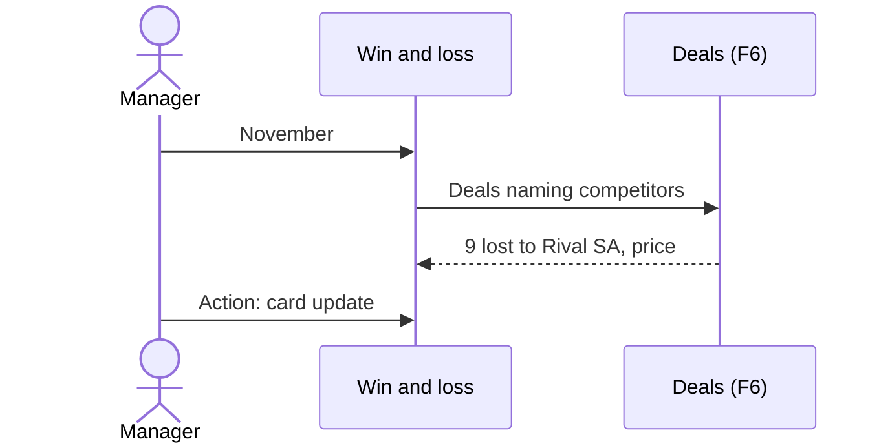

🏠 [Specs](../../../../README.md) › 🧩 [Functional capabilities](../../../README.md) ›
🔭 [F17 Competitive analysis](../../README.md) › 📝 [Use cases](../README.md) ›
📝 [Use cases: FL-F17-03 Analyse and arm sales](README.md) › 📝 UC-F17-14 Analyse wins and losses

# 📝 UC-F17-14 Analyse wins and losses

**Status:** ✅ specified

## Summary

Sales and managers analyse deals won and lost against each competitor from F6 opportunities whose reason names one, and
act on the patterns.

## Personas

- [U03 Sales](../../../../01-users/personas/u03-sales.md)
- [U02 Manager](../../../../01-users/personas/u02-manager.md)

## Goal

Learn why deals are lost.

## Trigger

Monthly review.

## Frequency

Monthly.

## Preconditions

- F6 deals with lost reasons.

## Postconditions

- Success: patterns seen; actions noted.
- Failure: no deal names a competitor.

## Main flow

1. The manager opens Win and loss (S-F17-14).
2. simple-ERP lists deals per competitor (BR-F17-12).
3. They group by reason.
4. They note an action (price, feature, card update).

## Alternative flows

- 4a. A reason feeds a card update proposal (UC-F17-24).

## Error flows

- 2e. No deal names a competitor: said.
- Any step: a service does not answer; the call is retried first (BR-F3-32), then the message follows the error pattern
  (D122) and what was typed stays on the screen.

## Business rules

- [BR-F17-12 Win and loss from real deals](../../business-rules/br-f17-12-win-loss-from-real-deals.md)

## Entities

- [E-F17-12 Win-loss record](../../data/e-f17-12-win-loss-record.md)

## Permissions

Sales own deals; managers team.

## Notifications

- None.

## Audit events

Actions noted.

## AI involvement

The AI assistant groups reasons.

## API, MCP and A2A exposure

Through T5 and T6 with the caller's rights (BR-F3-34).

## Screens

- [S-F17-14 Win and loss](../../screens/03-analyse-and-arm-sales/s-f17-14-win-and-loss.md)

## Flowchart

See [FL-F17-03 Analyse and arm sales](../../flows/fl-f17-03-analyse-and-arm-sales.md#flowchart).

## Sequence diagram

## Acceptance criteria

1. **Given** 9 deals lost to Rival SA on price **when** grouped **then** "price" leads.
2. **Given** a deal counted once **when** listed **then** it is never twice.
3. **Given** a sales person **when** they open **then** only their deals show.

## Non-functional notes

D408's targets ([Performance](../../../../05-non-functional/performance.md)): 95 % of screens within 1 second; lists
paged on the server, the first page within 1 second; reports within 5 seconds or in the background.

## Regulatory references

Collection rules of the France country pack:
[CR-FR-192 Trade secrets](../../../../10-country-packs/france/trade/cr-fr-192-trade-secrets.md),
[CR-FR-193 Database producer's right](../../../../10-country-packs/france/trade/cr-fr-193-database-producer-right.md),
[CR-FR-196 Legitimate interest needs a documented balance](../../../../10-country-packs/france/data-protection/cr-fr-196-legitimate-interest-balancing.md),
[CR-FR-198 Comparative advertising](../../../../10-country-packs/france/consumer/cr-fr-198-comparative-advertising.md),
[CR-FR-060 Copyrighted standards and text mining](../../../../10-country-packs/france/ai-and-recording/cr-fr-060-text-and-data-mining-opt-out.md),
[CR-FR-052 Personal data kept no longer than needed](../../../../10-country-packs/france/data-protection/cr-fr-052-storage-limitation.md),
[CR-FR-051 Access and erasure requests](../../../../10-country-packs/france/data-protection/cr-fr-051-access-and-erasure.md).

## Related use cases

- [UC-F17-24 Feed battle cards from call topics](../07-sales-enablement/uc-f17-24-feed-battle-cards-from-call-topics.md)
- [UC-F17-13 Prepare battle cards for sales](uc-f17-13-prepare-battle-cards-for-sales.md)

## Open questions

None.

---

⬅️ [UC-F17-13 Prepare battle cards for sales](uc-f17-13-prepare-battle-cards-for-sales.md) · ⬆️ [Up](README.md) ·
➡️ [UC-F17-15 Get alerts on changes](../04-alerts-and-sharing/uc-f17-15-get-alerts-on-changes.md)
