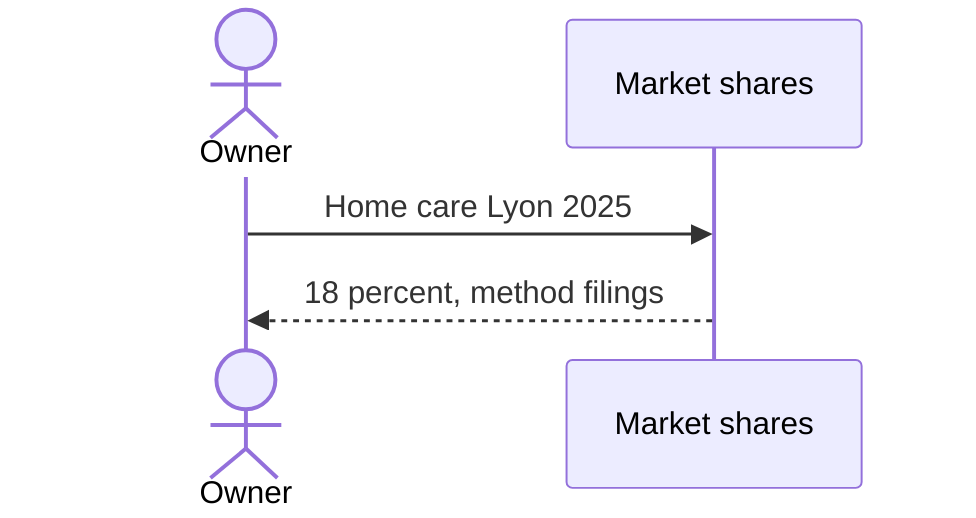

🏠 [Specs](../../../../README.md) › 🧩 [Functional capabilities](../../../README.md) ›
🔭 [F17 Competitive analysis](../../README.md) › 📝 [Use cases](../README.md) ›
📝 [Use cases: FL-F17-03 Analyse and arm sales](README.md) › 📝 UC-F17-17 Estimate market shares in a territory

# 📝 UC-F17-17 Estimate market shares in a territory

**Status:** ✅ specified

## Summary

The owner estimates market shares in a territory from filings, tenders and estimates, with the method shown.

## Personas

- [U13 Owner](../../../../01-users/personas/u13-owner.md)

## Goal

Know the company's place in its market.

## Trigger

A yearly review.

## Frequency

Yearly.

## Preconditions

- Filings exist for the competitors.

## Postconditions

- Success: shares with method.
- Failure: too few data.

## Main flow

1. The owner opens Market shares (S-F17-17) and chooses market and year.
2. SimpleERP computes shares from filings and tenders.
3. It shows the method and sources.
4. The owner saves the estimate.

## Alternative flows

- 2a. Estimates for companies with no filings.

## Error flows

- 2e. Too few data: said.
- Any step: a service does not answer; the call is retried first (BR-F3-32), then the message follows the error pattern
  (D122) and what was typed stays on the screen.

## Business rules

- [BR-F17-02 Every fact keeps its source and date](../../business-rules/br-f17-02-every-fact-keeps-its-source.md)
- [BR-F17-08 Comparisons are like for like](../../business-rules/br-f17-08-comparisons-are-like-for-like.md)

## Entities

- [E-F17-14 Market estimate](../../data/e-f17-14-market-estimate.md)

## Permissions

Owner; granted roles.

## Notifications

- None.

## Audit events

Estimates saved.

## AI involvement

The AI assistant explains the method.

## API, MCP and A2A exposure

Through T5 and T6 with the caller's rights (BR-F3-34).

## Screens

- [S-F17-17 Market shares](../../screens/03-analyse-and-arm-sales/s-f17-17-market-shares.md)

## Flowchart

See [FL-F17-03 Analyse and arm sales](../../flows/fl-f17-03-analyse-and-arm-sales.md#flowchart).

## Sequence diagram

## Acceptance criteria

1. **Given** home care Lyon 2025 **when** computed **then** our 18 % shows with the method.
2. **Given** estimates used **when** shown **then** they are marked estimates.
3. **Given** too few data **when** computed **then** it says so.

## Non-functional notes

D408's targets ([Performance](../../../../05-non-functional/performance.md)): 95 % of screens within 1 second; lists
paged on the server, the first page within 1 second; reports within 5 seconds or in the background.

## Regulatory references

Collection rules of the France country pack:
[CR-FR-192 Trade secrets](../../../../10-country-packs/france/trade/cr-fr-192-trade-secrets.md),
[CR-FR-193 Database producer's right](../../../../10-country-packs/france/trade/cr-fr-193-database-producer-right.md),
[CR-FR-196 Legitimate interest needs a documented balance](../../../../10-country-packs/france/data-protection/cr-fr-196-legitimate-interest-balancing.md),
[CR-FR-198 Comparative advertising](../../../../10-country-packs/france/consumer/cr-fr-198-comparative-advertising.md),
[CR-FR-060 Copyrighted standards and text mining](../../../../10-country-packs/france/ai-and-recording/cr-fr-060-text-and-data-mining-opt-out.md),
[CR-FR-052 Personal data kept no longer than needed](../../../../10-country-packs/france/data-protection/cr-fr-052-storage-limitation.md),
[CR-FR-051 Access and erasure requests](../../../../10-country-packs/france/data-protection/cr-fr-051-access-and-erasure.md).

## Related use cases

- [UC-F17-25 Report share of voice and the price-index trend](../06-price-intelligence/uc-f17-25-report-share-of-voice-and-the-price-index-trend.md)

## Open questions

None.

---

⬅️ [UC-F17-16 Receive a periodic digest](../04-alerts-and-sharing/uc-f17-16-receive-a-periodic-digest.md) ·
⬆️ [Up](README.md) ·
➡️ [UC-F17-18 Set lawful collection rules](../01-set-up-and-profiles/uc-f17-18-set-lawful-collection-rules.md)
