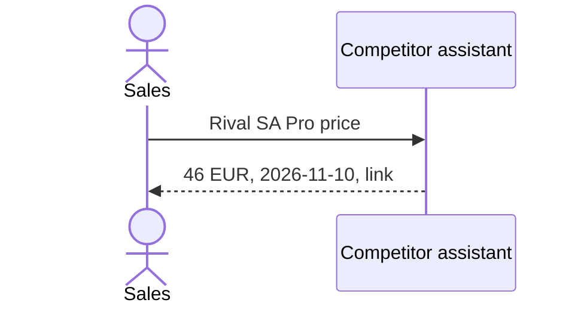

🏠 [Specs](../../../../README.md) › 🧩 [Functional capabilities](../../../README.md) ›
🔭 [F17 Competitive analysis](../../README.md) › 📝 [Use cases](../README.md) ›
📝 [Use cases: FL-F17-03 Analyse and arm sales](README.md) › 📝 UC-F17-20 Ask the AI assistant about a competitor

# 📝 UC-F17-20 Ask the AI assistant about a competitor

**Status:** ✅ specified

## Summary

The owner and sales ask the AI assistant about a competitor: profile, prices, card, tenders, within their rights, with
sources.

## Personas

- [U13 Owner](../../../../01-users/personas/u13-owner.md)
- [U03 Sales](../../../../01-users/personas/u03-sales.md)

## Goal

Answers about competitors by asking.

## Trigger

A question.

## Frequency

Daily for sales.

## Preconditions

- The user may see the files asked.

## Postconditions

- Success: answer with sources.
- Failure: refused beyond rights.

## Main flow

1. The user opens the competitor assistant (S-F17-20).
2. They ask: "how does Rival SA price its Pro plan?"
3. The answer cites facts with dates (BR-F17-02).
4. They open the source or save the answer.

## Alternative flows

- 4a. Ask for the battle card before a call.

## Error flows

- 3e. A file not granted: refused.
- Any step: a service does not answer; the call is retried first (BR-F3-32), then the message follows the error pattern
  (D122) and what was typed stays on the screen.

## Business rules

- [BR-F17-02 Every fact keeps its source and date](../../business-rules/br-f17-02-every-fact-keeps-its-source.md)
- [BR-F17-09 Analyses are confidential by default](../../business-rules/br-f17-09-analyses-are-confidential.md)

## Entities

- [E-F17-01 Competitor](../../data/e-f17-01-competitor.md)
- [E-F17-10 Analysis](../../data/e-f17-10-analysis.md)

## Permissions

Within grants.

## Notifications

- None.

## Audit events

Questions and data read.

## AI involvement

Answers from facts only.

## API, MCP and A2A exposure

Through T5 and T6 with the caller's rights (BR-F3-34).

## Screens

- [S-F17-20 Competitor assistant](../../screens/03-analyse-and-arm-sales/s-f17-20-competitor-assistant.md)

## Flowchart

See [FL-F17-03 Analyse and arm sales](../../flows/fl-f17-03-analyse-and-arm-sales.md#flowchart).

## Sequence diagram

## Acceptance criteria

1. **Given** Rival SA's Pro at 46.00 EUR **when** asked **then** the answer cites date and link.
2. **Given** no grant **when** asked **then** refused.
3. **Given** a battle card asked **when** asked **then** it opens read-only.

## Non-functional notes

D408's targets ([Performance](../../../../05-non-functional/performance.md)): 95 % of screens within 1 second; lists
paged on the server, the first page within 1 second; reports within 5 seconds or in the background.

## Regulatory references

Collection rules of the France country pack:
[CR-FR-192 Trade secrets](../../../../10-country-packs/france/trade/cr-fr-192-trade-secrets.md),
[CR-FR-193 Database producer's right](../../../../10-country-packs/france/trade/cr-fr-193-database-producer-right.md),
[CR-FR-196 Legitimate interest needs a documented balance](../../../../10-country-packs/france/data-protection/cr-fr-196-legitimate-interest-balancing.md),
[CR-FR-198 Comparative advertising](../../../../10-country-packs/france/consumer/cr-fr-198-comparative-advertising.md),
[CR-FR-060 Copyrighted standards and text mining](../../../../10-country-packs/france/ai-and-recording/cr-fr-060-text-and-data-mining-opt-out.md),
[CR-FR-052 Personal data kept no longer than needed](../../../../10-country-packs/france/data-protection/cr-fr-052-storage-limitation.md),
[CR-FR-051 Access and erasure requests](../../../../10-country-packs/france/data-protection/cr-fr-051-access-and-erasure.md).

## Related use cases

- [UC-F17-13 Prepare battle cards for sales](uc-f17-13-prepare-battle-cards-for-sales.md)

## Open questions

None.

---

⬅️ [UC-F17-19 Restrict access to analyses](../04-alerts-and-sharing/uc-f17-19-restrict-access-to-analyses.md) ·
⬆️ [Up](README.md) · ➡️ [UC-F17-21 Watch tenders to answer](../05-tender-watch/uc-f17-21-watch-tenders-to-answer.md)
