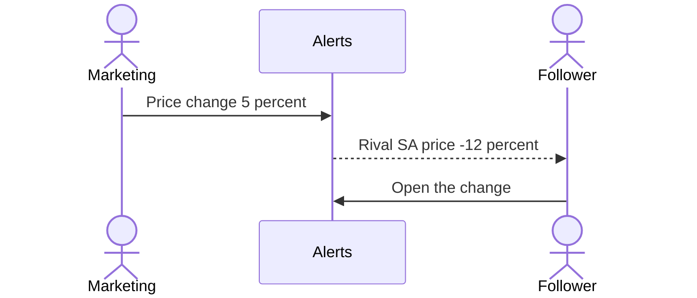

🏠 [Specs](../../../../README.md) › 🧩 [Functional capabilities](../../../README.md) ›
🔭 [F17 Competitive analysis](../../README.md) › 📝 [Use cases](../README.md) ›
📝 [Use cases: FL-F17-04 Alerts and sharing](README.md) › 📝 UC-F17-15 Get alerts on changes

# 📝 UC-F17-15 Get alerts on changes

**Status:** ✅ specified

## Summary

Marketing and sales set alert thresholds and receive alerts on price changes, new products, sites, hiring bursts and
tenders won, at most once a day per competitor.

## Personas

- [U12 Marketing](../../../../01-users/personas/u12-marketing.md)
- [U03 Sales](../../../../01-users/personas/u03-sales.md)

## Goal

Know of important changes quickly.

## Trigger

A change above a threshold.

## Frequency

Weekly alerts.

## Preconditions

- Thresholds are set.

## Postconditions

- Success: alerts received.
- Failure: none.

## Main flow

1. Marketing opens Alerts (S-F17-15) and sets thresholds.
2. A change above a threshold fires an alert (BR-F17-10).
3. Followers receive it, at most once a day per competitor.
4. They open the change and its source.

## Alternative flows

- 2a. Urgent events (insolvency) are sent at once.

## Error flows

- 3e. A notification fails: kept in the in-app list.
- Any step: a service does not answer; the call is retried first (BR-F3-32), then the message follows the error pattern
  (D122) and what was typed stays on the screen.

## Business rules

- [BR-F17-10 Alerts have thresholds](../../business-rules/br-f17-10-alerts-have-thresholds.md)

## Entities

- [E-F17-13 Alert](../../data/e-f17-13-alert.md)

## Permissions

Followers.

## Notifications

- Followers by in-app and email.

## Audit events

Alerts sent.

## AI involvement

None.

## API, MCP and A2A exposure

Through T5 and T6 with the caller's rights (BR-F3-34).

## Screens

- [S-F17-15 Alerts](../../screens/04-alerts-and-sharing/s-f17-15-alerts.md)

## Flowchart

See [FL-F17-04 Alerts and sharing](../../flows/fl-f17-04-alerts-and-sharing.md#flowchart).

## Sequence diagram

## Acceptance criteria

1. **Given** a threshold of 5 % **when** Rival SA drops 12 % **then** an alert fires.
2. **Given** 3 changes in a day **when** fired **then** one alert per competitor that day.
3. **Given** an insolvency **when** read **then** it is sent at once.

## Non-functional notes

D408's targets ([Performance](../../../../05-non-functional/performance.md)): 95 % of screens within 1 second; lists
paged on the server, the first page within 1 second; reports within 5 seconds or in the background.

## Regulatory references

Collection rules of the France country pack:
[CR-FR-192 Trade secrets](../../../../10-country-packs/france/trade/cr-fr-192-trade-secrets.md),
[CR-FR-193 Database producer's right](../../../../10-country-packs/france/trade/cr-fr-193-database-producer-right.md),
[CR-FR-196 Legitimate interest needs a documented balance](../../../../10-country-packs/france/data-protection/cr-fr-196-legitimate-interest-balancing.md),
[CR-FR-198 Comparative advertising](../../../../10-country-packs/france/consumer/cr-fr-198-comparative-advertising.md),
[CR-FR-060 Copyrighted standards and text mining](../../../../10-country-packs/france/ai-and-recording/cr-fr-060-text-and-data-mining-opt-out.md),
[CR-FR-052 Personal data kept no longer than needed](../../../../10-country-packs/france/data-protection/cr-fr-052-storage-limitation.md),
[CR-FR-051 Access and erasure requests](../../../../10-country-packs/france/data-protection/cr-fr-051-access-and-erasure.md).

## Related use cases

- [UC-F17-16 Receive a periodic digest](uc-f17-16-receive-a-periodic-digest.md)
- [UC-F17-21 Watch tenders to answer](../05-tender-watch/uc-f17-21-watch-tenders-to-answer.md)

## Open questions

None.

---

⬅️ [UC-F17-14 Analyse wins and losses](../03-analyse-and-arm-sales/uc-f17-14-analyse-wins-and-losses.md) ·
⬆️ [Up](README.md) · ➡️ [UC-F17-16 Receive a periodic digest](uc-f17-16-receive-a-periodic-digest.md)
