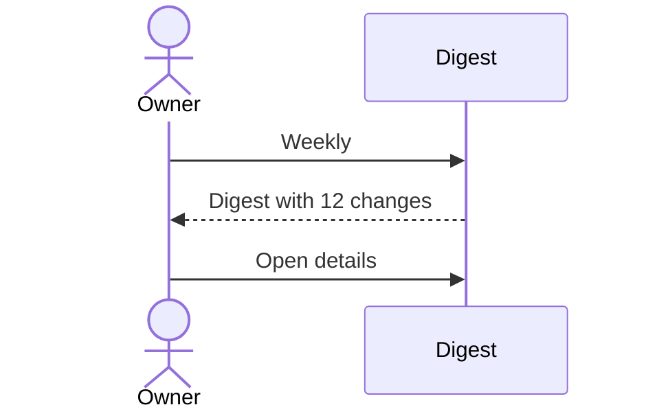

🏠 [Specs](../../../../README.md) › 🧩 [Functional capabilities](../../../README.md) ›
🔭 [F17 Competitive analysis](../../README.md) › 📝 [Use cases](../README.md) ›
📝 [Use cases: FL-F17-04 Alerts and sharing](README.md) › 📝 UC-F17-16 Receive a periodic digest

# 📝 UC-F17-16 Receive a periodic digest

**Status:** ✅ specified

## Summary

The owner receives a weekly or monthly digest of changes, analyses and reports, with links to details.

## Personas

- [U13 Owner](../../../../01-users/personas/u13-owner.md)

## Goal

Stay informed without searching.

## Trigger

The period's end.

## Frequency

Weekly or monthly.

## Preconditions

- Facts exist.

## Postconditions

- Success: digest received.
- Failure: none.

## Main flow

1. The owner chooses the period in Digest (S-F17-16).
2. At its end, SimpleERP writes the digest citing facts (BR-F17-07).
3. The owner receives it.
4. They open details.

## Alternative flows

- 2a. Reports (UC-F17-25) included.

## Error flows

- 2e. Nothing changed: a short digest says so.
- Any step: a service does not answer; the call is retried first (BR-F3-32), then the message follows the error pattern
  (D122) and what was typed stays on the screen.

## Business rules

- [BR-F17-07 AI summaries cite their facts](../../business-rules/br-f17-07-ai-summaries-cite-facts.md)

## Entities

- [E-F17-13 Alert](../../data/e-f17-13-alert.md)
- [E-F17-10 Analysis](../../data/e-f17-10-analysis.md)

## Permissions

Owner and marketing.

## Notifications

- The owner at the period's end.

## Audit events

Digests sent.

## AI involvement

The AI writes the digest.

## API, MCP and A2A exposure

Through T5 and T6 with the caller's rights (BR-F3-34).

## Screens

- [S-F17-16 Digest](../../screens/04-alerts-and-sharing/s-f17-16-digest.md)

## Flowchart

See [FL-F17-04 Alerts and sharing](../../flows/fl-f17-04-alerts-and-sharing.md#flowchart).

## Sequence diagram

## Acceptance criteria

1. **Given** weekly **when** the week ends **then** the digest arrives with citations.
2. **Given** nothing changed **when** written **then** it says so.
3. **Given** reports included **when** written **then** the share of voice shows.

## Non-functional notes

D408's targets ([Performance](../../../../05-non-functional/performance.md)): 95 % of screens within 1 second; lists
paged on the server, the first page within 1 second; reports within 5 seconds or in the background.

## Regulatory references

Collection rules of the France country pack:
[CR-FR-192 Trade secrets](../../../../10-country-packs/france/trade/cr-fr-192-trade-secrets.md),
[CR-FR-193 Database producer's right](../../../../10-country-packs/france/trade/cr-fr-193-database-producer-right.md),
[CR-FR-196 Legitimate interest needs a documented balance](../../../../10-country-packs/france/data-protection/cr-fr-196-legitimate-interest-balancing.md),
[CR-FR-198 Comparative advertising](../../../../10-country-packs/france/consumer/cr-fr-198-comparative-advertising.md),
[CR-FR-060 Copyrighted standards and text mining](../../../../10-country-packs/france/ai-and-recording/cr-fr-060-text-and-data-mining-opt-out.md),
[CR-FR-052 Personal data kept no longer than needed](../../../../10-country-packs/france/data-protection/cr-fr-052-storage-limitation.md),
[CR-FR-051 Access and erasure requests](../../../../10-country-packs/france/data-protection/cr-fr-051-access-and-erasure.md).

## Related use cases

- [UC-F17-25 Report share of voice and the price-index trend](../06-price-intelligence/uc-f17-25-report-share-of-voice-and-the-price-index-trend.md)

## Open questions

None.

---

⬅️ [UC-F17-15 Get alerts on changes](uc-f17-15-get-alerts-on-changes.md) · ⬆️ [Up](README.md) ·
➡️ [UC-F17-17](../03-analyse-and-arm-sales/uc-f17-17-estimate-market-shares-in-a-territory.md)
