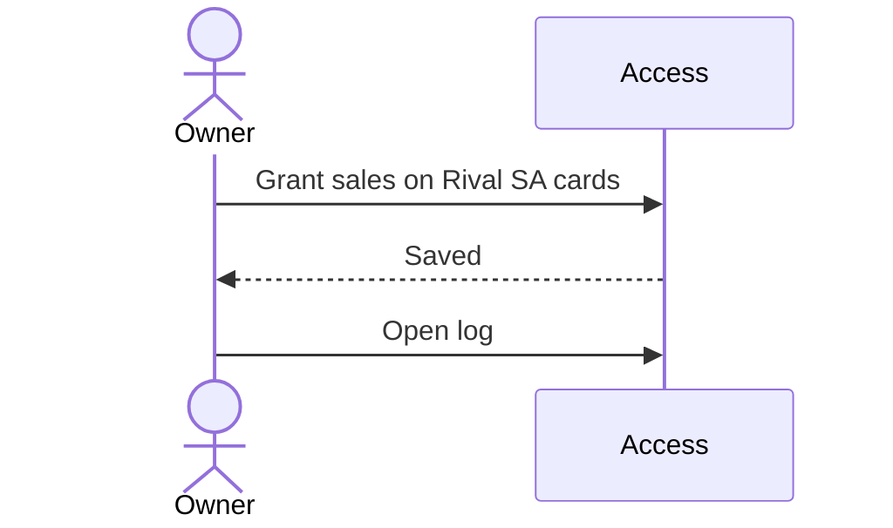

🏠 [Specs](../../../../README.md) › 🧩 [Functional capabilities](../../../README.md) ›
🔭 [F17 Competitive analysis](../../README.md) › 📝 [Use cases](../README.md) ›
📝 [Use cases: FL-F17-04 Alerts and sharing](README.md) › 📝 UC-F17-19 Restrict access to analyses

# 📝 UC-F17-19 Restrict access to analyses

**Status:** ✅ specified

## Summary

The owner and the administrator choose which roles see which competitor files, and audit who opened them.

## Personas

- [U13 Owner](../../../../01-users/personas/u13-owner.md)
- [U07 Administrator](../../../../01-users/personas/u07-administrator.md)

## Goal

Analyses confidential by default.

## Trigger

A new role needing access.

## Frequency

Rare.

## Preconditions

- Analyses exist.

## Postconditions

- Success: grants saved.
- Failure: none.

## Main flow

1. The owner opens Access (S-F17-19).
2. They choose roles per competitor file.
3. They grant (BR-F17-09).
4. They audit the access log.

## Alternative flows

- 3a. Battle cards shared with sales read-only.

## Error flows

- 3e. A role without the module: refused.
- Any step: a service does not answer; the call is retried first (BR-F3-32), then the message follows the error pattern
  (D122) and what was typed stays on the screen.

## Business rules

- [BR-F17-09 Analyses are confidential by default](../../business-rules/br-f17-09-analyses-are-confidential.md)

## Entities

- [E-F17-10 Analysis](../../data/e-f17-10-analysis.md)

## Permissions

Owner; the administrator reads the log.

## Notifications

- Granted roles.

## Audit events

Grants and every access.

## AI involvement

None.

## API, MCP and A2A exposure

Through T5 and T6 with the caller's rights (BR-F3-34).

## Screens

- [S-F17-19 Access](../../screens/04-alerts-and-sharing/s-f17-19-access.md)

## Flowchart

See [FL-F17-04 Alerts and sharing](../../flows/fl-f17-04-alerts-and-sharing.md#flowchart).

## Sequence diagram

## Acceptance criteria

1. **Given** sales granted **when** they open **then** cards are read-only.
2. **Given** no grant **when** a manager opens **then** refused.
3. **Given** the log **when** opened **then** each access shows.

## Non-functional notes

D408's targets ([Performance](../../../../05-non-functional/performance.md)): 95 % of screens within 1 second; lists
paged on the server, the first page within 1 second; reports within 5 seconds or in the background.

## Regulatory references

Collection rules of the France country pack:
[CR-FR-192 Trade secrets](../../../../10-country-packs/france/trade/cr-fr-192-trade-secrets.md),
[CR-FR-193 Database producer's right](../../../../10-country-packs/france/trade/cr-fr-193-database-producer-right.md),
[CR-FR-196 Legitimate interest needs a documented balance](../../../../10-country-packs/france/data-protection/cr-fr-196-legitimate-interest-balancing.md),
[CR-FR-198 Comparative advertising](../../../../10-country-packs/france/consumer/cr-fr-198-comparative-advertising.md),
[CR-FR-060 Copyrighted standards and text mining](../../../../10-country-packs/france/ai-and-recording/cr-fr-060-text-and-data-mining-opt-out.md),
[CR-FR-052 Personal data kept no longer than needed](../../../../10-country-packs/france/data-protection/cr-fr-052-storage-limitation.md),
[CR-FR-051 Access and erasure requests](../../../../10-country-packs/france/data-protection/cr-fr-051-access-and-erasure.md).

## Related use cases

- [UC-F17-13 Prepare battle cards for sales](../03-analyse-and-arm-sales/uc-f17-13-prepare-battle-cards-for-sales.md)

## Open questions

None.

---

⬅️ [UC-F17-18 Set lawful collection rules](../01-set-up-and-profiles/uc-f17-18-set-lawful-collection-rules.md) ·
⬆️ [Up](README.md) · ➡️ [UC-F17-20](../03-analyse-and-arm-sales/uc-f17-20-ask-the-assistant-about-a-competitor.md)
