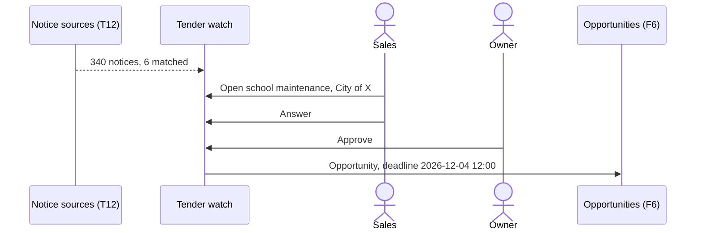

🏠 [Specs](../../../../README.md) › 🧩 [Functional capabilities](../../../README.md) ›
🔭 [F17 Competitive analysis](../../README.md) › 📝 [Use cases](../README.md) ›
📝 [Use cases: FL-F17-05 Tender watch](README.md) › 📝 UC-F17-21 Watch tenders to answer

# 📝 UC-F17-21 Watch tenders to answer

**Status:** 🔄 waiting for the owner

## Summary

Sales and the owner see the public tender notices that match the company's activity, areas and size, with their
deadlines, and decide which to answer; skipped ones keep their reason.

## Personas

- [U03 Sales](../../../../01-users/personas/u03-sales.md)
- [U13 Owner](../../../../01-users/personas/u13-owner.md), who approves the decision to answer

## Goal

No relevant tender missed, and time spent only on those worth answering.

## Trigger

New notices published in the official sources; a deadline approaching.

## Frequency

Daily reading; a few decisions a week for the construction example company (SC01).

## Preconditions

- The company's activity codes, areas and amounts are set.

## Postconditions

- Success: each opportunity decided: answering (with an F6 opportunity) or skipped with a reason.
- Failure: the deadline passes; the opportunity closes as missed.

## Main flow

1. simple-ERP reads the new notices from the official sources and matches them to the profile (BR-F17-13).
2. Sales opens Tender watch (S-F17-21); opportunities show with buyer, amount, deadline and why they matched.
3. Sales opens one, reads the notice and the documents linked.
4. Sales decides "answer" (the owner approves) or "skip" with a reason.
5. An answer creates an F6 opportunity with the deadline; the construction sector's tender answer (SC01) takes over.

## Alternative flows

- 2a. The AI assistant summarises the notice and lists the documents required.
- 5a. When the award notice is read later, the outcome and the winner are recorded (UC-F17-05).

## Error flows

- 1e. A source is unreachable: the last read is kept and the administrator is told.
- 4e. The deadline passes undecided: the opportunity closes as missed.
- Any step: a service does not answer; the call is retried first (BR-F3-32), then the message follows the error pattern
  (D122) and what was typed stays on the screen.

## Business rules

- [BR-F17-13 Tender opportunities matched to the company](../../business-rules/br-f17-13-tender-opportunities-matched-to-the-company.md)
- [BR-F17-02 Every fact keeps its source and date](../../business-rules/br-f17-02-every-fact-keeps-its-source.md)

## Entities

- [E-F17-16 Tender opportunity](../../data/e-f17-16-tender-opportunity.md)

## Permissions

Sales and owner decide; marketing reads; the administrator manages sources.

## Notifications

- Sales daily of new opportunities; sales and the owner (Proposed) 7 days and 2 days before a deadline.

## Audit events

Opportunities matched, decided, with who, when and the reason.

## AI involvement

The AI assistant summarises notices and checks the requirements against the company's documents; it never decides.

## API, MCP and A2A exposure

Through the API (T5) and as AI assistant tools (T6), with the caller's rights (BR-F3-34).

## Screens

- [S-F17-21 Tender watch](../../screens/05-tender-watch/s-f17-21-tender-watch.md)

## Flowchart

See [FL-F17-05 Tender watch](../../flows/fl-f17-05-tender-watch.md#flowchart).

## Sequence diagram

## Acceptance criteria

1. **Given** the construction example company serving its department with activity code 45453000 **when** 340 notices
   are read **then** the 6 matching ones are listed with why they matched.
2. **Given** a notice outside the areas served **when** read **then** it is ignored.
3. **Given** an opportunity decided "answer" and approved **when** saved **then** an F6 opportunity with the deadline is
   created.
4. **Given** an opportunity undecided at its deadline **when** the deadline passes **then** it closes as missed.

## Non-functional notes

D408's targets ([Performance](../../../../05-non-functional/performance.md)): 95 % of screens within 1 second; lists
paged on the server, the first page within 1 second; reports within 5 seconds or in the background.

## Regulatory references

Public procurement notices: (Proposed) to read for the France pack;
[CR-FR-091 Public contracts payment and Chorus Pro](../../../../10-country-packs/france/invoicing/cr-fr-091-public-contracts-payment-and-chorus-pro.md)
for invoicing once won.

## Related use cases

- [UC-F17-05 Follow tenders won](../02-collect-signals/uc-f17-05-follow-tenders-won.md)
- [UC-F17-15 Get alerts on changes](../04-alerts-and-sharing/uc-f17-15-get-alerts-on-changes.md)

## Open questions

None.

---

⬅️ [UC-F17-20](../03-analyse-and-arm-sales/uc-f17-20-ask-the-assistant-about-a-competitor.md) · ⬆️ [Up](README.md) ·
➡️ [UC-F17-22](../01-set-up-and-profiles/uc-f17-22-follow-data-provider-costs-against-the-budget.md)
