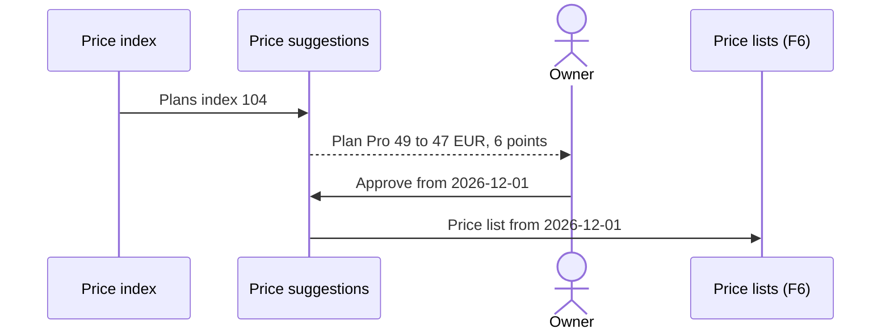

🏠 [Specs](../../../../README.md) › 🧩 [Functional capabilities](../../../README.md) ›
🔭 [F17 Competitive analysis](../../README.md) › 📝 [Use cases](../README.md) ›
📝 [Use cases: FL-F17-06 Price intelligence](README.md) › 📝 UC-F17-23 Suggest price-list changes from the price index

# 📝 UC-F17-23 Suggest price-list changes from the price index

**Status:** ✅ specified

## Summary

From the like-for-like price index, SimpleERP suggests changes to the company's F6 price lists when the gap passes a
threshold; the owner approves or refuses each, and nothing changes without approval.

## Personas

- [U13 Owner](../../../../01-users/personas/u13-owner.md)
- [U03 Sales](../../../../01-users/personas/u03-sales.md), who sees why prices move

## Goal

Prices that follow the market by decision, not by surprise.

## Trigger

The price index computed after a collection.

## Frequency

Weekly index; a few suggestions a month.

## Preconditions

- Prices are tracked (UC-F17-03) with like-for-like pairs (BR-F17-08).

## Postconditions

- Success: suggestions approved become a dated F6 price list; refused ones keep their reason.
- Failure: none: no price changes without approval.

## Main flow

1. SimpleERP computes the price index per family from the like-for-like pairs (S-F17-23).
2. A family whose gap passes the threshold produces a suggestion with the price points it rests on.
3. The owner opens the suggestion, its evidence and the expected margin effect.
4. The owner approves with a date or refuses with a reason (BR-F17-15).
5. An approved suggestion creates the price list in F6 from its date; sales see the change.

## Alternative flows

- 3a. The owner asks for a what-if of the change (F23).

## Error flows

- 1e. Too few pairs in a family: no index for it.
- 4e. A user without the right approves: refused.
- Any step: a service does not answer; the call is retried first (BR-F3-32), then the message follows the error pattern
  (D122) and what was typed stays on the screen.

## Business rules

- [BR-F17-15 Price suggestions need approval](../../business-rules/br-f17-15-price-suggestions-need-approval.md)
- [BR-F17-08 Comparisons are like for like](../../business-rules/br-f17-08-comparisons-are-like-for-like.md)

## Entities

- [E-F17-17 Price index](../../data/e-f17-17-price-index.md)
- [E-F17-18 Price suggestion](../../data/e-f17-18-price-suggestion.md)

## Permissions

Owner approves (or a role they grant); sales and marketing read.

## Notifications

- The owner when a suggestion is made; sales when an approved price list starts.

## Audit events

Index computed, suggestions, approvals and refusals with reasons.

## AI involvement

The AI assistant explains the index and the suggestion with its sources; it never approves.

## API, MCP and A2A exposure

Through the API (T5) and as AI assistant tools (T6), with the caller's rights (BR-F3-34).

## Screens

- [S-F17-23 Price suggestions](../../screens/06-price-intelligence/s-f17-23-price-suggestions.md)

## Flowchart

See [FL-F17-06 Price intelligence](../../flows/fl-f17-06-price-intelligence.md#flowchart).

## Sequence diagram

## Acceptance criteria

1. **Given** competitors' like-for-like plans 4 % cheaper on average **when** the index is computed **then** the Plans
   family shows 104.
2. **Given** a gap above the 5 % threshold **when** computed **then** a suggestion lists its 6 price points.
3. **Given** the owner approves 47.00 EUR from 2026-12-01 **when** approved **then** F6 has a price list from that date.
4. **Given** a sales person approves **when** they try **then** it is refused.

## Non-functional notes

D408's targets ([Performance](../../../../05-non-functional/performance.md)): 95 % of screens within 1 second; lists
paged on the server, the first page within 1 second; reports within 5 seconds or in the background.

## Regulatory references

[CR-FR-198 Comparative advertising](../../../../10-country-packs/france/consumer/cr-fr-198-comparative-advertising.md)
when a comparison is reused.

## Related use cases

- [UC-F17-03 Track products and prices](../02-collect-signals/uc-f17-03-track-products-and-prices.md)
- [UC-F17-11 Compare side by side](../03-analyse-and-arm-sales/uc-f17-11-compare-side-by-side.md)
- [UC-F17-25 Report share of voice and the price-index trend](uc-f17-25-report-share-of-voice-and-the-price-index-trend.md)

## Open questions

None.

---

⬅️ [UC-F17-22](../01-set-up-and-profiles/uc-f17-22-follow-data-provider-costs-against-the-budget.md) ·
⬆️ [Up](README.md) · ➡️ [UC-F17-24](../07-sales-enablement/uc-f17-24-feed-battle-cards-from-call-topics.md)
