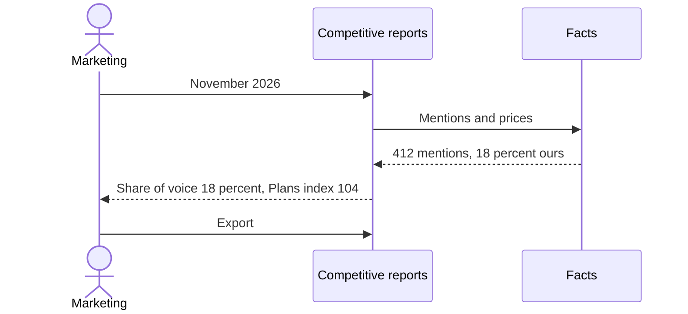

🏠 [Specs](../../../../README.md) › 🧩 [Functional capabilities](../../../README.md) ›
🔭 [F17 Competitive analysis](../../README.md) › 📝 [Use cases](../README.md) ›
📝 [Use cases: FL-F17-06 Price intelligence](README.md) › 📝 UC-F17-25 Report share of voice and the price-index trend

# 📝 UC-F17-25 Report share of voice and the price-index trend

**Status:** 🔄 waiting for the owner

## Summary

The owner and marketing read the reports added to the three KPIs: share of voice (mentions of the company against
competitors) and the price-index trend per family, with their sources and an export.

## Personas

- [U13 Owner](../../../../01-users/personas/u13-owner.md)
- [U12 Marketing and communication](../../../../01-users/personas/u12-marketing.md)

## Goal

See over time how visible and how priced the company is against its competitors.

## Trigger

The monthly review; the digest.

## Frequency

Monthly.

## Preconditions

- Mentions (UC-F17-08) and prices (UC-F17-03) are collected.

## Postconditions

- Success: reports shown and exported.
- Failure: too little data, said.

## Main flow

1. Marketing opens Competitive reports (S-F17-24) and chooses a period.
2. simple-ERP shows the share of voice: the company's mentions over all mentions, per channel.
3. It shows the price-index trend per family over 24 months.
4. Marketing opens a point to see its facts and sources.
5. They export the reports or add them to the digest (UC-F17-16).

## Alternative flows

- 2a. Per competitor: each one's share.

## Error flows

- 2e. Fewer than (Proposed) 30 mentions in the period: the share is not computed.
- Any step: a service does not answer; the call is retried first (BR-F3-32), then the message follows the error pattern
  (D122) and what was typed stays on the screen.

## Business rules

- [BR-F17-02 Every fact keeps its source and date](../../business-rules/br-f17-02-every-fact-keeps-its-source.md)
- [BR-F17-08 Comparisons are like for like](../../business-rules/br-f17-08-comparisons-are-like-for-like.md)

## Entities

- [E-F17-17 Price index](../../data/e-f17-17-price-index.md)
- [E-F17-08 Mention](../../data/e-f17-08-mention.md)

## Permissions

Owner and marketing; others as granted (BR-F17-09).

## Notifications

- None outside the digest.

## Audit events

Exports.

## AI involvement

The AI assistant comments the trend with its sources.

## API, MCP and A2A exposure

Through the API (T5) and as AI assistant tools (T6), with the caller's rights (BR-F3-34).

## Screens

- [S-F17-24 Competitive reports](../../screens/06-price-intelligence/s-f17-24-competitive-reports.md)

## Flowchart

See [FL-F17-06 Price intelligence](../../flows/fl-f17-06-price-intelligence.md#flowchart).

## Sequence diagram

## Acceptance criteria

1. **Given** 412 mentions in November of which 74 name the company **when** the report opens **then** the share of voice
   is 18 %.
2. **Given** the Plans index at 108 in May and 104 in November **when** the trend opens **then** both points show with
   their facts.
3. **Given** 12 mentions only **when** opened **then** the share is not computed and the reason shown.

## Non-functional notes

D408's targets ([Performance](../../../../05-non-functional/performance.md)): 95 % of screens within 1 second; lists
paged on the server, the first page within 1 second; reports within 5 seconds or in the background.

## Regulatory references

None.

## Related use cases

- [UC-F17-23 Suggest price-list changes from the price index](uc-f17-23-suggest-price-list-changes-from-the-price-index.md)
- [UC-F17-16 Receive a periodic digest](../04-alerts-and-sharing/uc-f17-16-receive-a-periodic-digest.md)

## Open questions

None.

---

⬅️ [UC-F17-24](../07-sales-enablement/uc-f17-24-feed-battle-cards-from-call-topics.md) · ⬆️ [Up](README.md) ·
➡️ [UC-F17-26 Follow competitors' ads](../08-ads-pages-search-and-tech/uc-f17-26-follow-competitors-ads.md)
