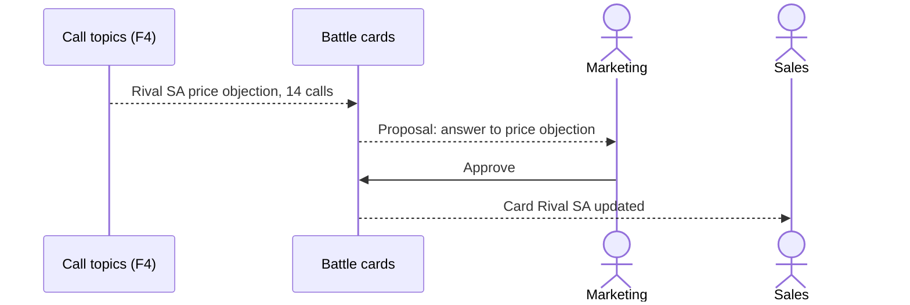

🏠 [Specs](../../../../README.md) › 🧩 [Functional capabilities](../../../README.md) ›
🔭 [F17 Competitive analysis](../../README.md) › 📝 [Use cases](../README.md) ›
📝 [Use cases: FL-F17-07 Sales enablement](README.md) › 📝 UC-F17-24 Feed battle cards from call topics

# 📝 UC-F17-24 Feed battle cards from call topics

**Status:** ✅ specified

## Summary

The topics F4 finds in sales calls that name a competitor are counted per theme and proposed as battle-card updates;
marketing approves them, and no person or recording reaches a card.

## Personas

- [U03 Sales](../../../../01-users/personas/u03-sales.md)
- [U02 Manager](../../../../01-users/personas/u02-manager.md)
- [U12 Marketing and communication](../../../../01-users/personas/u12-marketing.md), who approves card updates

## Goal

Battle cards that answer what customers actually say.

## Trigger

Call topics naming a competitor in F4.

## Frequency

Weekly proposals.

## Preconditions

- F4 records and summarises calls with consent (CR-FR-059).
- A battle card exists for the competitor.

## Postconditions

- Success: cards updated with counted themes.
- Failure: proposals dismissed.

## Main flow

1. F4's call topics naming a competitor arrive as themes with counts (BR-F17-16).
2. SimpleERP groups them per competitor and proposes card updates (S-F17-13).
3. Marketing reads each proposal with its count and period.
4. Marketing approves, edits or dismisses it.
5. The card is updated and sales are told.

## Alternative flows

- 2a. Win and loss reasons (UC-F17-14) add to the same proposal.

## Error flows

- 2e. A proposal holds a name: it is removed before the proposal is shown.
- Any step: a service does not answer; the call is retried first (BR-F3-32), then the message follows the error pattern
  (D122) and what was typed stays on the screen.

## Business rules

- [BR-F17-16 Call topics feed cards without people](../../business-rules/br-f17-16-call-topics-feed-cards-without-people.md)
- [BR-F17-07 AI summaries cite their facts](../../business-rules/br-f17-07-ai-summaries-cite-facts.md)

## Entities

- [E-F17-20 Call topic signal](../../data/e-f17-20-call-topic-signal.md)
- [E-F17-11 Battle card](../../data/e-f17-11-battle-card.md)

## Permissions

Marketing approves; sales and managers read cards.

## Notifications

- Marketing when proposals are ready; sales when a card changes.

## Audit events

Proposals, approvals, card versions.

## AI involvement

The AI assistant writes the proposal from the themes and cites them (BR-F17-07).

## API, MCP and A2A exposure

Through the API (T5) and as AI assistant tools (T6), with the caller's rights (BR-F3-34).

## Screens

- [S-F17-13 Battle cards](../../screens/03-analyse-and-arm-sales/s-f17-13-battle-cards.md)

## Flowchart

See [FL-F17-07 Sales enablement](../../flows/fl-f17-07-sales-enablement.md#flowchart).

## Sequence diagram

## Acceptance criteria

1. **Given** 14 calls in November naming Rival SA on price **when** grouped **then** a proposal "price objection, 14
   calls" is made for Rival SA's card.
2. **Given** marketing approves **when** saved **then** sales are told and the card shows the new answer.
3. **Given** a proposal quoting a customer by name **when** built **then** the name is removed.

## Non-functional notes

D408's targets ([Performance](../../../../05-non-functional/performance.md)): 95 % of screens within 1 second; lists
paged on the server, the first page within 1 second; reports within 5 seconds or in the background.

## Regulatory references

[CR-FR-059 Recordings are announced](../../../../10-country-packs/france/ai-and-recording/cr-fr-059-recordings-are-announced.md),
[CR-FR-207 Call recording proportionate](../../../../10-country-packs/france/data-protection/cr-fr-207-call-recording-proportionate.md).

## Related use cases

- [UC-F17-13 Prepare battle cards for sales](../03-analyse-and-arm-sales/uc-f17-13-prepare-battle-cards-for-sales.md)
- [UC-F17-14 Analyse wins and losses](../03-analyse-and-arm-sales/uc-f17-14-analyse-wins-and-losses.md)

## Open questions

None.

---

⬅️ [UC-F17-23](../06-price-intelligence/uc-f17-23-suggest-price-list-changes-from-the-price-index.md) ·
⬆️ [Up](README.md) ·
➡️ [UC-F17-25](../06-price-intelligence/uc-f17-25-report-share-of-voice-and-the-price-index-trend.md)
