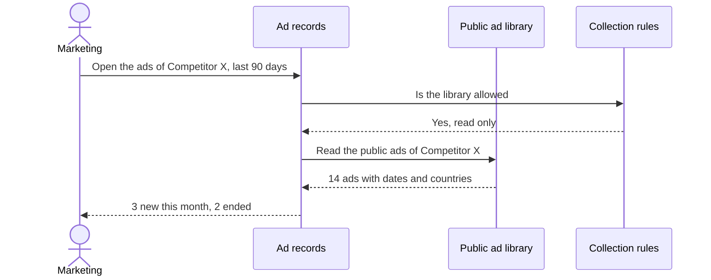

🏠 [Specs](../../../../README.md) › 🧩 [Functional capabilities](../../../README.md) ›
🔭 [F17 Competitive analysis](../../README.md) › 📝 [Use cases](../README.md) ›
📝 [Use cases: FL-F17-08 Ads, pages, search and technologies](README.md) › 📝 UC-F17-26 Follow competitors' ads

# 📝 UC-F17-26 Follow competitors' ads

**Status:** ✅ specified

## Summary

The marketing person follows the ads a competitor runs, read only from the public ad libraries that advertising
platforms publish: the text, the format, the channel, the countries, the dates and the address the ad leads to. Each ad
becomes an ad record under the competitor, so that campaigns, themes and offers can be compared over time.

## Personas

- [U12 Marketing and communication](../../../../01-users/personas/u12-marketing.md)

## Goal

The company sees what its competitors advertise, where and for how long, without any account, trick or profile of the
people who see the ads.

## Trigger

A competitor is added to the follow list ([UC-F17-01](../01-set-up-and-profiles/uc-f17-01-list-competitors.md)), or the
weekly collection of the ad libraries runs.

## Frequency

A weekly collection per competitor; a look at the screen a few times a month.

## Preconditions

- The competitor is followed ([E-F17-01 Competitor](../../data/e-f17-01-competitor.md)) and the collection rules allow
  the ad libraries ([UC-F17-18](../01-set-up-and-profiles/uc-f17-18-set-lawful-collection-rules.md)).
- At least one public ad library is listed in the competitor's sources, with its address.

## Postconditions

- **Succeeded:** each new or changed ad is saved as an ad record
  ([E-F17-21 Ad record](../../data/e-f17-21-ad-record.md)) with its library, its address and the date it was read; ads
  gone from the library are marked Ended.
- **Failed:** nothing is saved for the library that failed; the competitor keeps its earlier records and the failure is
  listed with the library's name.

## Main flow

1. The marketing person opens the competitor ads screen
   ([S-F17-25 Competitor ads](../../screens/08-ads-pages-search-and-tech/s-f17-25-competitor-ads.md)) and picks a
   competitor and a period.
2. simple-ERP lists the ad records read from the public ad libraries, newest first, with the channel, the format, the
   countries and the first and last dates seen.
3. The marketing person opens an ad to read its text and see the address it leads to; the library's own page is one
   click away as the source ([BR-F17-02](../../business-rules/br-f17-02-every-fact-keeps-its-source.md)).
4. The marketing person filters by channel, country or theme, and groups the ads by campaign (same text, same landing
   address).
5. simple-ERP shows the number of ads running, how many started in the last 30 days and the most repeated words, as a
   short sourced summary ([BR-F17-07](../../business-rules/br-f17-07-ai-summaries-cite-facts.md)).
6. The marketing person pins an ad to the competitor's profile or sends it to a battle card
   ([UC-F17-13](../03-analyse-and-arm-sales/uc-f17-13-prepare-battle-cards-for-sales.md)).

## Alternative flows

- 2a. The library gives only ranges of reach: the range is kept as read and never turned into a single number.
- 4a. Two libraries show the same ad: the records are merged and keep both sources.
- 5a. A competitor runs no ad in the period: the screen says so and shows the last ad seen.

## Error flows

- 2e. A library is down or changes its format: the read is retried, then the library is listed as failed and the other
  libraries are still read.
- 2e. A library asks to sign in or to accept terms the company has not accepted: it is skipped and the reason is shown
  ([BR-F17-17](../../business-rules/br-f17-17-ads-come-only-from-public-ad-libraries.md)).
- 3e. The address of an ad no longer answers: the record keeps the address and shows it as unreachable.
- Any step: a service does not answer; the call is retried first
  ([BR-F3-32](../../../f03-assistant/business-rules/br-f03-32-retry-before-an-error.md)), then the message follows the
  error pattern ([D122](../../../../06-decisions/ux/d122-error-message-standard.md)) and what the user typed stays on
  the screen.

## Business rules

- [BR-F17-17](../../business-rules/br-f17-17-ads-come-only-from-public-ad-libraries.md)
- [BR-F17-02](../../business-rules/br-f17-02-every-fact-keeps-its-source.md)
- [BR-F17-03](../../business-rules/br-f17-03-terms-and-robots-respected.md)
- [BR-F17-04](../../business-rules/br-f17-04-no-profiling-of-people.md)

## Entities

- [E-F17-21 Ad record](../../data/e-f17-21-ad-record.md): created, changed, ended
- [E-F17-01 Competitor](../../data/e-f17-01-competitor.md): read, the competitor the ads belong to
- [E-F17-15 Collection rule](../../data/e-f17-15-collection-rule.md): read, the ad libraries allowed
- [E-F17-08 Mention](../../data/e-f17-08-mention.md): read, the mentions an ad may be linked to

## Permissions

Marketing reads and filters every ad record. Sales reads them; the owner reads them and sets the libraries;
analyses stay confidential by default ([BR-F17-09](../../business-rules/br-f17-09-analyses-are-confidential.md)).

## Notifications

The marketing person, in the app and in the digest
([UC-F17-16](../04-alerts-and-sharing/uc-f17-16-receive-a-periodic-digest.md)): a competitor starts a new campaign (a
text or a landing address not seen before).

## Audit events

Each collection of an ad library (which, when, how many records); each ad created, changed or ended; each library
skipped with the reason.

## AI involvement

No AI step of its own. The AI assistant may open the screen and prefill it from the user's words; the user checks and
confirms ([BR-F3-07](../../../f03-assistant/business-rules/br-f03-07-no-deletes-no-irreversible-acts.md)).

## API, MCP and A2A exposure

T5 operations of the capability for the personas above: create, read, update and list. The MCP tool of the
capability may read and propose, never confirm alone. No A2A skill.

## Screens

- [S-F17-25 Competitor ads](../../screens/08-ads-pages-search-and-tech/s-f17-25-competitor-ads.md)

## Flowchart

See [FL-F17-08 Ads, pages, search and technologies](../../flows/fl-f17-08-ads-pages-search-and-tech.md#flowchart).

## Sequence diagram

## Acceptance criteria

1. **Given** a competitor with an ad in a public ad library **when** the collection runs **then** an ad record is saved
   with the library's name, its address and the date read.
2. **Given** an ad that the library no longer lists **when** the next collection runs **then** the record becomes Ended
   with the last date seen.
3. **Given** a source that is a signed-in feed of a social account **when** someone tries to add it **then** it is
   refused as not a public ad library.
4. **Given** a library that gives a range of reach **when** the record is saved **then** the range is shown as given,
   never a single figure.

## Non-functional notes

The screen answers within 2 seconds for 10,000 records; every change is audited.

## Regulatory references

Large online platforms must publish a searchable library of the ads they show; simple-ERP reads only those
public libraries and the competitor's own public pages, never a private feed or a profile of the people the ad was shown
to. Collection follows [CR-FR-198](../../../../10-country-packs/france/consumer/cr-fr-198-comparative-advertising.md)
for comparative advertising and the company's lawful collection rules
([BR-F17-01](../../business-rules/br-f17-01-analysis-follows-the-country-pack.md)).

## Related use cases

- [UC-F17-27 Watch competitors' web pages](uc-f17-27-watch-competitors-web-pages.md)
- [UC-F17-08](../02-collect-signals/uc-f17-08-follow-news-press-and-social-media.md)
- [UC-F17-13](../03-analyse-and-arm-sales/uc-f17-13-prepare-battle-cards-for-sales.md)
- [UC-F17-27 Watch competitors' web pages](uc-f17-27-watch-competitors-web-pages.md)
- [UC-F5-27](../../../f05-social-media/use-cases/10-referrals-push-and-listening/uc-f05-27-listen-to-brand-mentions.md)

## Open questions

None.

---

⬅️ [UC-F17-25](../06-price-intelligence/uc-f17-25-report-share-of-voice-and-the-price-index-trend.md) ·
⬆️ [Up](README.md) · ➡️ [UC-F17-27 Watch competitors' web pages](uc-f17-27-watch-competitors-web-pages.md)
