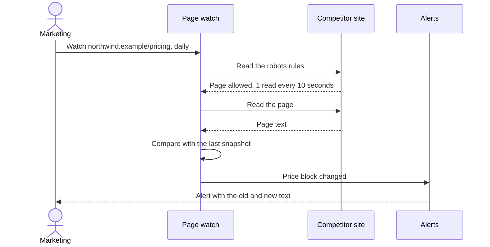

🏠 [Specs](../../../../README.md) › 🧩 [Functional capabilities](../../../README.md) ›
🔭 [F17 Competitive analysis](../../README.md) › 📝 [Use cases](../README.md) ›
📝 [Use cases: FL-F17-08 Ads, pages, search and technologies](README.md) › 📝 UC-F17-27 Watch competitors' web pages

# 📝 UC-F17-27 Watch competitors' web pages

**Status:** ✅ specified

## Summary

The marketing person watches chosen public web pages of a competitor (pricing, offers, product, careers, legal terms)
and is told when the text or the structure changes. Each watched page keeps its snapshots and the differences between
them, and the watching obeys the site's robots rules and a rate limit.

## Personas

- [U12 Marketing and communication](../../../../01-users/personas/u12-marketing.md)
- [U13 Owner](../../../../01-users/personas/u13-owner.md)

## Goal

The company notices a competitor's change of price, offer or message soon after it appears, without overloading or
tricking the site.

## Trigger

The marketing person adds a page to watch, or the scheduled check of a watched page comes due.

## Frequency

A check per page every day or week as set; a change a few times a month across a dozen pages.

## Preconditions

- The competitor is followed ([E-F17-01 Competitor](../../data/e-f17-01-competitor.md)) and its pages may be read under
  the collection rules ([UC-F17-18](../01-set-up-and-profiles/uc-f17-18-set-lawful-collection-rules.md)).
- The page is public: it needs no sign-in and its robots rules do not forbid reading it.

## Postconditions

- **Succeeded:** the page is saved as a watched page ([E-F17-22 Watched page](../../data/e-f17-22-watched-page.md)) with
  its address, its rhythm and its first snapshot; each change is stored with the old and the new text and an alert is
  sent ([UC-F17-15](../04-alerts-and-sharing/uc-f17-15-get-alerts-on-changes.md)).
- **Failed:** the page is not watched: the screen says whether the robots rules, the sign-in or the address stopped it.

## Main flow

1. The marketing person opens the page watch screen
   ([S-F17-26 Watched pages](../../screens/08-ads-pages-search-and-tech/s-f17-26-page-watch.md)) and adds a page
   address, with the competitor and the rhythm (daily, weekly).
2. simple-ERP reads the site's robots rules and terms notice, shows what they allow, and refuses a page they forbid
   ([BR-F17-18](../../business-rules/br-f17-18-page-watching-respects-robots-rules-and-rate-limits.md)).
3. simple-ERP takes the first snapshot of the page's text and keeps it with the date.
4. At each check simple-ERP reads the page at the allowed rate, compares it with the last snapshot and ignores what is
   not content (dates, counters, advertising slots).
5. When the content changed, simple-ERP stores the new snapshot, highlights the added and removed words and sends an
   alert to the marketing person and, on a phone, to the owner.
6. The marketing person marks the change as important, adds a note, or sends it to a battle card.

## Alternative flows

- 2a. The robots rules allow only part of the site: the page is accepted only if its own address is allowed.
- 4a. The page changes too often: simple-ERP groups the changes of a day into one alert.
- 6a. A change is a price: it is also offered to the price points of the competitor
  ([UC-F17-03](../02-collect-signals/uc-f17-03-track-products-and-prices.md)).

## Error flows

- 2e. The page needs a sign-in or hides behind a bot check: the watch is refused and nothing is bypassed.
- 4e. The site answers with an error or blocks the reads: the check waits longer each time and the page is marked
  Blocked after three failed checks.
- 5e. The page no longer exists: the page becomes Removed and an alert says so.
- Any step: a service does not answer; the call is retried first
  ([BR-F3-32](../../../f03-assistant/business-rules/br-f03-32-retry-before-an-error.md)), then the message follows the
  error pattern ([D122](../../../../06-decisions/ux/d122-error-message-standard.md)) and what the user typed stays on
  the screen.

## Business rules

- [BR-F17-18](../../business-rules/br-f17-18-page-watching-respects-robots-rules-and-rate-limits.md)
- [BR-F17-03](../../business-rules/br-f17-03-terms-and-robots-respected.md)
- [BR-F17-02](../../business-rules/br-f17-02-every-fact-keeps-its-source.md)

## Entities

- [E-F17-22 Watched page](../../data/e-f17-22-watched-page.md): created, changed
- [E-F17-01 Competitor](../../data/e-f17-01-competitor.md): read, the competitor
- [E-F17-15 Collection rule](../../data/e-f17-15-collection-rule.md): read, the rate and the allowed pages
- [E-F17-03 Price point](../../data/e-f17-03-price-point.md): created, a price found on a watched page
- [E-F17-13 Alert](../../data/e-f17-13-alert.md): created, an alert on a change

## Permissions

Marketing adds, changes and removes watched pages. Sales reads the changes; the owner reads them and sets the
highest rate allowed.

## Notifications

The marketing person, in the app: a watched page changed, or is blocked or removed. The owner, on a phone: a change
marked important.

## Audit events

Each page added or removed, each check (when, result), each change detected with its two snapshots, each refusal because
of the robots rules.

## AI involvement

No AI step of its own. The AI assistant may open the screen and prefill it from the user's words; the user checks and
confirms ([BR-F3-07](../../../f03-assistant/business-rules/br-f03-07-no-deletes-no-irreversible-acts.md)).

## API, MCP and A2A exposure

T5 operations of the capability for the personas above: create, read, update and list. The MCP tool of the
capability may read and propose, never confirm alone. No A2A skill.

## Screens

- [S-F17-26 Watched pages](../../screens/08-ads-pages-search-and-tech/s-f17-26-page-watch.md)

## Flowchart

See [FL-F17-08 Ads, pages, search and technologies](../../flows/fl-f17-08-ads-pages-search-and-tech.md#flowchart).

## Sequence diagram

## Acceptance criteria

1. **Given** a page that the site's robots rules forbid **when** the marketing person adds it **then** it is refused
   with the rule that forbids it.
2. **Given** a watched page whose price text changes **when** the next check runs **then** a snapshot, the highlighted
   difference and an alert are produced.
3. **Given** a page that changes only in a date or a counter **when** the check runs **then** no change is recorded.
4. **Given** a site that blocks three checks in a row **when** the third check fails **then** the page becomes Blocked
   and the rhythm is not retried until a person acts.

## Non-functional notes

The screen answers within 2 seconds for 10,000 records; every change is audited.

## Regulatory references

Reading a public page is lawful only within the site's robots rules and terms, at a reasonable rate, without
bypassing a sign-in or a bot check, and keeping the database producer's right in mind
([CR-FR-193](../../../../10-country-packs/france/trade/cr-fr-193-database-producer-right.md)): simple-ERP keeps short
extracts and the differences, not copies of whole sites. Trade secrets are never sought
([CR-FR-192 Trade secrets](../../../../10-country-packs/france/trade/cr-fr-192-trade-secrets.md)).

## Related use cases

- [UC-F17-26 Follow competitors' ads](uc-f17-26-follow-competitors-ads.md)
- [UC-F17-28 Compare search positions](uc-f17-28-compare-search-positions.md)
- [UC-F17-26 Follow competitors' ads](uc-f17-26-follow-competitors-ads.md)
- [UC-F17-28 Compare search positions](uc-f17-28-compare-search-positions.md)
- [UC-F17-03](../02-collect-signals/uc-f17-03-track-products-and-prices.md)
- [UC-F17-15 Get alerts on changes](../04-alerts-and-sharing/uc-f17-15-get-alerts-on-changes.md)
- [UC-F17-18](../01-set-up-and-profiles/uc-f17-18-set-lawful-collection-rules.md)

## Open questions

None.

---

⬅️ [UC-F17-26 Follow competitors' ads](uc-f17-26-follow-competitors-ads.md) · ⬆️ [Up](README.md) ·
➡️ [UC-F17-28 Compare search positions](uc-f17-28-compare-search-positions.md)
