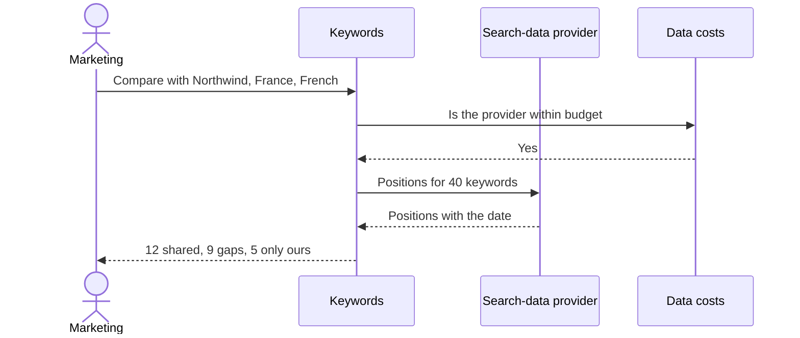

🏠 [Specs](../../../../README.md) › 🧩 [Functional capabilities](../../../README.md) ›
🔭 [F17 Competitive analysis](../../README.md) › 📝 [Use cases](../README.md) ›
📝 [Use cases: FL-F17-08 Ads, pages, search and technologies](README.md) › 📝 UC-F17-28 Compare search positions

# 📝 UC-F17-28 Compare search positions

**Status:** ✅ specified

## Summary

The marketing person compares the company's search positions with its competitors' on a list of keywords: who ranks
where for each keyword, which keywords only the competitor ranks for, and how the gap moves over months. The figures
come from a search-data provider chosen in the data providers screen and always carry the provider and the date.

## Personas

- [U12 Marketing and communication](../../../../01-users/personas/u12-marketing.md)

## Goal

The company knows which search terms its competitors win, which ones it could win, and whether the gap narrows.

## Trigger

The marketing person adds keywords to follow, or the monthly refresh from the search-data provider runs.

## Frequency

A monthly refresh; a look at the overlap a few times a quarter.

## Preconditions

- A search-data provider is connected and within its budget
  ([UC-F17-10](../01-set-up-and-profiles/uc-f17-10-connect-paid-data-providers.md),
  [UC-F17-22](../01-set-up-and-profiles/uc-f17-22-follow-data-provider-costs-against-the-budget.md)).
- The company's own site and at least one followed competitor have a web address
  ([E-F17-01 Competitor](../../data/e-f17-01-competitor.md)).

## Postconditions

- **Succeeded:** each keyword is saved ([E-F17-23 Keyword](../../data/e-f17-23-keyword.md)) with the position of each
  followed site, the provider and the date; the overlap and the gaps are computed.
- **Failed:** no keyword is changed; the screen shows the provider's error and the date of the last good figures.

## Main flow

1. The marketing person opens the search overlap screen
   ([S-F17-27 Search overlap](../../screens/08-ads-pages-search-and-tech/s-f17-27-search-overlap.md)) and chooses the
   competitors and the country and language to compare.
2. The marketing person adds keywords by hand, or asks SimpleERP to propose them from the company's pages and the
   competitors' titles.
3. SimpleERP asks the provider for the positions of the company and of each competitor on each keyword and records the
   answer with the provider's name and the date
   ([BR-F17-19](../../business-rules/br-f17-19-search-data-carries-its-provider-and-date.md)).
4. SimpleERP shows three groups: shared keywords, keywords only a competitor ranks for (gaps) and keywords only the
   company ranks for.
5. The marketing person sorts the gaps by search volume and by distance, and marks keywords to pursue.
6. At the next refresh SimpleERP adds the new positions and draws the trend of each keyword.

## Alternative flows

- 2a. A keyword has no volume in the provider's data: it is kept with the volume shown as unknown.
- 4a. Two providers disagree on a position: both figures are shown with their dates and none is averaged.
- 6a. A keyword is dropped: it leaves the monthly refresh and keeps its past figures.

## Error flows

- 3e. The provider's budget is reached: the refresh waits for the next period or a raised budget
  ([BR-F17-14](../../business-rules/br-f17-14-data-costs-within-their-budget.md)).
- 3e. The provider returns no data for a competitor's address: the competitor is listed as not covered.
- 4e. A position is older than the refresh rhythm: it is shown in grey with its age.
- Any step: a service does not answer; the call is retried first
  ([BR-F3-32](../../../f03-assistant/business-rules/br-f03-32-retry-before-an-error.md)), then the message follows the
  error pattern ([D122](../../../../06-decisions/ux/d122-error-message-standard.md)) and what the user typed stays on
  the screen.

## Business rules

- [BR-F17-19](../../business-rules/br-f17-19-search-data-carries-its-provider-and-date.md)
- [BR-F17-06](../../business-rules/br-f17-06-paid-sources-under-their-licence.md)
- [BR-F17-14](../../business-rules/br-f17-14-data-costs-within-their-budget.md)

## Entities

- [E-F17-23 Keyword](../../data/e-f17-23-keyword.md): created, changed
- [E-F17-09 Data provider](../../data/e-f17-09-data-provider.md): read, the provider and its licence
- [E-F17-19 Data cost line](../../data/e-f17-19-data-cost-line.md): created, the cost of the call
- [E-F17-01 Competitor](../../data/e-f17-01-competitor.md): read, the competitors compared
- [E-F18-18](../../../f18-hosted-websites-and-domains/data/e-f18-18-search-settings.md): read, the company's own search
  basics

## Permissions

Marketing reads and manages the keywords. The owner reads the overlap and the data cost; sales reads the
gaps.

## Notifications

The marketing person, in the digest ([UC-F17-16](../04-alerts-and-sharing/uc-f17-16-receive-a-periodic-digest.md)): a
competitor took a keyword the company held, or a gap closed.

## Audit events

Each keyword added or dropped; each refresh with the provider, the date and the number of calls; each figure replaced
with its old value.

## AI involvement

No AI step of its own. The AI assistant may open the screen and prefill it from the user's words; the user checks and
confirms ([BR-F3-07](../../../f03-assistant/business-rules/br-f03-07-no-deletes-no-irreversible-acts.md)).

## API, MCP and A2A exposure

T5 operations of the capability for the personas above: create, read, update and list. The MCP tool of the
capability may read and propose, never confirm alone. No A2A skill.

## Screens

- [S-F17-27 Search overlap](../../screens/08-ads-pages-search-and-tech/s-f17-27-search-overlap.md)

## Flowchart

See [FL-F17-08 Ads, pages, search and technologies](../../flows/fl-f17-08-ads-pages-search-and-tech.md#flowchart).

## Sequence diagram

## Acceptance criteria

1. **Given** a followed competitor and 40 keywords **when** the refresh runs **then** each keyword shows the position of
   each site with the provider's name and the date.
2. **Given** a keyword only a competitor ranks for **when** the groups are computed **then** it appears in the gaps with
   its search volume.
3. **Given** a provider whose budget is reached **when** the refresh is due **then** it waits and says so, with the date
   of the last figures.
4. **Given** two providers that give different positions **when** the screen is opened **then** both are shown with
   their dates and none is averaged.

## Non-functional notes

The screen answers within 2 seconds for 10,000 records; every change is audited.

## Regulatory references

Search data is bought under the provider's licence and shown with its name
([BR-F17-06](../../business-rules/br-f17-06-paid-sources-under-their-licence.md)); SimpleERP does not read the search
engines' result pages itself. Competitors' keywords are about companies, not about individual people
([BR-F17-04](../../business-rules/br-f17-04-no-profiling-of-people.md)).

## Related use cases

- [UC-F17-27 Watch competitors' web pages](uc-f17-27-watch-competitors-web-pages.md)
- [UC-F17-29 Detect a site's technologies](uc-f17-29-detect-a-sites-technologies.md)
- [UC-F17-27 Watch competitors' web pages](uc-f17-27-watch-competitors-web-pages.md)
- [UC-F17-29 Detect a site's technologies](uc-f17-29-detect-a-sites-technologies.md)
- [UC-F17-10](../01-set-up-and-profiles/uc-f17-10-connect-paid-data-providers.md)
- [UC-F17-22](../01-set-up-and-profiles/uc-f17-22-follow-data-provider-costs-against-the-budget.md)
- [UC-F18-18](../../../f18-hosted-websites-and-domains/use-cases/05-run-the-site/uc-f18-18-measure-audience-and-search-ranking.md)
- [UC-F18-26](../../../f18-hosted-websites-and-domains/use-cases/06-content-and-search/uc-f18-26-set-the-search-engine-basics.md)

## Open questions

None.

---

⬅️ [UC-F17-27 Watch competitors' web pages](uc-f17-27-watch-competitors-web-pages.md) · ⬆️ [Up](README.md) ·
➡️ [UC-F17-29 Detect a site's technologies](uc-f17-29-detect-a-sites-technologies.md)
