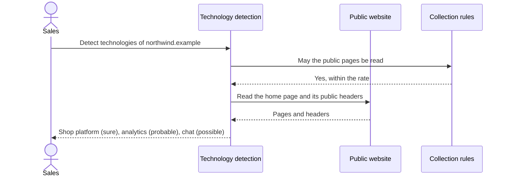

🏠 [Specs](../../../../README.md) › 🧩 [Functional capabilities](../../../README.md) ›
🔭 [F17 Competitive analysis](../../README.md) › 📝 [Use cases](../README.md) ›
📝 [Use cases: FL-F17-08 Ads, pages, search and technologies](README.md) › 📝 UC-F17-29 Detect a site's technologies

# 📝 UC-F17-29 Detect a site's technologies

**Status:** ✅ specified

## Summary

The sales person looks at which technologies a competitor's or a prospect's public website runs (shop platform,
analytics, payment, chat, hosting) and keeps them as technology records. The detection reads only what the public pages
and their public headers show, and tells how sure it is of each finding.

## Personas

- [U03 Sales](../../../../01-users/personas/u03-sales.md)

## Goal

Sales knows what a competitor or a prospect uses, to adapt the offer and the battle card, without probing the site.

## Trigger

The sales person opens a competitor or a prospect and asks for its technologies, or the quarterly re-detection runs.

## Frequency

A detection per site when it is added, then each quarter; a look before a sales call.

## Preconditions

- The competitor or prospect has a public web address ([E-F17-01 Competitor](../../data/e-f17-01-competitor.md),
  [E-F6-01 Customer record](../../../f06-customers-and-sales/data/e-f06-01-customer-record.md)).
- The collection rules allow reading the site's public pages
  ([UC-F17-18](../01-set-up-and-profiles/uc-f17-18-set-lawful-collection-rules.md)).

## Postconditions

- **Succeeded:** each technology found is saved ([E-F17-24 Technology record](../../data/e-f17-24-technology-record.md))
  with its category, how sure the detection is, the page and the date it was seen; technologies no longer seen are
  marked Gone.
- **Failed:** nothing is saved; the screen says whether the site blocked the read or showed nothing recognisable.

## Main flow

1. The sales person opens the technology detection screen
   ([S-F17-28](../../screens/08-ads-pages-search-and-tech/s-f17-28-tech-detection.md)) and enters or picks a site.
2. SimpleERP reads the public home page and a few public pages, within the robots rules and the read rate
   ([BR-F17-03](../../business-rules/br-f17-03-terms-and-robots-respected.md)).
3. SimpleERP matches what the pages and their public headers show against its list of known technologies and gives each
   finding a confidence: sure, probable or possible.
4. The sales person reads the technologies grouped by category, each with the evidence (the page and the mark that was
   found).
5. The sales person confirms, rejects or corrects a finding, and adds a technology the detection missed from what the
   customer said.
6. SimpleERP compares the site's technologies with the company's own offer and lists where a competitor uses what the
   company replaces, as a hint for the battle card
   ([UC-F17-13](../03-analyse-and-arm-sales/uc-f17-13-prepare-battle-cards-for-sales.md)).

## Alternative flows

- 2a. The site is built so that nothing can be read without a script: only the public headers are used and the
  confidence is lower.
- 4a. A technology is found on a prospect: the finding is also added to the prospect's record
  [UC-F6-17](../../../f06-customers-and-sales/use-cases/06-accounts-and-credit/uc-f06-17-organise-accounts-with-their-timeline-and-emails.md).
- 6a. Several sites are compared: the technologies are shown in a grid by competitor.

## Error flows

- 2e. The site blocks the read or its robots rules forbid it: the detection stops and says so.
- 3e. A mark matches two technologies: both are listed as possible and none as sure.
- 5e. A rejected finding returns at the next detection: it stays rejected until the site shows new evidence.
- Any step: a service does not answer; the call is retried first
  ([BR-F3-32](../../../f03-assistant/business-rules/br-f03-32-retry-before-an-error.md)), then the message follows the
  error pattern ([D122](../../../../06-decisions/ux/d122-error-message-standard.md)) and what the user typed stays on
  the screen.

## Business rules

- [BR-F17-20](../../business-rules/br-f17-20-detection-reads-public-pages-only.md)
- [BR-F17-03](../../business-rules/br-f17-03-terms-and-robots-respected.md)
- [BR-F17-04](../../business-rules/br-f17-04-no-profiling-of-people.md)

## Entities

- [E-F17-24 Technology record](../../data/e-f17-24-technology-record.md): created, changed
- [E-F17-01 Competitor](../../data/e-f17-01-competitor.md): read, the competitor
- [E-F6-01 Customer record](../../../f06-customers-and-sales/data/e-f06-01-customer-record.md): read, the prospect or
  customer
- [E-F17-15 Collection rule](../../data/e-f17-15-collection-rule.md): read, the pages and rate allowed

## Permissions

Sales reads, confirms and corrects the technologies. Marketing reads them; the owner reads them and sets the
rate.

## Notifications

The sales person, in the app: a followed competitor changed a main technology (a new shop platform, a new payment tool).

## Audit events

Each detection (site, time, pages read, number found); each finding confirmed, rejected or added by hand, with who.

## AI involvement

No AI step of its own. The AI assistant may open the screen and prefill it from the user's words; the user checks and
confirms ([BR-F3-07](../../../f03-assistant/business-rules/br-f03-07-no-deletes-no-irreversible-acts.md)).

## API, MCP and A2A exposure

T5 operations of the capability for the personas above: create, read, update and list. The MCP tool of the
capability may read and propose, never confirm alone. No A2A skill.

## Screens

- [S-F17-28](../../screens/08-ads-pages-search-and-tech/s-f17-28-tech-detection.md)

## Flowchart

See [FL-F17-08 Ads, pages, search and technologies](../../flows/fl-f17-08-ads-pages-search-and-tech.md#flowchart).

## Sequence diagram

## Acceptance criteria

1. **Given** a public site showing a known shop platform **when** the detection runs **then** the platform is listed as
   sure with the page and the mark found.
2. **Given** a technology that cannot be told from another **when** the detection runs **then** both are listed as
   possible.
3. **Given** a site whose robots rules forbid the read **when** the detection is asked **then** it stops and says so.
4. **Given** a finding rejected by the sales person **when** the next detection finds the same mark **then** it stays
   rejected.

## Non-functional notes

The screen answers within 2 seconds for 10,000 records; every change is audited.

## Regulatory references

Reading what a public page and its public headers show is lawful within the site's robots rules and without
probing, scanning ports or trying sign-ins; this use case never does more
([BR-F17-20](../../business-rules/br-f17-20-detection-reads-public-pages-only.md)). Findings are about companies, not
about people ([BR-F17-04](../../business-rules/br-f17-04-no-profiling-of-people.md)).

## Related use cases

- [UC-F17-28 Compare search positions](uc-f17-28-compare-search-positions.md)
- [UC-F17-28 Compare search positions](uc-f17-28-compare-search-positions.md)
- [UC-F17-13](../03-analyse-and-arm-sales/uc-f17-13-prepare-battle-cards-for-sales.md)
- [UC-F17-18](../01-set-up-and-profiles/uc-f17-18-set-lawful-collection-rules.md)
- [UC-F6-17](../../../f06-customers-and-sales/use-cases/06-accounts-and-credit/uc-f06-17-organise-accounts-with-their-timeline-and-emails.md)

## Open questions

None.

---

⬅️ [UC-F17-28 Compare search positions](uc-f17-28-compare-search-positions.md) · ⬆️ [Up](README.md)
