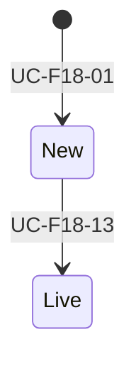

🏠 [Specs](../../../README.md) › 🧩 [Functional capabilities](../../README.md) ›
🌐 [F18 Hosted websites and domains (hosted edition)](../README.md) › 🗃️ [Data](README.md) › 🗃️ E-F18-01 Hosted website

# 🗃️ E-F18-01 Hosted website

**Status:** ✅ specified

## Purpose

A company's website and its versions.

## Fields

| Name | Type | Required | Validation | Default | Example | Personal data | Custom fields |
|---|---|---|---|---|---|---|---|
| company, preview address, live version | records | yes | BR-F18-03 | - | Acme, preview link, v12 | no | no |
| status | enum | yes | BR-F18-05 | draft | draft, live | no | no |

## Relations

As its use cases.

## Lifecycle

## Indexes and search

By number, date, partner.

## Retention

Kept for the period of its kind of record in the country pack (D293), or else its kind's default in the
[retention schedule](../../../05-non-functional/data-retention.md).

## Audit

Every change.

## Import and export

CSV, FEC where relevant.

## Used by

- [UC-F18-01](../use-cases/01-build-the-site/uc-f18-01-build-the-site-with-the-guide.md)
- [UC-F18-13](../use-cases/04-test-and-publish/uc-f18-13-review-the-private-preview.md)
- [UC-F18-15](../use-cases/04-test-and-publish/uc-f18-15-approve-publish-and-roll-back.md)
- [UC-F18-16](../use-cases/04-test-and-publish/uc-f18-16-edit-the-site-after-publication.md)

## Open questions

None.

---

⬆️ [Up](README.md) · ➡️ [E-F18-02 Page](e-f18-02-page.md)
