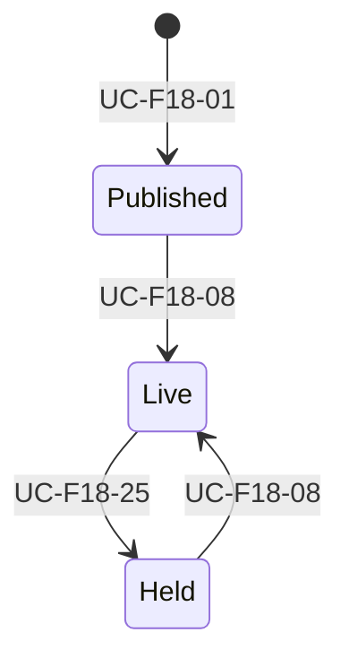

🏠 [Specs](../../../README.md) › 🧩 [Functional capabilities](../../README.md) ›
🌐 [F18 Hosted websites and domains (hosted edition)](../README.md) › 🗃️ [Data](README.md) › 🗃️ E-F18-02 Page

# 🗃️ E-F18-02 Page

**Status:** ✅ specified

## Purpose

A page and its source data.

## Fields

| Name | Type | Required | Validation | Default | Example | Personal data | Custom fields |
|---|---|---|---|---|---|---|---|
| site, kind, language, content | records | yes | BR-F18-02 | - | Acme, services, fr | no | yes |

## Relations

As its use cases.

## Lifecycle

## Indexes and search

By number, date, partner.

## Retention

Kept for the period of its kind of record in the country pack (D293), or else its kind's default in the
[retention schedule](../../../05-non-functional/data-retention.md).

## Audit

Every change.

## Import and export

CSV, FEC where relevant.

## Used by

- [UC-F18-01](../use-cases/01-build-the-site/uc-f18-01-build-the-site-with-the-guide.md)
- [UC-F18-03](../use-cases/01-build-the-site/uc-f18-03-generate-pages-from-the-erp-s-data.md)
- [UC-F18-04](../use-cases/01-build-the-site/uc-f18-04-add-a-contact-page-that-feeds-leads.md)
- [UC-F18-08](../use-cases/01-build-the-site/uc-f18-08-generate-legal-notices-privacy-and-cookies.md)
- [UC-F18-16](../use-cases/04-test-and-publish/uc-f18-16-edit-the-site-after-publication.md)
- [UC-F18-17](../use-cases/01-build-the-site/uc-f18-17-offer-the-site-in-several-languages.md)
- [UC-F18-19](../use-cases/01-build-the-site/uc-f18-19-connect-the-online-shop.md)
- [UC-F18-25 Use a sector page template](../use-cases/06-content-and-search/uc-f18-25-use-a-sector-page-template.md)

## Open questions

None.

---

⬅️ [E-F18-01 Hosted website](e-f18-01-hosted-website.md) · ⬆️ [Up](README.md) ·
➡️ [E-F18-03 Identity](e-f18-03-identity.md)
