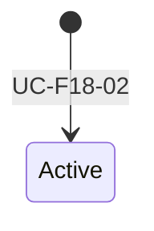

🏠 [Specs](../../../README.md) › 🧩 [Functional capabilities](../../README.md) ›
🌐 [F18 Hosted websites and domains (hosted edition)](../README.md) › 🗃️ [Data](README.md) › 🗃️ E-F18-03 Identity

# 🗃️ E-F18-03 Identity

**Status:** ✅ specified

## Purpose

Logo, colours, fonts, tone.

## Fields

| Name | Type | Required | Validation | Default | Example | Personal data | Custom fields |
|---|---|---|---|---|---|---|---|
| logo, colours, fonts, tone | records | yes | BR-F18-06 | - | logo.svg, #0B5, Inter, friendly | no | no |

## Relations

As its use cases.

## Lifecycle

## Indexes and search

By number, date, partner.

## Retention

Kept for the period of its kind of record in the country pack (D293), or else its kind's default in the
[retention schedule](../../../05-non-functional/data-retention.md).

## Audit

Every change.

## Import and export

CSV, FEC where relevant.

## Used by

- [UC-F18-02](../use-cases/01-build-the-site/uc-f18-02-apply-the-visual-identity.md)

## Open questions

None.

---

⬅️ [E-F18-02 Page](e-f18-02-page.md) · ⬆️ [Up](README.md) · ➡️ [E-F18-04 Contact message](e-f18-04-contact-message.md)
