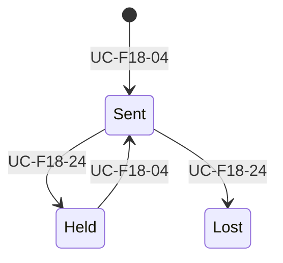

🏠 [Specs](../../../README.md) › 🧩 [Functional capabilities](../../README.md) ›
🌐 [F18 Hosted websites and domains (hosted edition)](../README.md) › 🗃️ [Data](README.md) ›
🗃️ E-F18-04 Contact message

# 🗃️ E-F18-04 Contact message

**Status:** ✅ specified

## Purpose

A message from the contact form.

## Fields

| Name | Type | Required | Validation | Default | Example | Personal data | Custom fields |
|---|---|---|---|---|---|---|---|
| name, email, message, consent | records | yes | - | - | J. Doe, j@example.org, quote please | yes | yes |

## Relations

As its use cases.

## Lifecycle

## Indexes and search

By number, date, partner.

## Retention

[CR-FR-052 Personal data kept no longer than needed](../../../10-country-packs/france/data-protection/cr-fr-052-storage-limitation.md).

## Audit

Every change.

## Import and export

CSV, FEC where relevant.

## Used by

- [UC-F18-04](../use-cases/01-build-the-site/uc-f18-04-add-a-contact-page-that-feeds-leads.md)
- [UC-F18-24 Protect forms against spam](../use-cases/01-build-the-site/uc-f18-24-protect-forms-against-spam.md)

## Open questions

None.

---

⬅️ [E-F18-03 Identity](e-f18-03-identity.md) · ⬆️ [Up](README.md) · ➡️ [E-F18-05 Job posting](e-f18-05-job-posting.md)
