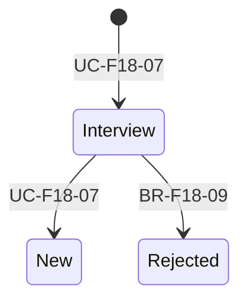

🏠 [Specs](../../../README.md) › 🧩 [Functional capabilities](../../README.md) ›
🌐 [F18 Hosted websites and domains (hosted edition)](../README.md) › 🗃️ [Data](README.md) › 🗃️ E-F18-06 Application

# 🗃️ E-F18-06 Application

**Status:** ✅ specified

## Purpose

An application from any channel.

## Fields

| Name | Type | Required | Validation | Default | Example | Personal data | Custom fields |
|---|---|---|---|---|---|---|---|
| candidate, opening, channels, stage | records | yes | BR-F18-08, BR-F18-09 | - | C-88, Carer, site+Indeed, interview | yes | yes |

## Relations

As its use cases.

## Lifecycle

## Indexes and search

By number, date, partner.

## Retention

Unsuccessful candidates:
[CR-FR-195 Candidates' personal data](../../../10-country-packs/france/data-protection/cr-fr-195-candidate-data.md).

## Audit

Every change.

## Import and export

CSV, FEC where relevant.

## Used by

- [UC-F18-06](../use-cases/02-careers/uc-f18-06-post-openings-to-linkedin-and-indeed.md)
- [UC-F18-07](../use-cases/02-careers/uc-f18-07-handle-one-pipeline-of-applications.md)

## Open questions

None.

---

⬅️ [E-F18-05 Job posting](e-f18-05-job-posting.md) · ⬆️ [Up](README.md) · ➡️ [E-F18-07 Domain](e-f18-07-domain.md)
