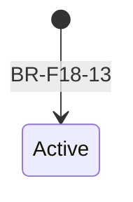

🏠 [Specs](../../../README.md) › 🧩 [Functional capabilities](../../README.md) ›
🌐 [F18 Hosted websites and domains (hosted edition)](../README.md) › 🗃️ [Data](README.md) ›
🗃️ E-F18-09 TLS certificate

# 🗃️ E-F18-09 TLS certificate

**Status:** ✅ specified

## Purpose

A TLS certificate.

## Fields

| Name | Type | Required | Validation | Default | Example | Personal data | Custom fields |
|---|---|---|---|---|---|---|---|
| domain, issuer, expires | records | yes | BR-F18-13 | - | acme.fr, CA, 2027-02-01 | no | no |

## Relations

As its use cases.

## Lifecycle

## Indexes and search

By number, date, partner.

## Retention

Kept for the period of its kind of record in the country pack (D293), or else its kind's default in the
[retention schedule](../../../05-non-functional/data-retention.md).

## Audit

Every change.

## Import and export

CSV, FEC where relevant.

## Used by

- [UC-F18-11](../use-cases/03-domain-and-dns/uc-f18-11-manage-the-dns-zone-and-certificates.md)
- [UC-F18-20](../use-cases/05-run-the-site/uc-f18-20-watch-uptime-renewals-and-expiry.md)

## Open questions

None.

---

⬅️ [E-F18-08 DNS record](e-f18-08-dns-record.md) · ⬆️ [Up](README.md) ·
➡️ [E-F18-10 Publication check report](e-f18-10-publication-check-report.md)
