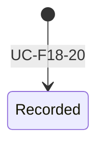

🏠 [Specs](../../../README.md) › 🧩 [Functional capabilities](../../README.md) ›
🌐 [F18 Hosted websites and domains (hosted edition)](../README.md) › 🗃️ [Data](README.md) › 🗃️ E-F18-12 Uptime event

# 🗃️ E-F18-12 Uptime event

**Status:** ✅ specified

## Purpose

Downtime and renewal events.

## Fields

| Name | Type | Required | Validation | Default | Example | Personal data | Custom fields |
|---|---|---|---|---|---|---|---|
| site, event, started, ended | records | yes | - | - | Acme, down, 03:10, 03:14 | no | no |

## Relations

As its use cases.

## Lifecycle

## Indexes and search

By number, date, partner.

## Retention

Kept for the period of its kind of record in the country pack (D293), or else its kind's default in the
[retention schedule](../../../05-non-functional/data-retention.md).

## Audit

Every change.

## Import and export

CSV, FEC where relevant.

## Used by

- [UC-F18-20](../use-cases/05-run-the-site/uc-f18-20-watch-uptime-renewals-and-expiry.md)

## Open questions

None.

---

⬅️ [E-F18-11 Audience figure](e-f18-11-audience-figure.md) · ⬆️ [Up](README.md) ·
➡️ [E-F18-13 Blog article](e-f18-13-blog-article.md)
