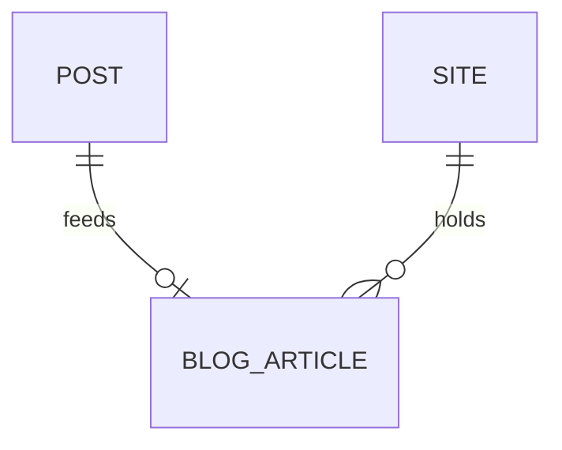
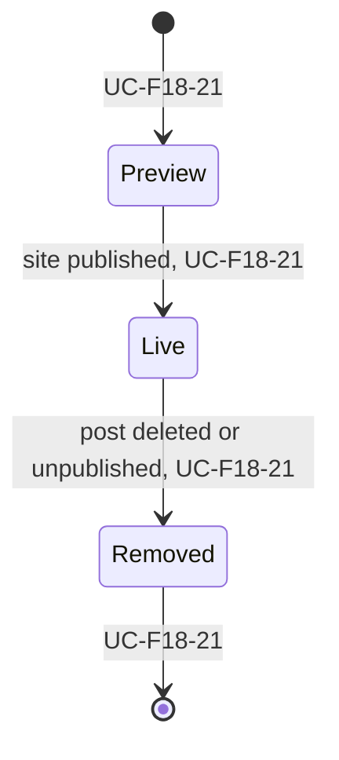

🏠 [Specs](../../../README.md) › 🧩 [Functional capabilities](../../README.md) ›
🌐 [F18 Hosted websites and domains (hosted edition)](../README.md) › 🗃️ [Data](README.md) › 🗃️ E-F18-13 Blog article

# 🗃️ E-F18-13 Blog article

**Status:** 🔄 waiting for the owner

## Purpose

An article of the site's blog, created from an F5 post or written in the builder.

## Fields

| Name | Type | Required | Validation | Default | Example | Personal data | Custom fields |
|---|---|---|---|---|---|---|---|
| title | text | yes | - | from the post | Winter menu | no | no |
| body, images | text, files | yes | - | from the post | text and 2 photos | no | yes |
| post | link | no | an F5 post | - | post 418 | no | no |
| AI label | yes or no | yes | from the post | from the post | yes | no | no |
| published | date | when published | - | - | 2026-11-12 | no | no |

## Relations

## Lifecycle

## Indexes and search

By title, date and tag.

## Retention

As long as the site; removed articles kept (Proposed) 1 year.

## Audit

Every creation and change, with who, when, the old and the new value.

## Import and export

CSV and JSON export through the API (T5); no bulk import.

## Used by

- [UC-F18-21 Publish a blog fed by F5 posts](../use-cases/06-content-and-search/uc-f18-21-publish-a-blog-fed-by-f5-posts.md)

## Open questions

None.

---

⬅️ [E-F18-12 Uptime event](e-f18-12-uptime-event.md) · ⬆️ [Up](README.md) ·
➡️ [E-F18-14 Redirect](e-f18-14-redirect.md)
