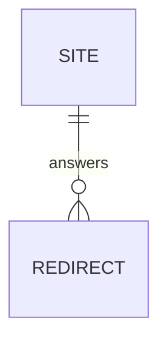
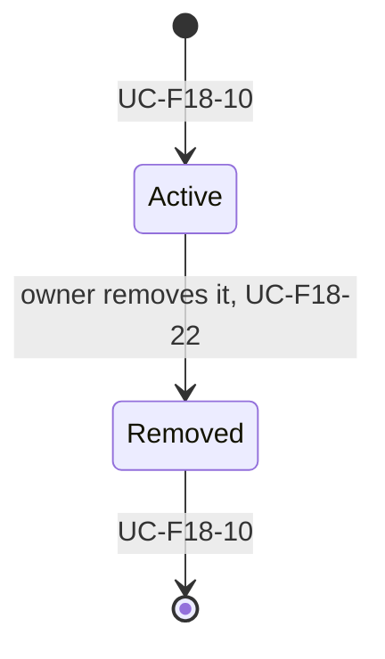

🏠 [Specs](../../../README.md) › 🧩 [Functional capabilities](../../README.md) ›
🌐 [F18 Hosted websites and domains (hosted edition)](../README.md) › 🗃️ [Data](README.md) › 🗃️ E-F18-14 Redirect

# 🗃️ E-F18-14 Redirect

**Status:** ✅ specified

## Purpose

A permanent redirect from an address that existed to the page that replaces it.

## Fields

| Name | Type | Required | Validation | Default | Example | Personal data | Custom fields |
|---|---|---|---|---|---|---|---|
| from | path | yes | unique per site | - | /nos-services | no | no |
| to | path or page | yes | not itself, no loop | home page | /services | no | no |
| kind | choice | yes | moved, gone | moved | moved | no | no |
| hits | number | no | counted | 0 | 112 | no | no |

## Relations

## Lifecycle

## Indexes and search

By from and to.

## Retention

As long as the site.

## Audit

Every creation and change, with who, when, the old and the new value.

## Import and export

CSV import of an old site's addresses.

## Used by

- [UC-F18-22 Redirect the old site's addresses](../use-cases/03-domain-and-dns/uc-f18-22-redirect-the-old-sites-addresses.md)
- [UC-F18-10 Connect an existing domain](../use-cases/03-domain-and-dns/uc-f18-10-connect-an-existing-domain.md)

## Open questions

None.

---

⬅️ [E-F18-13 Blog article](e-f18-13-blog-article.md) · ⬆️ [Up](README.md) · ➡️ [E-F18-15 Mailbox](e-f18-15-mailbox.md)
