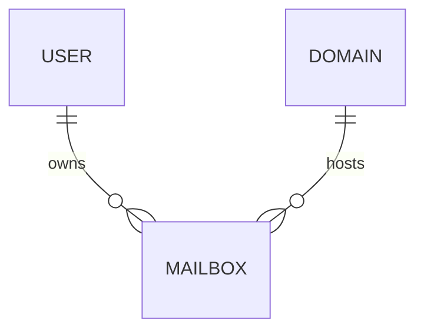
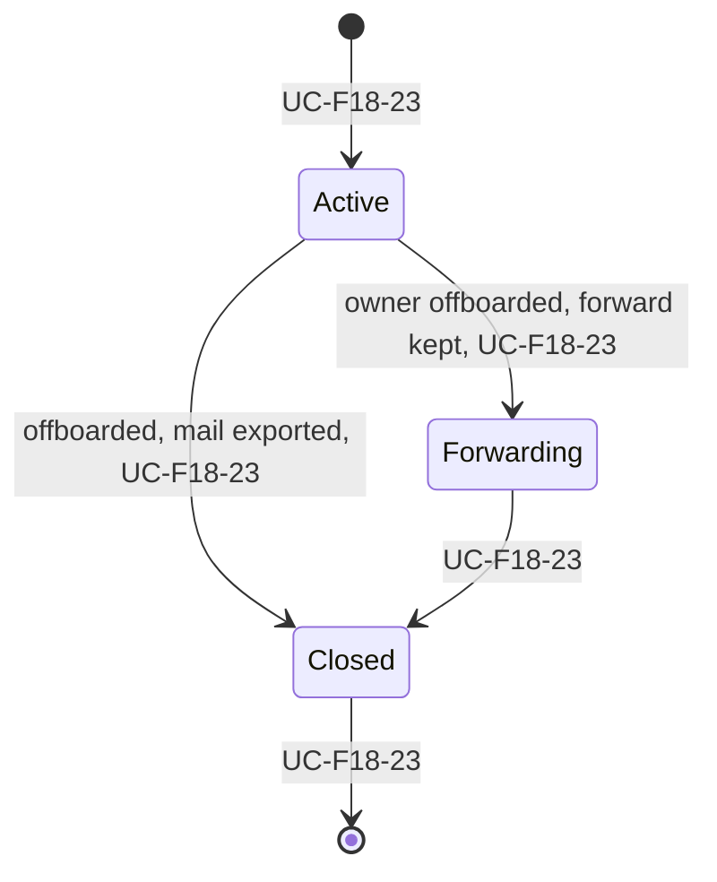

🏠 [Specs](../../../README.md) › 🧩 [Functional capabilities](../../README.md) ›
🌐 [F18 Hosted websites and domains (hosted edition)](../README.md) › 🗃️ [Data](README.md) › 🗃️ E-F18-15 Mailbox

# 🗃️ E-F18-15 Mailbox

**Status:** 🔄 waiting for the owner

## Purpose

A mailbox or a shared address on the company's domain.

## Fields

| Name | Type | Required | Validation | Default | Example | Personal data | Custom fields |
|---|---|---|---|---|---|---|---|
| address | email | yes | on the domain, unique | - | marie@restaurant.example | yes | no |
| owner | link | yes | a user or role members | - | Marie | yes | no |
| kind | choice | yes | personal, shared, forward | personal | shared | no | no |
| size | number | yes | per plan | (Proposed) 10 GB | 10 GB | no | no |
| status | choice | yes | active, closed | active | active | no | no |

## Relations

## Lifecycle

## Indexes and search

By address, owner and status.

## Retention

Mail exported at closing kept as the company decides; the mailbox deleted (Proposed) 30 days after closing.

## Audit

Every creation and change, with who, when, the old and the new value.

## Import and export

CSV and JSON export through the API (T5); no bulk import.

## Used by

- [UC-F18-23 Create mailboxes on the domain](../use-cases/03-domain-and-dns/uc-f18-23-create-mailboxes-on-the-domain.md)

## Open questions

None.

---

⬅️ [E-F18-14 Redirect](e-f18-14-redirect.md) · ⬆️ [Up](README.md) · ➡️ [E-F18-16 Spam hold](e-f18-16-spam-hold.md)
