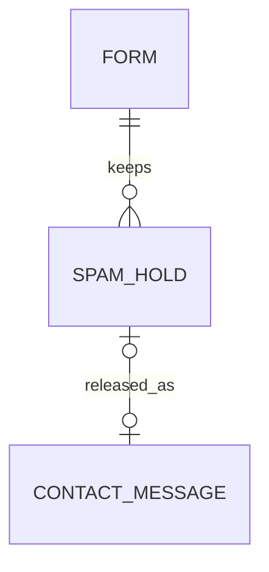
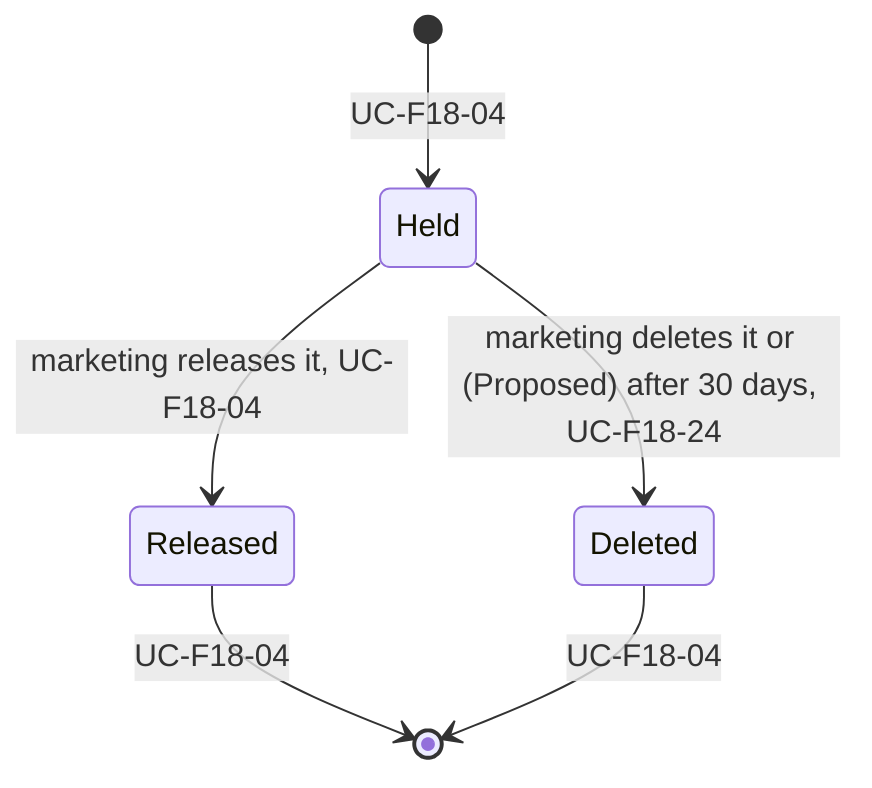

🏠 [Specs](../../../README.md) › 🧩 [Functional capabilities](../../README.md) ›
🌐 [F18 Hosted websites and domains (hosted edition)](../README.md) › 🗃️ [Data](README.md) › 🗃️ E-F18-16 Spam hold

# 🗃️ E-F18-16 Spam hold

**Status:** 🔄 waiting for the owner

## Purpose

A form message kept aside as suspected spam, with why.

## Fields

| Name | Type | Required | Validation | Default | Example | Personal data | Custom fields |
|---|---|---|---|---|---|---|---|
| form | link | yes | a site form | - | contact | no | no |
| received | date and time | yes | - | now | 2026-11-12 10:04 | no | no |
| reason | choice | yes | hidden field, too fast, rate, content | - | too fast | no | no |
| content | text | yes | - | - | Buy cheap ... | yes | no |
| decision | choice | no | released, deleted | - | deleted | no | no |

## Relations

## Lifecycle

## Indexes and search

By form, reason and date.

## Retention

(Proposed) 30 days, then deleted.

## Audit

Every creation and change, with who, when, the old and the new value.

## Import and export

CSV and JSON export through the API (T5); no bulk import.

## Used by

- [UC-F18-24 Protect forms against spam](../use-cases/01-build-the-site/uc-f18-24-protect-forms-against-spam.md)
- [UC-F18-04 Add a contact page that feeds leads](../use-cases/01-build-the-site/uc-f18-04-add-a-contact-page-that-feeds-leads.md)

## Open questions

None.

---

⬅️ [E-F18-15 Mailbox](e-f18-15-mailbox.md) · ⬆️ [Up](README.md) ·
➡️ [E-F18-17 Sector template](e-f18-17-sector-template.md)
