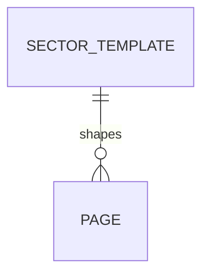
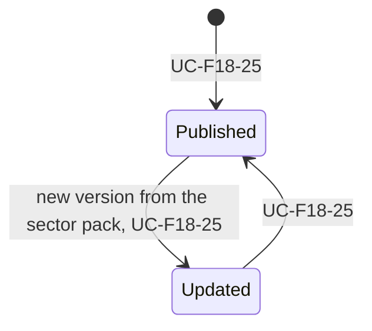

🏠 [Specs](../../../README.md) › 🧩 [Functional capabilities](../../README.md) ›
🌐 [F18 Hosted websites and domains (hosted edition)](../README.md) › 🗃️ [Data](README.md) ›
🗃️ E-F18-17 Sector template

# 🗃️ E-F18-17 Sector template

**Status:** ✅ specified

## Purpose

A set of page designs for a sector with the mandatory information each page must show.

## Fields

| Name | Type | Required | Validation | Default | Example | Personal data | Custom fields |
|---|---|---|---|---|---|---|---|
| sector | link | yes | a sector pack | - | SC06 Restaurants | no | no |
| pages | list | yes | - | - | menu, opening hours, booking | no | no |
| mandatory | list | yes | country-pack rules | - | allergens (CR-FR-107) | no | no |

## Relations

## Lifecycle

## Indexes and search

By sector.

## Retention

Shipped with the sector pack.

## Audit

Every creation and change, with who, when, the old and the new value.

## Import and export

Delivered by the sector pack.

## Used by

- [UC-F18-25 Use a sector page template](../use-cases/06-content-and-search/uc-f18-25-use-a-sector-page-template.md)

## Open questions

None.

---

⬅️ [E-F18-16 Spam hold](e-f18-16-spam-hold.md) · ⬆️ [Up](README.md) ·
➡️ [E-F18-18 Search settings](e-f18-18-search-settings.md)
