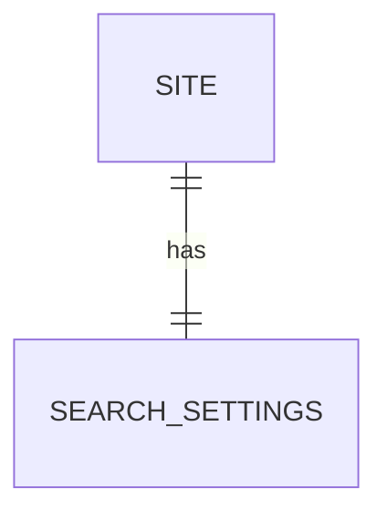
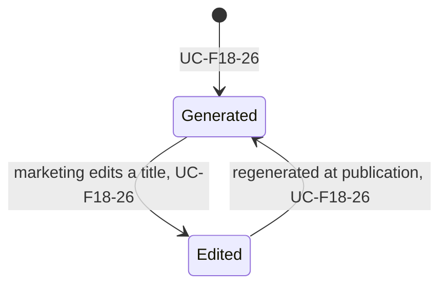

🏠 [Specs](../../../README.md) › 🧩 [Functional capabilities](../../README.md) ›
🌐 [F18 Hosted websites and domains (hosted edition)](../README.md) › 🗃️ [Data](README.md) ›
🗃️ E-F18-18 Search settings

# 🗃️ E-F18-18 Search settings

**Status:** 🔄 waiting for the owner

## Purpose

A site's sitemap, titles, descriptions and structured data settings.

## Fields

| Name | Type | Required | Validation | Default | Example | Personal data | Custom fields |
|---|---|---|---|---|---|---|---|
| site | link | yes | a site | - | restaurant site | no | no |
| titles, descriptions | text per page | yes | 60 and 160 characters (Proposed) | generated | Winter menu, Bistro Lyon | no | no |
| structured data | list | yes | organisation, products, hours, job postings | all | organisation, hours | no | no |
| not indexed | list | no | pages | - | /thank-you | no | no |

## Relations

## Lifecycle

## Indexes and search

By site.

## Retention

As long as the site.

## Audit

Every creation and change, with who, when, the old and the new value.

## Import and export

CSV and JSON export through the API (T5); no bulk import.

## Used by

- [UC-F18-26 Set the search-engine basics](../use-cases/06-content-and-search/uc-f18-26-set-the-search-engine-basics.md)

## Open questions

None.

---

⬅️ [E-F18-17 Sector template](e-f18-17-sector-template.md) · ⬆️ [Up](README.md) ·
➡️ [E-F18-19 Site backup](e-f18-19-site-backup.md)
