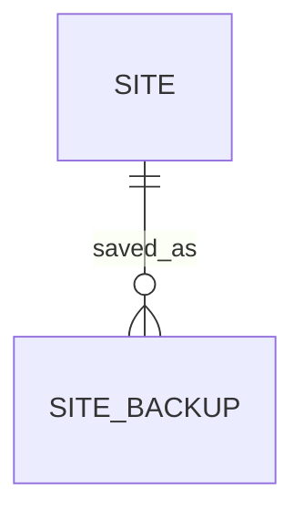
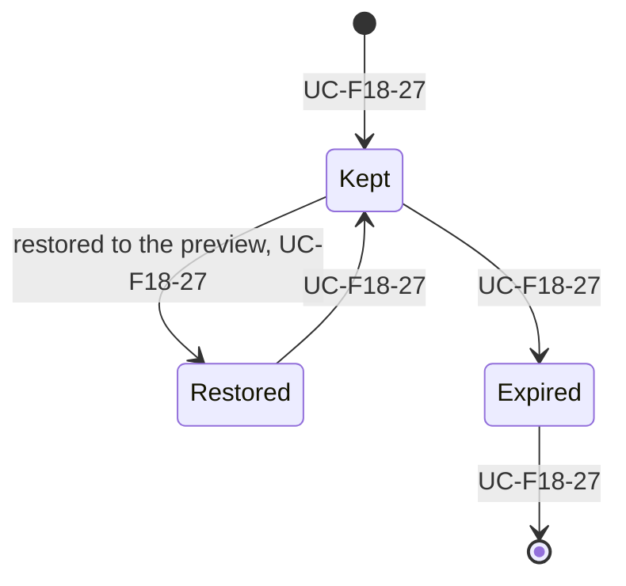

🏠 [Specs](../../../README.md) › 🧩 [Functional capabilities](../../README.md) ›
🌐 [F18 Hosted websites and domains (hosted edition)](../README.md) › 🗃️ [Data](README.md) › 🗃️ E-F18-19 Site backup

# 🗃️ E-F18-19 Site backup

**Status:** ✅ specified

## Purpose

A daily copy of a site that can be restored to its preview.

## Fields

| Name | Type | Required | Validation | Default | Example | Personal data | Custom fields |
|---|---|---|---|---|---|---|---|
| site | link | yes | a site | - | restaurant site | no | no |
| taken | date and time | yes | daily | - | 2026-11-10 03:00 | no | no |
| size | number | yes | - | - | 84 MB | no | no |
| expires | date | yes | 30 days after | computed | 2026-12-10 | no | no |

## Relations

## Lifecycle

## Indexes and search

By site and date.

## Retention

30 days.

## Audit

Every creation and change, with who, when, the old and the new value.

## Import and export

CSV and JSON export through the API (T5); no bulk import.

## Used by

- [UC-F18-27 Back up and restore the site](../use-cases/05-run-the-site/uc-f18-27-back-up-and-restore-the-site.md)

## Open questions

None.

---

⬅️ [E-F18-18 Search settings](e-f18-18-search-settings.md) · ⬆️ [Up](README.md) ·
➡️ [E-F18-20 Page test](e-f18-20-page-test.md)
