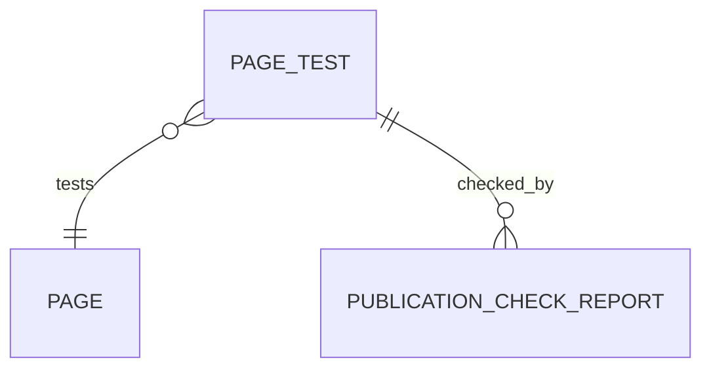
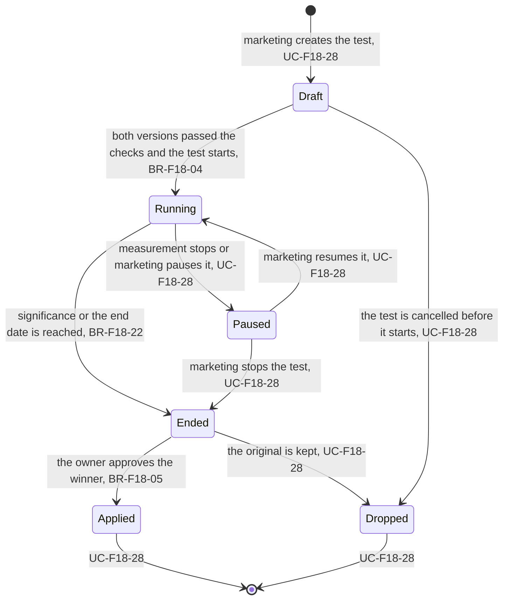

🏠 [Specs](../../../README.md) › 🧩 [Functional capabilities](../../README.md) ›
🌐 [F18 Hosted websites and domains (hosted edition)](../README.md) › 🗃️ [Data](README.md) › 🗃️ E-F18-20 Page test

# 🗃️ E-F18-20 Page test

**Status:** ✅ specified

## Purpose

A test of two versions of one page of a hosted site, with its goal, its figures and its result
[D537](../../../06-decisions/f18-hosted-websites-and-domains/d537-benchmark-gaps-f18-hosted-websites-and-domains.md). It
differs from the A/B test of F5 ([E-F5-16 A/B test](../../f05-social-media/data/e-f05-16-a-b-test.md)), which tests
posts, emails and messages, not the pages of the site.

## Fields

| Name | Type | Required | Validation | Default | Example | Personal data | Custom fields |
|---|---|---|---|---|---|---|---|
| page | page (E-F18-02) | yes | a published page of the site | - | Home page | no | no |
| version B | page version | yes | differs from the original | - | Title: Plans from 29 EUR | no | no |
| goal | form sent, click, next page | yes | one of the three | form sent | form sent | no | no |
| split | percent for version B | yes | 10 to 90 | 50 | 50 | no | no |
| start date | date | no | set at the start | - | 2026-11-24 | no | no |
| end date | date | yes | after the start, at most 8 weeks later | - | 2026-12-15 | no | no |
| visitors per version | two numbers | no | counted with consent only | 0 | 1204 and 1187 | no | no |
| goals per version | two numbers | no | counted with consent only | 0 | 31 and 46 | no | no |
| significance | percent | no | computed | - | 96 | no | no |
| winner | A, B, none | no | set at the end | - | B | no | no |
| state | Draft, Running, Paused, Ended, Applied, Dropped | yes | the lifecycle below | Draft | Running | no | no |
| owner | user | yes | a user of the company | the creator | Claire P. | yes | no |

## Relations

- [E-F18-02 Page](e-f18-02-page.md)
- [E-F18-10 Publication check report](e-f18-10-publication-check-report.md)
- [E-F18-11 Audience figure](e-f18-11-audience-figure.md)
- [E-F5-16 A/B test](../../f05-social-media/data/e-f05-16-a-b-test.md)

## Lifecycle

## Indexes and search

By page, goal, state, dates and winner.

## Retention

Kept with the site's audience figures ([E-F18-11 Audience figure](e-f18-11-audience-figure.md)), as long as
the page exists; the counts are totals, never visitors.

## Audit

Every creation, change, start, pause, stop and end of a test, the figures at the end and the approval of a winner.

## Import and export

No import. The results of a test are exported as a CSV with the counts per version.

## Used by

- [UC-F18-28](../use-cases/07-tests-visitors-and-accessibility/uc-f18-28-a-b-test-a-page.md)

## Open questions

None.

---

⬅️ [E-F18-19 Site backup](e-f18-19-site-backup.md) · ⬆️ [Up](README.md) · ➡️ [E-F18-21 Visit](e-f18-21-visit.md)
