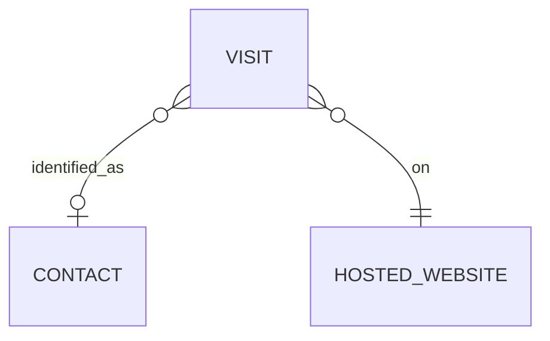
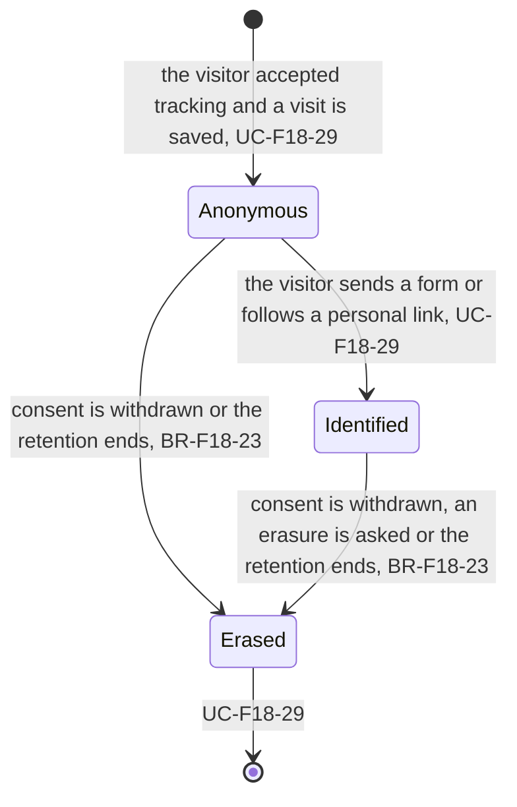

🏠 [Specs](../../../README.md) › 🧩 [Functional capabilities](../../README.md) ›
🌐 [F18 Hosted websites and domains (hosted edition)](../README.md) › 🗃️ [Data](README.md) › 🗃️ E-F18-21 Visit

# 🗃️ E-F18-21 Visit

**Status:** ✅ specified

## Purpose

One visit of a consenting visitor to the hosted site, with its pages and source, anonymous until the visitor identifies
themselves
[D537](../../../06-decisions/f18-hosted-websites-and-domains/d537-benchmark-gaps-f18-hosted-websites-and-domains.md). It
differs from the audience figure ([E-F18-11 Audience figure](e-f18-11-audience-figure.md)), which is a total that holds
no visitor.

## Fields

| Name | Type | Required | Validation | Default | Example | Personal data | Custom fields |
|---|---|---|---|---|---|---|---|
| visitor number | number | yes | random, tied to a device | - | 4821 | yes | no |
| site | hosted website (E-F18-01) | yes | the company's site | - | atelier-nord.example | no | no |
| pages seen | list of pages | yes | pages of the site | - | pricing, plans, contact | yes | no |
| source | search, link, campaign, direct | yes | one of the four | direct | campaign | no | no |
| visited at | date and time | yes | not in the future | - | 2026-11-14 09:12 | no | no |
| consent given at | date and time | yes | before the first visit saved | - | 2026-11-12 18:03 | no | no |
| contact | contact (E-F5-18) | no | set only by the visitor's own form or link | - | Claire P. | yes | no |
| erase on | date | yes | consent date plus the retention | - | 2027-12-12 | no | no |
| state | Anonymous, Identified, Erased | yes | the lifecycle below | Anonymous | Identified | no | no |
| owner | user | yes | a user of the company | the creator | Claire P. | yes | no |

## Relations

- [E-F18-01 Hosted website](e-f18-01-hosted-website.md)
- [E-F18-11 Audience figure](e-f18-11-audience-figure.md)
- [E-F5-18 Contact](../../f05-social-media/data/e-f05-18-contact.md)
- [E-F5-10](../../f05-social-media/data/e-f05-10-consent-and-suppression-record.md)
- [E-F11-15 Tracker consent](../../f11-online-shop/data/e-f11-15-tracker-consent.md)

## Lifecycle

## Indexes and search

By visitor number, contact, page, source, state and visit date.

## Retention

13 months from the consent date by default, set by the owner; erased earlier on withdrawal or on an erasure
request.

## Audit

Every consent choice, visit, link, read by a person and erasure, with the time and the reason.

## Import and export

No import. The visits of one contact are part of the export of that contact's data.

## Used by

- [UC-F18-29](../use-cases/07-tests-visitors-and-accessibility/uc-f18-29-track-known-visitors-for-sales.md)

## Open questions

None.

---

⬅️ [E-F18-20 Page test](e-f18-20-page-test.md) · ⬆️ [Up](README.md) ·
➡️ [E-F18-22 Accessibility statement](e-f18-22-accessibility-statement.md)
