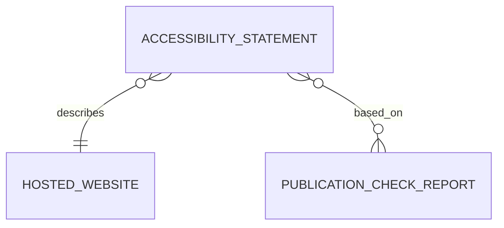
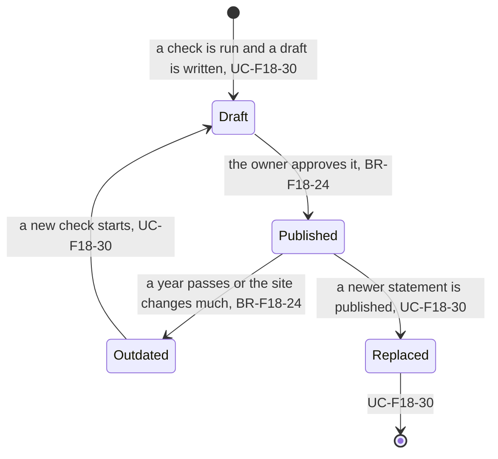

🏠 [Specs](../../../README.md) › 🧩 [Functional capabilities](../../README.md) ›
🌐 [F18 Hosted websites and domains (hosted edition)](../README.md) › 🗃️ [Data](README.md) ›
🗃️ E-F18-22 Accessibility statement

# 🗃️ E-F18-22 Accessibility statement

**Status:** ✅ specified

## Purpose

The accessibility statement of a hosted site: the standard, the level reached, the known gaps, the contact and the dates
[D537](../../../06-decisions/f18-hosted-websites-and-domains/d537-benchmark-gaps-f18-hosted-websites-and-domains.md). It
differs from the publication check report ([E-F18-10 Publication check report](e-f18-10-publication-check-report.md)),
which is one run of checks, not the public statement.

## Fields

| Name | Type | Required | Validation | Default | Example | Personal data | Custom fields |
|---|---|---|---|---|---|---|---|
| site | hosted website (E-F18-01) | yes | a site of the company | - | atelier-nord.example | no | no |
| standard | text | yes | the standard of the country pack | - | the web accessibility criteria | no | no |
| level | accessible, partly accessible, not accessible | yes | one of the three | - | partly accessible | no | no |
| gaps | list of text and reason | no | required when the level is not accessible | - | shop images without descriptions | no | no |
| checked on | date | yes | not in the future | - | 2026-11-10 | no | no |
| contact | email | yes | a monitored address | - | access@atelier-nord.example | no | no |
| text | text | yes | the statement as published | - | This site is partly accessible ... | no | no |
| address | link | no | set at publication | - | atelier-nord.example/accessibility | no | no |
| state | Draft, Published, Outdated, Replaced | yes | the lifecycle below | Draft | Published | no | no |
| owner | user | yes | a user of the company | the creator | Claire P. | yes | no |

## Relations

- [E-F18-01 Hosted website](e-f18-01-hosted-website.md)
- [E-F18-10 Publication check report](e-f18-10-publication-check-report.md)
- [E-F11-14 Legal page](../../f11-online-shop/data/e-f11-14-legal-page.md)

## Lifecycle

## Indexes and search

By site, level, state and checked on.

## Retention

Every published statement is kept with its dates for as long as the site exists and five years after, to show
what was said and when.

## Audit

Every check, statement edit, approval, publication, replacement and reported barrier.

## Import and export

No import. A statement is exported as a page text and as a PDF.

## Used by

- [UC-F18-30](../use-cases/07-tests-visitors-and-accessibility/uc-f18-30-check-and-declare-accessibility.md)

## Open questions

None.

---

⬅️ [E-F18-21 Visit](e-f18-21-visit.md) · ⬆️ [Up](README.md) · ➡️ [E-F18-23 Page audience](e-f18-23-page-audience.md)
