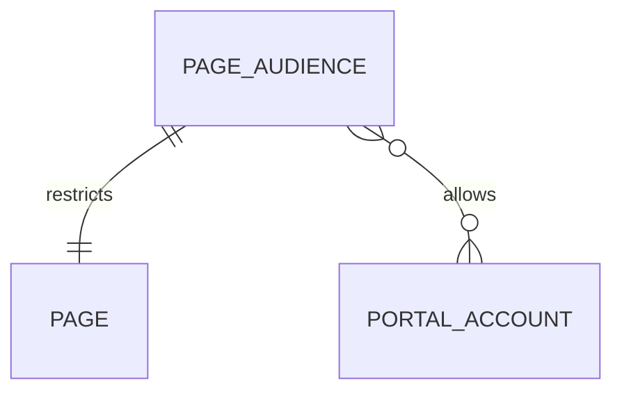
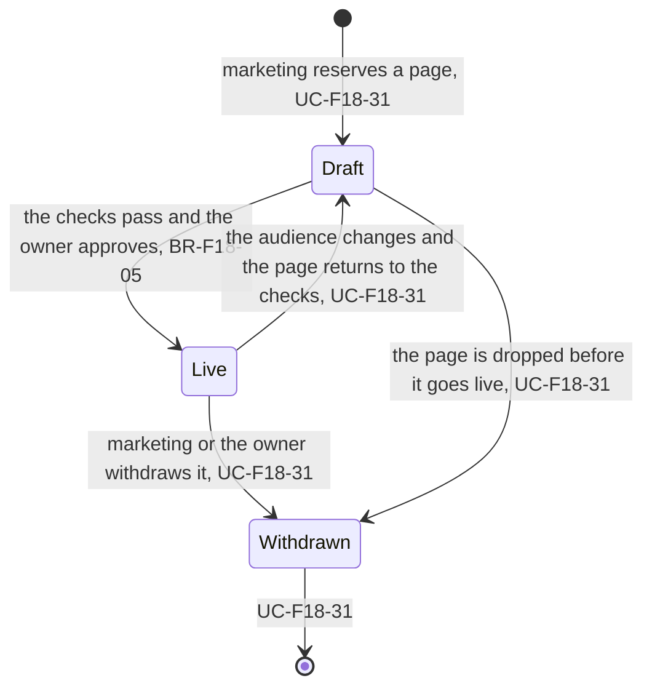

🏠 [Specs](../../../README.md) › 🧩 [Functional capabilities](../../README.md) ›
🌐 [F18 Hosted websites and domains (hosted edition)](../README.md) › 🗃️ [Data](README.md) › 🗃️ E-F18-23 Page audience

# 🗃️ E-F18-23 Page audience

**Status:** ✅ specified

## Purpose

Who may read a page of a hosted site: the audience of a members-only page, its indexing state and its reads
[D537](../../../06-decisions/f18-hosted-websites-and-domains/d537-benchmark-gaps-f18-hosted-websites-and-domains.md). It
differs from the page ([E-F18-02 Page](e-f18-02-page.md)), which holds the content: the audience says who may see it.

## Fields

| Name | Type | Required | Validation | Default | Example | Personal data | Custom fields |
|---|---|---|---|---|---|---|---|
| page | page (E-F18-02) | yes | a page of the site | - | Price list 2027 | no | no |
| audience | all customers, group, named people | yes | one of the three | all customers | all customers | no | no |
| group or people | list of portal accounts | no | required for a group or named people | - | Partners | no | no |
| indexed | no | yes | always no | no | no | no | no |
| in sitemap | no | yes | always no | no | no | no | no |
| reads over 30 days | number | no | counted per member, shown as a total | 0 | 86 | no | no |
| live since | date | no | set at approval | - | 2026-11-02 | no | no |
| state | Draft, Live, Withdrawn | yes | the lifecycle below | Draft | Live | no | no |
| owner | user | yes | a user of the company | the creator | Claire P. | yes | no |

## Relations

- [E-F18-02 Page](e-f18-02-page.md)
- [E-F1-17 Portal account](../../f01-administration/data/e-f01-17-portal-account.md)
- [E-F18-18 Search settings](e-f18-18-search-settings.md)

## Lifecycle

## Indexes and search

By page, audience, state and live since.

## Retention

The reads are kept as totals for 12 months; who read what is kept 13 months, then erased.

## Audit

Every reservation, audience change, approval, withdrawal, read and refused access, with who and when.

## Import and export

No import. The members of an audience are exported as a CSV by the administrator.

## Used by

- [UC-F18-31](../use-cases/07-tests-visitors-and-accessibility/uc-f18-31-publish-members-only-pages.md)

## Open questions

None.

---

⬅️ [E-F18-22 Accessibility statement](e-f18-22-accessibility-statement.md) · ⬆️ [Up](README.md)
