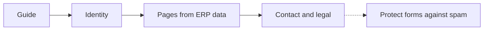

🏠 [Specs](../../../README.md) › 🧩 [Functional capabilities](../../README.md) ›
🌐 [F18 Hosted websites and domains (hosted edition)](../README.md) › 🔀 [Flows](README.md) › 🔀 FL-F18-01 Build the site

# 🔀 FL-F18-01 Build the site

**Status:** ✅ specified

## Summary

Covers UC-F18-01, UC-F18-02, UC-F18-03, UC-F18-04, UC-F18-08, UC-F18-17, UC-F18-19.

## Personas

- [U09 Customer](../../../01-users/personas/u09-customer.md)
- [U12 Marketing](../../../01-users/personas/u12-marketing.md)
- [U13 Owner](../../../01-users/personas/u13-owner.md)

## Flowchart

## Sequence diagram

See each use case.

## Steps

| Step | Persona | Screen | Use case | What happens |
|---|---|---|---|---|
| 1 | U13, U12 | [S-F18-01](../screens/01-build-the-site/s-f18-01-site-builder.md) | [UC-F18-01](../use-cases/01-build-the-site/uc-f18-01-build-the-site-with-the-guide.md) | Build the site with the guide |
| 2 | U12 | [S-F18-02](../screens/01-build-the-site/s-f18-02-identity.md) | [UC-F18-02](../use-cases/01-build-the-site/uc-f18-02-apply-the-visual-identity.md) | Apply the visual identity |
| 3 | U12 | [S-F18-03](../screens/01-build-the-site/s-f18-03-pages.md) | [UC-F18-03](../use-cases/01-build-the-site/uc-f18-03-generate-pages-from-the-erp-s-data.md) | Generate pages from the ERP's data |
| 4 | U12, U09 | [S-F18-04](../screens/01-build-the-site/s-f18-04-contact-page.md) | [UC-F18-04](../use-cases/01-build-the-site/uc-f18-04-add-a-contact-page-that-feeds-leads.md) | Add a contact page that feeds leads |
| 5 | U13 | [S-F18-08](../screens/01-build-the-site/s-f18-08-legal-pages.md) | [UC-F18-08](../use-cases/01-build-the-site/uc-f18-08-generate-legal-notices-privacy-and-cookies.md) | Generate legal notices, privacy and cookies |
| 6 | U12 | [S-F18-17](../screens/01-build-the-site/s-f18-17-languages.md) | [UC-F18-17](../use-cases/01-build-the-site/uc-f18-17-offer-the-site-in-several-languages.md) | Offer the site in several languages |
| 7 | U12 | [S-F18-19](../screens/01-build-the-site/s-f18-19-shop-link.md) | [UC-F18-19](../use-cases/01-build-the-site/uc-f18-19-connect-the-online-shop.md) | Connect the online shop |
| 8 | U12, U09 | [S-F18-24](../screens/01-build-the-site/s-f18-24-form-protection.md) | [UC-F18-24](../use-cases/01-build-the-site/uc-f18-24-protect-forms-against-spam.md) | Protect forms against spam |

### Entities and screens

| Entity | States in this flow | Shown at step and screen | Aggregated view |
|---|---|---|---|
| [E-F18-03 Identity](../data/e-f18-03-identity.md) | Active | 2 [S-F18-02](../screens/01-build-the-site/s-f18-02-identity.md) | Identities |
| [E-F18-02 Page](../data/e-f18-02-page.md) | Published, Live, Held | 1 [S-F18-01](../screens/01-build-the-site/s-f18-01-site-builder.md); 3 [S-F18-03](../screens/01-build-the-site/s-f18-03-pages.md); 4 [S-F18-04](../screens/01-build-the-site/s-f18-04-contact-page.md); 5 [S-F18-08](../screens/01-build-the-site/s-f18-08-legal-pages.md); 6 [S-F18-17](../screens/01-build-the-site/s-f18-17-languages.md); 7 [S-F18-19](../screens/01-build-the-site/s-f18-19-shop-link.md) | Pages |
| [E-F18-04 Contact message](../data/e-f18-04-contact-message.md) | Sent, Held, Lost | 4 [S-F18-04](../screens/01-build-the-site/s-f18-04-contact-page.md); 8 [S-F18-24](../screens/01-build-the-site/s-f18-24-form-protection.md) | Contact messages |
| [E-F18-16 Spam hold](../data/e-f18-16-spam-hold.md) | Held, Released, Deleted | 4 [S-F18-04](../screens/01-build-the-site/s-f18-04-contact-page.md); 8 [S-F18-24](../screens/01-build-the-site/s-f18-24-form-protection.md) | Spam holds |

## Errors

As each use case.

## Images

Every step and error, for each persona taking part, in light and dark mode (D120). Steps are numbered as in the Steps
table; E rows are the error cases.

| Step | Persona | Device | Light | Dark |
|---|---|---|---|---|
| 1 | U13 | desktop | [light](../images/01-build-the-site/u13-owner/1-guide-desktop-light.png) | [dark](../images/01-build-the-site/u13-owner/1-guide-desktop-dark.png) |
| 1 | U13 | phone | [light](../images/01-build-the-site/u13-owner/1-guide-phone-light.png) | [dark](../images/01-build-the-site/u13-owner/1-guide-phone-dark.png) |
| 1 | U12 | desktop | [light](../images/01-build-the-site/u12-marketing/1-guide-desktop-light.png) | [dark](../images/01-build-the-site/u12-marketing/1-guide-desktop-dark.png) |
| 1 | U12 | phone | [light](../images/01-build-the-site/u12-marketing/1-guide-phone-light.png) | [dark](../images/01-build-the-site/u12-marketing/1-guide-phone-dark.png) |
| 2 | U12 | desktop | [light](../images/01-build-the-site/u12-marketing/2-identity-desktop-light.png) | [dark](../images/01-build-the-site/u12-marketing/2-identity-desktop-dark.png) |
| 2 | U12 | phone | [light](../images/01-build-the-site/u12-marketing/2-identity-phone-light.png) | [dark](../images/01-build-the-site/u12-marketing/2-identity-phone-dark.png) |
| 3 | U12 | desktop | [light](../images/01-build-the-site/u12-marketing/3-pages-desktop-light.png) | [dark](../images/01-build-the-site/u12-marketing/3-pages-desktop-dark.png) |
| 3 | U12 | phone | [light](../images/01-build-the-site/u12-marketing/3-pages-phone-light.png) | [dark](../images/01-build-the-site/u12-marketing/3-pages-phone-dark.png) |
| 4 | U09 | phone | [light](../images/01-build-the-site/u09-customer/4-contact-phone-light.png) | [dark](../images/01-build-the-site/u09-customer/4-contact-phone-dark.png) |
| 4 | U12 | desktop | [light](../images/01-build-the-site/u12-marketing/4-contact-desktop-light.png) | [dark](../images/01-build-the-site/u12-marketing/4-contact-desktop-dark.png) |
| 4 | U12 | phone | [light](../images/01-build-the-site/u12-marketing/4-contact-phone-light.png) | [dark](../images/01-build-the-site/u12-marketing/4-contact-phone-dark.png) |
| 5 | U13 | desktop | [light](../images/01-build-the-site/u13-owner/5-legal-desktop-light.png) | [dark](../images/01-build-the-site/u13-owner/5-legal-desktop-dark.png) |
| 5 | U13 | phone | [light](../images/01-build-the-site/u13-owner/5-legal-phone-light.png) | [dark](../images/01-build-the-site/u13-owner/5-legal-phone-dark.png) |
| 6 | U12 | desktop | [light](../images/01-build-the-site/u12-marketing/6-languages-desktop-light.png) | [dark](../images/01-build-the-site/u12-marketing/6-languages-desktop-dark.png) |
| 6 | U12 | phone | [light](../images/01-build-the-site/u12-marketing/6-languages-phone-light.png) | [dark](../images/01-build-the-site/u12-marketing/6-languages-phone-dark.png) |
| 7 | U12 | desktop | [light](../images/01-build-the-site/u12-marketing/7-shop-desktop-light.png) | [dark](../images/01-build-the-site/u12-marketing/7-shop-desktop-dark.png) |
| 7 | U12 | phone | [light](../images/01-build-the-site/u12-marketing/7-shop-phone-light.png) | [dark](../images/01-build-the-site/u12-marketing/7-shop-phone-dark.png) |
| E1 | U13 | desktop | [light](../images/01-build-the-site/u13-owner/e1-identity-missing-desktop-light.png) | [dark](../images/01-build-the-site/u13-owner/e1-identity-missing-desktop-dark.png) |
| E1 | U13 | phone | [light](../images/01-build-the-site/u13-owner/e1-identity-missing-phone-light.png) | [dark](../images/01-build-the-site/u13-owner/e1-identity-missing-phone-dark.png) |
| 8 | U12 | desktop | [light](../images/01-build-the-site/u12-marketing/8-form-protection-desktop-light.png) | [dark](../images/01-build-the-site/u12-marketing/8-form-protection-desktop-dark.png) |
| 8 | U12 | phone | [light](../images/01-build-the-site/u12-marketing/8-form-protection-phone-light.png) | [dark](../images/01-build-the-site/u12-marketing/8-form-protection-phone-dark.png) |
| 8 | U09 | phone | [light](../images/01-build-the-site/u09-customer/8-form-protection-phone-light.png) | [dark](../images/01-build-the-site/u09-customer/8-form-protection-phone-dark.png) |

## Open questions

None.

---

⬆️ [Up](README.md) · ➡️ [FL-F18-02 Careers](fl-f18-02-careers.md)
