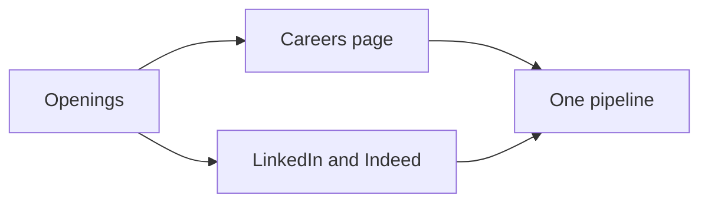

🏠 [Specs](../../../README.md) › 🧩 [Functional capabilities](../../README.md) ›
🌐 [F18 Hosted websites and domains (hosted edition)](../README.md) › 🔀 [Flows](README.md) › 🔀 FL-F18-02 Careers

# 🔀 FL-F18-02 Careers

**Status:** ✅ specified

## Summary

Covers UC-F18-05, UC-F18-06, UC-F18-07.

## Personas

- [U06 HR](../../../01-users/personas/u06-hr.md)

## Flowchart

## Sequence diagram

See each use case.

## Steps

| Step | Persona | Screen | Use case | What happens |
|---|---|---|---|---|
| 1 | U06 | [S-F18-05](../screens/02-careers/s-f18-05-careers-page.md) | [UC-F18-05](../use-cases/02-careers/uc-f18-05-publish-a-careers-page-from-openings.md) | Publish a careers page from openings |
| 2 | U06 | [S-F18-06](../screens/02-careers/s-f18-06-job-channels.md) | [UC-F18-06](../use-cases/02-careers/uc-f18-06-post-openings-to-linkedin-and-indeed.md) | Post openings to LinkedIn and Indeed |
| 3 | U06 | [S-F18-07](../screens/02-careers/s-f18-07-applications.md) | [UC-F18-07](../use-cases/02-careers/uc-f18-07-handle-one-pipeline-of-applications.md) | Handle one pipeline of applications |

### Entities and screens

| Entity | States in this flow | Shown at step and screen | Aggregated view |
|---|---|---|---|
| [E-F18-05 Job posting](../data/e-f18-05-job-posting.md) | Checked, Live, Blocked | 1 [S-F18-05](../screens/02-careers/s-f18-05-careers-page.md); 2 [S-F18-06](../screens/02-careers/s-f18-06-job-channels.md) | Job postings |
| [E-F18-02 Page](../data/e-f18-02-page.md) | Published, Live, Held | Shown elsewhere: [S-F18-03 Pages](../screens/01-build-the-site/s-f18-03-pages.md) | Pages |
| [E-F18-06 Application](../data/e-f18-06-application.md) | Interview, New, Rejected | 2 [S-F18-06](../screens/02-careers/s-f18-06-job-channels.md); 3 [S-F18-07](../screens/02-careers/s-f18-07-applications.md) | Applications |

## Errors

As each use case.

## Images

Every step and error, for each persona taking part, in light and dark mode (D120). Steps are numbered as in the Steps
table; E rows are the error cases.

| Step | Persona | Device | Light | Dark |
|---|---|---|---|---|
| 1 | U06 | desktop | [light](../images/02-careers/u06-hr/1-careers-desktop-light.png) | [dark](../images/02-careers/u06-hr/1-careers-desktop-dark.png) |
| 2 | U06 | desktop | [light](../images/02-careers/u06-hr/2-channels-desktop-light.png) | [dark](../images/02-careers/u06-hr/2-channels-desktop-dark.png) |
| 3 | U06 | desktop | [light](../images/02-careers/u06-hr/3-pipeline-desktop-light.png) | [dark](../images/02-careers/u06-hr/3-pipeline-desktop-dark.png) |
| E1 | U06 | desktop | [light](../images/02-careers/u06-hr/e1-offer-blocked-desktop-light.png) | [dark](../images/02-careers/u06-hr/e1-offer-blocked-desktop-dark.png) |

## Open questions

None.

---

⬅️ [FL-F18-01 Build the site](fl-f18-01-build-the-site.md) · ⬆️ [Up](README.md) ·
➡️ [FL-F18-03 Domain and DNS](fl-f18-03-domain-and-dns.md)
