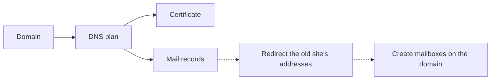

🏠 [Specs](../../../README.md) › 🧩 [Functional capabilities](../../README.md) ›
🌐 [F18 Hosted websites and domains (hosted edition)](../README.md) › 🔀 [Flows](README.md) › 🔀 FL-F18-03 Domain and DNS

# 🔀 FL-F18-03 Domain and DNS

**Status:** ✅ specified

## Summary

Covers UC-F18-09, UC-F18-10, UC-F18-11, UC-F18-12.

## Personas

- [U07 Administrator](../../../01-users/personas/u07-administrator.md)
- [U13 Owner](../../../01-users/personas/u13-owner.md)
- [U48 Hosting engineer](../../../01-users/personas/u48-hosting-engineer.md)
- [U12 Marketing and communication](../../../01-users/personas/u12-marketing.md)
- [U01 Employee](../../../01-users/personas/u01-employee.md)

## Flowchart

## Sequence diagram

See each use case.

## Steps

| Step | Persona | Screen | Use case | What happens |
|---|---|---|---|---|
| 1 | U13, U07 | [S-F18-09](../screens/03-domain-and-dns/s-f18-09-domains.md) | [UC-F18-09](../use-cases/03-domain-and-dns/uc-f18-09-buy-or-transfer-a-domain.md) | Buy or transfer a domain |
| 2 | U07 | [S-F18-10](../screens/03-domain-and-dns/s-f18-10-connect-domain.md) | [UC-F18-10](../use-cases/03-domain-and-dns/uc-f18-10-connect-an-existing-domain.md) | Connect an existing domain |
| 3 | U07, U48 | [S-F18-11](../screens/03-domain-and-dns/s-f18-11-dns-and-certificates.md) | [UC-F18-11](../use-cases/03-domain-and-dns/uc-f18-11-manage-the-dns-zone-and-certificates.md) | Manage the DNS zone and certificates |
| 4 | U07 | [S-F18-12](../screens/03-domain-and-dns/s-f18-12-mail-records.md) | [UC-F18-12](../use-cases/03-domain-and-dns/uc-f18-12-set-mail-records-spf-dkim-and-dmarc.md) | Set mail records SPF, DKIM and DMARC |
| 5 | U12, U07 | [S-F18-22](../screens/03-domain-and-dns/s-f18-22-redirects.md) | [UC-F18-22](../use-cases/03-domain-and-dns/uc-f18-22-redirect-the-old-sites-addresses.md) | Redirect the old site's addresses |
| 6 | U07, U01 | [S-F18-23](../screens/03-domain-and-dns/s-f18-23-mailboxes.md) | [UC-F18-23](../use-cases/03-domain-and-dns/uc-f18-23-create-mailboxes-on-the-domain.md) | Create mailboxes on the domain |

### Entities and screens

| Entity | States in this flow | Shown at step and screen | Aggregated view |
|---|---|---|---|
| [E-F18-07 Domain](../data/e-f18-07-domain.md) | Active | 1 [S-F18-09](../screens/03-domain-and-dns/s-f18-09-domains.md); 2 [S-F18-10](../screens/03-domain-and-dns/s-f18-10-connect-domain.md) | Domains |
| [E-F18-08 DNS record](../data/e-f18-08-dns-record.md) | Recorded | 2 [S-F18-10](../screens/03-domain-and-dns/s-f18-10-connect-domain.md); 3 [S-F18-11](../screens/03-domain-and-dns/s-f18-11-dns-and-certificates.md); 4 [S-F18-12](../screens/03-domain-and-dns/s-f18-12-mail-records.md) | DNS records |
| [E-F18-09 TLS certificate](../data/e-f18-09-tls-certificate.md) | Active | 3 [S-F18-11](../screens/03-domain-and-dns/s-f18-11-dns-and-certificates.md) | TLS certificates |
| [E-F18-14 Redirect](../data/e-f18-14-redirect.md) | Active, Removed | 2 [S-F18-10](../screens/03-domain-and-dns/s-f18-10-connect-domain.md); 5 [S-F18-22](../screens/03-domain-and-dns/s-f18-22-redirects.md) | Redirects |
| [E-F18-15 Mailbox](../data/e-f18-15-mailbox.md) | Active, Forwarding, Closed | 6 [S-F18-23](../screens/03-domain-and-dns/s-f18-23-mailboxes.md) | Mailboxes |

## Errors

As each use case.

## Images

Every step and error, for each persona taking part, in light and dark mode (D120). Steps are numbered as in the Steps
table; E rows are the error cases.

| Step | Persona | Device | Light | Dark |
|---|---|---|---|---|
| 1 | U13 | desktop | [light](../images/03-domain-and-dns/u13-owner/1-buy-desktop-light.png) | [dark](../images/03-domain-and-dns/u13-owner/1-buy-desktop-dark.png) |
| 1 | U13 | phone | [light](../images/03-domain-and-dns/u13-owner/1-buy-phone-light.png) | [dark](../images/03-domain-and-dns/u13-owner/1-buy-phone-dark.png) |
| 1 | U07 | desktop | [light](../images/03-domain-and-dns/u07-administrator/1-buy-desktop-light.png) | [dark](../images/03-domain-and-dns/u07-administrator/1-buy-desktop-dark.png) |
| 2 | U07 | desktop | [light](../images/03-domain-and-dns/u07-administrator/2-connect-desktop-light.png) | [dark](../images/03-domain-and-dns/u07-administrator/2-connect-desktop-dark.png) |
| 3 | U07 | desktop | [light](../images/03-domain-and-dns/u07-administrator/3-dns-plan-desktop-light.png) | [dark](../images/03-domain-and-dns/u07-administrator/3-dns-plan-desktop-dark.png) |
| 3 | U48 | desktop | [light](../images/03-domain-and-dns/u48-hosting-engineer/3-dns-plan-desktop-light.png) | [dark](../images/03-domain-and-dns/u48-hosting-engineer/3-dns-plan-desktop-dark.png) |
| 3 | U48 | phone | [light](../images/03-domain-and-dns/u48-hosting-engineer/3-dns-plan-phone-light.png) | [dark](../images/03-domain-and-dns/u48-hosting-engineer/3-dns-plan-phone-dark.png) |
| 4 | U07 | desktop | [light](../images/03-domain-and-dns/u07-administrator/4-mail-desktop-light.png) | [dark](../images/03-domain-and-dns/u07-administrator/4-mail-desktop-dark.png) |
| E1 | U13 | desktop | [light](../images/03-domain-and-dns/u13-owner/e1-not-eligible-desktop-light.png) | [dark](../images/03-domain-and-dns/u13-owner/e1-not-eligible-desktop-dark.png) |
| E1 | U13 | phone | [light](../images/03-domain-and-dns/u13-owner/e1-not-eligible-phone-light.png) | [dark](../images/03-domain-and-dns/u13-owner/e1-not-eligible-phone-dark.png) |
| 5 | U12 | desktop | [light](../images/03-domain-and-dns/u12-marketing/5-redirects-desktop-light.png) | [dark](../images/03-domain-and-dns/u12-marketing/5-redirects-desktop-dark.png) |
| 5 | U12 | phone | [light](../images/03-domain-and-dns/u12-marketing/5-redirects-phone-light.png) | [dark](../images/03-domain-and-dns/u12-marketing/5-redirects-phone-dark.png) |
| 5 | U07 | desktop | [light](../images/03-domain-and-dns/u07-administrator/5-redirects-desktop-light.png) | [dark](../images/03-domain-and-dns/u07-administrator/5-redirects-desktop-dark.png) |
| 6 | U07 | desktop | [light](../images/03-domain-and-dns/u07-administrator/6-mailboxes-desktop-light.png) | [dark](../images/03-domain-and-dns/u07-administrator/6-mailboxes-desktop-dark.png) |
| 6 | U01 | desktop | [light](../images/03-domain-and-dns/u01-employee/6-mailboxes-desktop-light.png) | [dark](../images/03-domain-and-dns/u01-employee/6-mailboxes-desktop-dark.png) |
| 6 | U01 | phone | [light](../images/03-domain-and-dns/u01-employee/6-mailboxes-phone-light.png) | [dark](../images/03-domain-and-dns/u01-employee/6-mailboxes-phone-dark.png) |

## Open questions

None.

---

⬅️ [FL-F18-02 Careers](fl-f18-02-careers.md) · ⬆️ [Up](README.md) ·
➡️ [FL-F18-04 Test and publish](fl-f18-04-test-and-publish.md)
