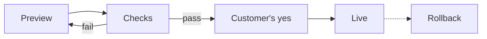

🏠 [Specs](../../../README.md) › 🧩 [Functional capabilities](../../README.md) ›
🌐 [F18 Hosted websites and domains (hosted edition)](../README.md) › 🔀 [Flows](README.md) ›
🔀 FL-F18-04 Test and publish

# 🔀 FL-F18-04 Test and publish

**Status:** ✅ specified

## Summary

Covers UC-F18-13, UC-F18-14, UC-F18-15, UC-F18-16.

## Personas

- [U12 Marketing](../../../01-users/personas/u12-marketing.md)
- [U13 Owner](../../../01-users/personas/u13-owner.md)
- [U48 Hosting engineer](../../../01-users/personas/u48-hosting-engineer.md)

## Flowchart

## Sequence diagram

See each use case.

## Steps

| Step | Persona | Screen | Use case | What happens |
|---|---|---|---|---|
| 1 | U13, U12 | [S-F18-13](../screens/04-test-and-publish/s-f18-13-preview.md) | [UC-F18-13](../use-cases/04-test-and-publish/uc-f18-13-review-the-private-preview.md) | Review the private preview |
| 2 | U12, U48 | [S-F18-14](../screens/04-test-and-publish/s-f18-14-checks.md) | [UC-F18-14](../use-cases/04-test-and-publish/uc-f18-14-run-the-automatic-checks.md) | Run the automatic checks |
| 3 | U13 | [S-F18-15](../screens/04-test-and-publish/s-f18-15-publication.md) | [UC-F18-15](../use-cases/04-test-and-publish/uc-f18-15-approve-publish-and-roll-back.md) | Approve, publish and roll back |
| 4 | U12 | [S-F18-16](../screens/04-test-and-publish/s-f18-16-editor.md) | [UC-F18-16](../use-cases/04-test-and-publish/uc-f18-16-edit-the-site-after-publication.md) | Edit the site after publication |

### Entities and screens

| Entity | States in this flow | Shown at step and screen | Aggregated view |
|---|---|---|---|
| [E-F18-01 Hosted website](../data/e-f18-01-hosted-website.md) | New, Live | 1 [S-F18-13](../screens/04-test-and-publish/s-f18-13-preview.md); 3 [S-F18-15](../screens/04-test-and-publish/s-f18-15-publication.md); 4 [S-F18-16](../screens/04-test-and-publish/s-f18-16-editor.md) | Hosted websites |
| [E-F18-10 Publication check report](../data/e-f18-10-publication-check-report.md) | Recorded | 2 [S-F18-14](../screens/04-test-and-publish/s-f18-14-checks.md); 3 [S-F18-15](../screens/04-test-and-publish/s-f18-15-publication.md) | Publication check reports |

## Errors

As each use case.

## Images

Every step and error, for each persona taking part, in light and dark mode (D120). Steps are numbered as in the Steps
table; E rows are the error cases.

| Step | Persona | Device | Light | Dark |
|---|---|---|---|---|
| 1 | U13 | desktop | [light](../images/04-test-and-publish/u13-owner/1-preview-desktop-light.png) | [dark](../images/04-test-and-publish/u13-owner/1-preview-desktop-dark.png) |
| 1 | U13 | phone | [light](../images/04-test-and-publish/u13-owner/1-preview-phone-light.png) | [dark](../images/04-test-and-publish/u13-owner/1-preview-phone-dark.png) |
| 1 | U12 | desktop | [light](../images/04-test-and-publish/u12-marketing/1-preview-desktop-light.png) | [dark](../images/04-test-and-publish/u12-marketing/1-preview-desktop-dark.png) |
| 1 | U12 | phone | [light](../images/04-test-and-publish/u12-marketing/1-preview-phone-light.png) | [dark](../images/04-test-and-publish/u12-marketing/1-preview-phone-dark.png) |
| 2 | U12 | desktop | [light](../images/04-test-and-publish/u12-marketing/2-checks-desktop-light.png) | [dark](../images/04-test-and-publish/u12-marketing/2-checks-desktop-dark.png) |
| 2 | U12 | phone | [light](../images/04-test-and-publish/u12-marketing/2-checks-phone-light.png) | [dark](../images/04-test-and-publish/u12-marketing/2-checks-phone-dark.png) |
| 2 | U48 | desktop | [light](../images/04-test-and-publish/u48-hosting-engineer/2-checks-desktop-light.png) | [dark](../images/04-test-and-publish/u48-hosting-engineer/2-checks-desktop-dark.png) |
| 2 | U48 | phone | [light](../images/04-test-and-publish/u48-hosting-engineer/2-checks-phone-light.png) | [dark](../images/04-test-and-publish/u48-hosting-engineer/2-checks-phone-dark.png) |
| 3 | U13 | desktop | [light](../images/04-test-and-publish/u13-owner/3-publish-desktop-light.png) | [dark](../images/04-test-and-publish/u13-owner/3-publish-desktop-dark.png) |
| 3 | U13 | phone | [light](../images/04-test-and-publish/u13-owner/3-publish-phone-light.png) | [dark](../images/04-test-and-publish/u13-owner/3-publish-phone-dark.png) |
| 4 | U12 | desktop | [light](../images/04-test-and-publish/u12-marketing/4-edit-desktop-light.png) | [dark](../images/04-test-and-publish/u12-marketing/4-edit-desktop-dark.png) |
| 4 | U12 | phone | [light](../images/04-test-and-publish/u12-marketing/4-edit-phone-light.png) | [dark](../images/04-test-and-publish/u12-marketing/4-edit-phone-dark.png) |
| E1 | U12 | desktop | [light](../images/04-test-and-publish/u12-marketing/e1-check-failed-desktop-light.png) | [dark](../images/04-test-and-publish/u12-marketing/e1-check-failed-desktop-dark.png) |
| E1 | U12 | phone | [light](../images/04-test-and-publish/u12-marketing/e1-check-failed-phone-light.png) | [dark](../images/04-test-and-publish/u12-marketing/e1-check-failed-phone-dark.png) |

## Open questions

None.

---

⬅️ [FL-F18-03 Domain and DNS](fl-f18-03-domain-and-dns.md) · ⬆️ [Up](README.md) ·
➡️ [FL-F18-05 Run the site](fl-f18-05-run-the-site.md)
