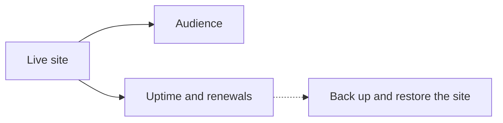

🏠 [Specs](../../../README.md) › 🧩 [Functional capabilities](../../README.md) ›
🌐 [F18 Hosted websites and domains (hosted edition)](../README.md) › 🔀 [Flows](README.md) › 🔀 FL-F18-05 Run the site

# 🔀 FL-F18-05 Run the site

**Status:** ✅ specified

## Summary

Covers UC-F18-18, UC-F18-20.

## Personas

- [U07 Administrator](../../../01-users/personas/u07-administrator.md)
- [U12 Marketing](../../../01-users/personas/u12-marketing.md)
- [U48 Hosting engineer](../../../01-users/personas/u48-hosting-engineer.md)
- [U13 Owner](../../../01-users/personas/u13-owner.md)

## Flowchart

## Sequence diagram

See each use case.

## Steps

| Step | Persona | Screen | Use case | What happens |
|---|---|---|---|---|
| 1 | U12 | [S-F18-18](../screens/05-run-the-site/s-f18-18-audience.md) | [UC-F18-18](../use-cases/05-run-the-site/uc-f18-18-measure-audience-and-search-ranking.md) | Measure audience and search ranking |
| 2 | U48, U07 | [S-F18-20](../screens/05-run-the-site/s-f18-20-site-health.md) | [UC-F18-20](../use-cases/05-run-the-site/uc-f18-20-watch-uptime-renewals-and-expiry.md) | Watch uptime, renewals and expiry |
| 3 | U13, U48 | [S-F18-27](../screens/05-run-the-site/s-f18-27-backups.md) | [UC-F18-27](../use-cases/05-run-the-site/uc-f18-27-back-up-and-restore-the-site.md) | Back up and restore the site |

### Entities and screens

| Entity | States in this flow | Shown at step and screen | Aggregated view |
|---|---|---|---|
| [E-F18-01 Hosted website](../data/e-f18-01-hosted-website.md) | Live | Shown elsewhere: [S-F18-01 Site builder](../screens/01-build-the-site/s-f18-01-site-builder.md) | Hosted websites |
| [E-F18-11 Audience figure](../data/e-f18-11-audience-figure.md) | Recorded | 1 [S-F18-18](../screens/05-run-the-site/s-f18-18-audience.md) | Audience figures |
| [E-F18-12 Uptime event](../data/e-f18-12-uptime-event.md) | Recorded | 2 [S-F18-20](../screens/05-run-the-site/s-f18-20-site-health.md) | Uptime events |
| [E-F18-07 Domain](../data/e-f18-07-domain.md) | Active | 2 [S-F18-20](../screens/05-run-the-site/s-f18-20-site-health.md) | Domains |

## Errors

As each use case.

## Images

Every step and error, for each persona taking part, in light and dark mode (D120). Steps are numbered as in the Steps
table; E rows are the error cases.

| Step | Persona | Device | Light | Dark |
|---|---|---|---|---|
| 1 | U12 | desktop | [light](../images/05-run-the-site/u12-marketing/1-audience-desktop-light.png) | [dark](../images/05-run-the-site/u12-marketing/1-audience-desktop-dark.png) |
| 1 | U12 | phone | [light](../images/05-run-the-site/u12-marketing/1-audience-phone-light.png) | [dark](../images/05-run-the-site/u12-marketing/1-audience-phone-dark.png) |
| 2 | U48 | desktop | [light](../images/05-run-the-site/u48-hosting-engineer/2-health-desktop-light.png) | [dark](../images/05-run-the-site/u48-hosting-engineer/2-health-desktop-dark.png) |
| 2 | U48 | phone | [light](../images/05-run-the-site/u48-hosting-engineer/2-health-phone-light.png) | [dark](../images/05-run-the-site/u48-hosting-engineer/2-health-phone-dark.png) |
| 2 | U07 | desktop | [light](../images/05-run-the-site/u07-administrator/2-health-desktop-light.png) | [dark](../images/05-run-the-site/u07-administrator/2-health-desktop-dark.png) |
| E1 | U07 | desktop | [light](../images/05-run-the-site/u07-administrator/e1-renewal-failed-desktop-light.png) | [dark](../images/05-run-the-site/u07-administrator/e1-renewal-failed-desktop-dark.png) |
| 3 | U13 | desktop | [light](../images/05-run-the-site/u13-owner/3-backups-desktop-light.png) | [dark](../images/05-run-the-site/u13-owner/3-backups-desktop-dark.png) |
| 3 | U13 | phone | [light](../images/05-run-the-site/u13-owner/3-backups-phone-light.png) | [dark](../images/05-run-the-site/u13-owner/3-backups-phone-dark.png) |
| 3 | U48 | desktop | [light](../images/05-run-the-site/u48-hosting-engineer/3-backups-desktop-light.png) | [dark](../images/05-run-the-site/u48-hosting-engineer/3-backups-desktop-dark.png) |
| 3 | U48 | phone | [light](../images/05-run-the-site/u48-hosting-engineer/3-backups-phone-light.png) | [dark](../images/05-run-the-site/u48-hosting-engineer/3-backups-phone-dark.png) |

## Open questions

None.

---

⬅️ [FL-F18-04 Test and publish](fl-f18-04-test-and-publish.md) · ⬆️ [Up](README.md) ·
➡️ [FL-F18-06 Content and search](fl-f18-06-content-and-search.md)
