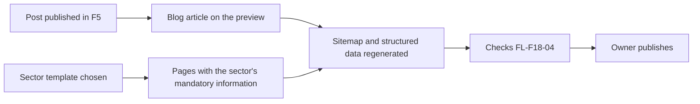
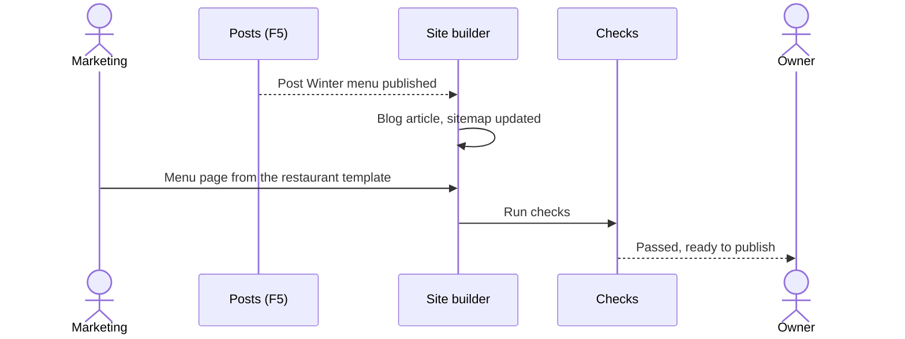

🏠 [Specs](../../../README.md) › 🧩 [Functional capabilities](../../README.md) ›
🌐 [F18 Hosted websites and domains (hosted edition)](../README.md) › 🔀 [Flows](README.md) ›
🔀 FL-F18-06 Content and search

# 🔀 FL-F18-06 Content and search

**Status:** ✅ specified

## Summary

The site keeps living after it is built: a blog fed by the posts written in F5, pages from the sector's template with
its mandatory information, and the search-engine basics generated from the ERP's data, all through the private preview
and the checks (D475).

## Personas

- [U12 Marketing and communication](../../../01-users/personas/u12-marketing.md)
- [U13 Owner](../../../01-users/personas/u13-owner.md)

## Flowchart

## Sequence diagram

## Steps

| Step | Persona | Screen | Use case | What happens |
|---|---|---|---|---|
| 1 | U12 | [S-F18-21](../screens/06-content-and-search/s-f18-21-blog.md) | [UC-F18-21](../use-cases/06-content-and-search/uc-f18-21-publish-a-blog-fed-by-f5-posts.md) | Publish a blog fed by F5 posts |
| 2 | U13, U12 | [S-F18-25](../screens/06-content-and-search/s-f18-25-sector-templates.md) | [UC-F18-25](../use-cases/06-content-and-search/uc-f18-25-use-a-sector-page-template.md) | Use a sector page template |
| 3 | U12 | [S-F18-26](../screens/06-content-and-search/s-f18-26-search-basics.md) | [UC-F18-26](../use-cases/06-content-and-search/uc-f18-26-set-the-search-engine-basics.md) | Set the search-engine basics |

### Entities and screens

| Entity | States in this flow | Shown at step and screen | Aggregated view |
|---|---|---|---|
| [E-F5-01 Post](../../f05-social-media/data/e-f05-01-post.md) | Published, Held | Shown elsewhere: [S-F5-01 Post composer](../../f05-social-media/screens/01-publish-a-post/s-f05-01-post-composer.md) | Posts |
| [E-F18-13 Blog article](../data/e-f18-13-blog-article.md) | Preview | 1 [S-F18-21](../screens/06-content-and-search/s-f18-21-blog.md) | Blog articles |
| [E-F18-01 Hosted website](../data/e-f18-01-hosted-website.md) | New, Live | Shown elsewhere: [S-F18-01 Site builder](../screens/01-build-the-site/s-f18-01-site-builder.md) | Hosted websites |
| [E-F18-17 Sector template](../data/e-f18-17-sector-template.md) | Published, Updated | 2 [S-F18-25](../screens/06-content-and-search/s-f18-25-sector-templates.md) | Sector templates |
| [E-F18-02 Page](../data/e-f18-02-page.md) | Published, Live, Held | 2 [S-F18-25](../screens/06-content-and-search/s-f18-25-sector-templates.md) | Pages |
| [E-F18-18 Search settings](../data/e-f18-18-search-settings.md) | Generated, Edited | 3 [S-F18-26](../screens/06-content-and-search/s-f18-26-search-basics.md) | Search settings |
| [E-F18-10 Publication check report](../data/e-f18-10-publication-check-report.md) | Recorded | Shown elsewhere: [S-F18-14 Checks](../screens/04-test-and-publish/s-f18-14-checks.md) | Publication check reports |

## Errors

E1: a sector template's mandatory information is missing in the ERP (allergens of a dish): the page is held in the
preview and the missing items listed (step 2). E2: structured data fails validation: the check fails and the publication
waits (step 3).

## Images

Every step and error, for each persona taking part, in light and dark mode (D120). Steps are numbered as in the Steps
table; E rows are the error cases.

| Step | Persona | Device | Light | Dark |
|---|---|---|---|---|
| 1 | U12 | desktop | [light](../images/06-content-and-search/u12-marketing/1-blog-desktop-light.png) | [dark](../images/06-content-and-search/u12-marketing/1-blog-desktop-dark.png) |
| 1 | U12 | phone | [light](../images/06-content-and-search/u12-marketing/1-blog-phone-light.png) | [dark](../images/06-content-and-search/u12-marketing/1-blog-phone-dark.png) |
| 2 | U13 | desktop | [light](../images/06-content-and-search/u13-owner/2-sector-templates-desktop-light.png) | [dark](../images/06-content-and-search/u13-owner/2-sector-templates-desktop-dark.png) |
| 2 | U13 | phone | [light](../images/06-content-and-search/u13-owner/2-sector-templates-phone-light.png) | [dark](../images/06-content-and-search/u13-owner/2-sector-templates-phone-dark.png) |
| 2 | U12 | desktop | [light](../images/06-content-and-search/u12-marketing/2-sector-templates-desktop-light.png) | [dark](../images/06-content-and-search/u12-marketing/2-sector-templates-desktop-dark.png) |
| 2 | U12 | phone | [light](../images/06-content-and-search/u12-marketing/2-sector-templates-phone-light.png) | [dark](../images/06-content-and-search/u12-marketing/2-sector-templates-phone-dark.png) |
| 3 | U12 | desktop | [light](../images/06-content-and-search/u12-marketing/3-search-basics-desktop-light.png) | [dark](../images/06-content-and-search/u12-marketing/3-search-basics-desktop-dark.png) |
| 3 | U12 | phone | [light](../images/06-content-and-search/u12-marketing/3-search-basics-phone-light.png) | [dark](../images/06-content-and-search/u12-marketing/3-search-basics-phone-dark.png) |
| E1 | U12 | desktop | [light](../images/06-content-and-search/u12-marketing/e1-blog-refused-desktop-light.png) | [dark](../images/06-content-and-search/u12-marketing/e1-blog-refused-desktop-dark.png) |
| E1 | U12 | phone | [light](../images/06-content-and-search/u12-marketing/e1-blog-refused-phone-light.png) | [dark](../images/06-content-and-search/u12-marketing/e1-blog-refused-phone-dark.png) |

## Open questions

None.

---

⬅️ [FL-F18-05 Run the site](fl-f18-05-run-the-site.md) · ⬆️ [Up](README.md) ·
➡️ [FL-F18-07 A/B tests, visitors, accessibility and members](fl-f18-07-tests-visitors-and-accessibility.md)
