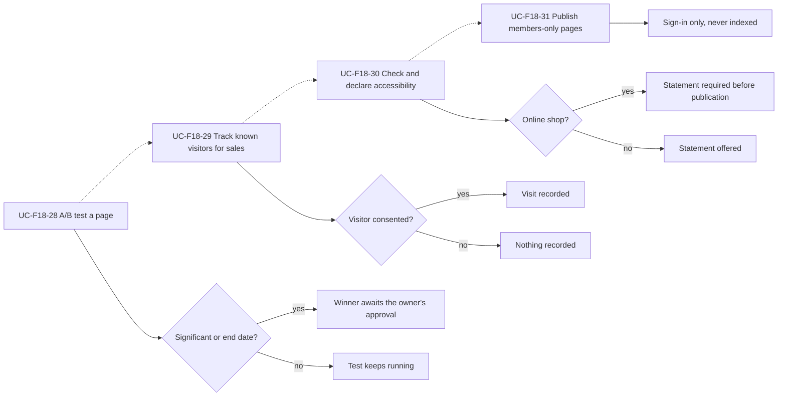
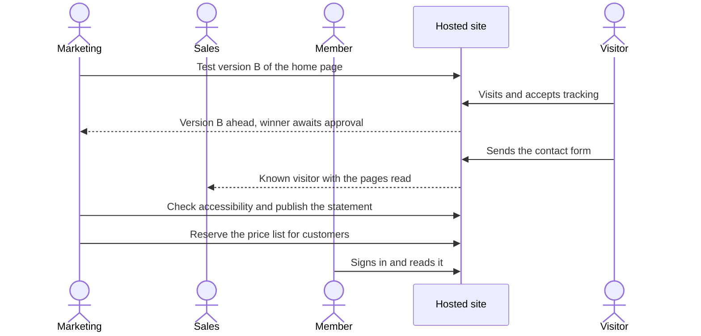

🏠 [Specs](../../../README.md) › 🧩 [Functional capabilities](../../README.md) ›
🌐 [F18 Hosted websites and domains (hosted edition)](../README.md) › 🔀 [Flows](README.md) ›
🔀 FL-F18-07 A/B tests, visitors, accessibility and members

# 🔀 FL-F18-07 A/B tests, visitors, accessibility and members

**Status:** ✅ specified

## Summary

The marketing person tests two versions of a page on the visitors who accepted tracking, sales sees the known visitors
who agreed to be recorded, the site's accessibility is checked and declared before a shop goes live, and reserved pages
are published for signed-in members and kept out of search engines
[D537](../../../06-decisions/f18-hosted-websites-and-domains/d537-benchmark-gaps-f18-hosted-websites-and-domains.md).

## Personas

- [U12 Marketing and communication](../../../01-users/personas/u12-marketing.md), who tests pages, declares
  accessibility and reserves pages
- [U03 Sales](../../../01-users/personas/u03-sales.md), who reads the visits of known contacts
- [U07 Administrator](../../../01-users/personas/u07-administrator.md), who fixes the accessibility findings
- [U09 Customer](../../../01-users/personas/u09-customer.md), who reads members pages on a phone

## Flowchart

## Sequence diagram

## Steps

| Step | Persona | Screen | Use case | What happens |
|---|---|---|---|---|
| 1 | [U12](../../../01-users/personas/u12-marketing.md) | [S-F18-28](../screens/07-tests-visitors-and-accessibility/s-f18-28-page-ab-test.md) | [UC-F18-28](../use-cases/07-tests-visitors-and-accessibility/uc-f18-28-a-b-test-a-page.md) | The marketing person tests two versions of a page and the winner waits for the owner's approval |
| 2 | [U03](../../../01-users/personas/u03-sales.md) | [S-F18-29](../screens/07-tests-visitors-and-accessibility/s-f18-29-visitor-tracking.md) | [UC-F18-29](../use-cases/07-tests-visitors-and-accessibility/uc-f18-29-track-known-visitors-for-sales.md) | Sales reads the known visitors who accepted tracking, while a refusal leaves no record |
| 3 | [U12](../../../01-users/personas/u12-marketing.md) | [S-F18-30](../screens/07-tests-visitors-and-accessibility/s-f18-30-accessibility.md) | [UC-F18-30](../use-cases/07-tests-visitors-and-accessibility/uc-f18-30-check-and-declare-accessibility.md) | The marketing person checks the site, fixes the gaps and publishes the accessibility statement |
| 4 | [U12](../../../01-users/personas/u12-marketing.md) | [S-F18-31](../screens/07-tests-visitors-and-accessibility/s-f18-31-members-pages.md) | [UC-F18-31](../use-cases/07-tests-visitors-and-accessibility/uc-f18-31-publish-members-only-pages.md) | The marketing person reserves a page for members, who read it signed in on a phone |

### Entities and screens

| Entity | States in this flow | Shown at step and screen | Aggregated view |
|---|---|---|---|
| [E-F18-20 Page test](../data/e-f18-20-page-test.md) | Draft, Running, Paused, Ended, Applied, Dropped | 1 [S-F18-28](../screens/07-tests-visitors-and-accessibility/s-f18-28-page-ab-test.md) | Page tests |
| [E-F18-21 Visit](../data/e-f18-21-visit.md) | Anonymous, Identified, Erased | 2 [S-F18-29](../screens/07-tests-visitors-and-accessibility/s-f18-29-visitor-tracking.md) | Visits |
| [E-F18-22 Accessibility statement](../data/e-f18-22-accessibility-statement.md) | Draft, Published, Outdated, Replaced | 3 [S-F18-30](../screens/07-tests-visitors-and-accessibility/s-f18-30-accessibility.md) | Accessibility statements |
| [E-F18-23 Page audience](../data/e-f18-23-page-audience.md) | Draft, Live, Withdrawn | 4 [S-F18-31](../screens/07-tests-visitors-and-accessibility/s-f18-31-members-pages.md) | Page audiences |
| [E-F5-16 A/B test](../../f05-social-media/data/e-f05-16-a-b-test.md) | Running | Shown elsewhere: [S-F5-22 A/B test](../../f05-social-media/screens/09-brand-tests-and-return-on-investment/s-f05-22-a-b-test.md) | A/B tests |

## Errors

- **E1 The visitor has not consented.** Nothing is recorded, the page works as usual and the visit is not counted in any
  test or figure ([BR-F18-23](../business-rules/br-f18-23-visits-are-tracked-only-with-consent.md), step 2).

## Images

Every step and error, for each persona taking part, in light and dark mode (D120). Steps are numbered as in the Steps
table; E rows are the error cases.

| Step | Persona | Device | Light | Dark |
|---|---|---|---|---|
| 1 | U12 | desktop | [light](../images/07-tests-visitors-and-accessibility/u12-marketing/1-page-ab-test-desktop-light.png) | [dark](../images/07-tests-visitors-and-accessibility/u12-marketing/1-page-ab-test-desktop-dark.png) |
| 1 | U12 | phone | [light](../images/07-tests-visitors-and-accessibility/u12-marketing/1-page-ab-test-phone-light.png) | [dark](../images/07-tests-visitors-and-accessibility/u12-marketing/1-page-ab-test-phone-dark.png) |
| 2 | U03 | desktop | [light](../images/07-tests-visitors-and-accessibility/u03-sales/2-visitor-tracking-desktop-light.png) | [dark](../images/07-tests-visitors-and-accessibility/u03-sales/2-visitor-tracking-desktop-dark.png) |
| 2 | U12 | desktop | [light](../images/07-tests-visitors-and-accessibility/u12-marketing/2-visitor-tracking-desktop-light.png) | [dark](../images/07-tests-visitors-and-accessibility/u12-marketing/2-visitor-tracking-desktop-dark.png) |
| 2 | U03 | phone | [light](../images/07-tests-visitors-and-accessibility/u03-sales/2-visitor-tracking-phone-light.png) | [dark](../images/07-tests-visitors-and-accessibility/u03-sales/2-visitor-tracking-phone-dark.png) |
| 2 | U03 | tablet | [light](../images/07-tests-visitors-and-accessibility/u03-sales/2-visitor-tracking-tablet-light.png) | [dark](../images/07-tests-visitors-and-accessibility/u03-sales/2-visitor-tracking-tablet-dark.png) |
| 3 | U12 | desktop | [light](../images/07-tests-visitors-and-accessibility/u12-marketing/3-accessibility-desktop-light.png) | [dark](../images/07-tests-visitors-and-accessibility/u12-marketing/3-accessibility-desktop-dark.png) |
| 3 | U07 | desktop | [light](../images/07-tests-visitors-and-accessibility/u07-administrator/3-accessibility-desktop-light.png) | [dark](../images/07-tests-visitors-and-accessibility/u07-administrator/3-accessibility-desktop-dark.png) |
| 3 | U12 | phone | [light](../images/07-tests-visitors-and-accessibility/u12-marketing/3-accessibility-phone-light.png) | [dark](../images/07-tests-visitors-and-accessibility/u12-marketing/3-accessibility-phone-dark.png) |
| 4 | U12 | desktop | [light](../images/07-tests-visitors-and-accessibility/u12-marketing/4-members-pages-desktop-light.png) | [dark](../images/07-tests-visitors-and-accessibility/u12-marketing/4-members-pages-desktop-dark.png) |
| 4 | U09 | phone | [light](../images/07-tests-visitors-and-accessibility/u09-customer/4-members-pages-phone-light.png) | [dark](../images/07-tests-visitors-and-accessibility/u09-customer/4-members-pages-phone-dark.png) |
| 4 | U12 | phone | [light](../images/07-tests-visitors-and-accessibility/u12-marketing/4-members-pages-phone-light.png) | [dark](../images/07-tests-visitors-and-accessibility/u12-marketing/4-members-pages-phone-dark.png) |
| E1 | U12 | desktop | [light](../images/07-tests-visitors-and-accessibility/u12-marketing/e1-the-visitor-has-not-consented-desktop-light.png) | [dark](../images/07-tests-visitors-and-accessibility/u12-marketing/e1-the-visitor-has-not-consented-desktop-dark.png) |
| E1 | U12 | phone | [light](../images/07-tests-visitors-and-accessibility/u12-marketing/e1-the-visitor-has-not-consented-phone-light.png) | [dark](../images/07-tests-visitors-and-accessibility/u12-marketing/e1-the-visitor-has-not-consented-phone-dark.png) |

## Open questions

None.

---

⬅️ [FL-F18-06 Content and search](fl-f18-06-content-and-search.md) · ⬆️ [Up](README.md)
