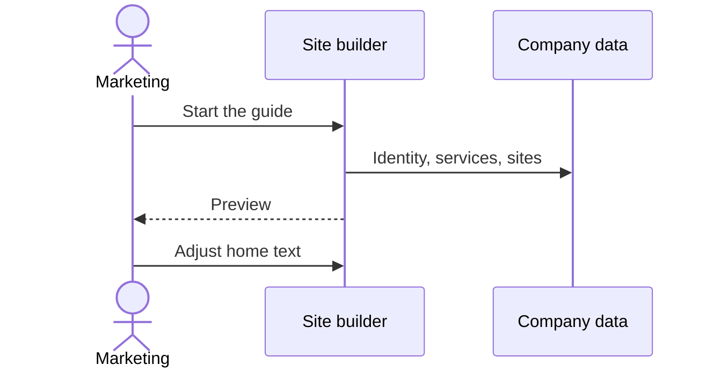

🏠 [Specs](../../../../README.md) › 🧩 [Functional capabilities](../../../README.md) ›
🌐 [F18 Hosted websites and domains (hosted edition)](../../README.md) › 📝 [Use cases](../README.md) ›
📝 [Use cases: FL-F18-01 Build the site](README.md) › 📝 UC-F18-01 Build the site with the guide

# 📝 UC-F18-01 Build the site with the guide

**Status:** ✅ specified

## Summary

The owner or marketing builds the site step by step with the guide and the AI assistant: questions on the business, then
a live preview built from the ERP's data, adjusted until it fits.

## Personas

- [U13 Owner](../../../../01-users/personas/u13-owner.md)
- [U12 Marketing](../../../../01-users/personas/u12-marketing.md)

## Goal

A first site ready to review in under an hour.

## Trigger

F18 turned on (hosted edition).

## Frequency

Once; again for a new site.

## Preconditions

- The company's identity and data exist in the ERP.

## Postconditions

- Success: a site on the private preview.
- Failure: the draft is kept.

## Main flow

1. Marketing opens the Site builder (S-F18-01); the guide asks about the business and the pages wanted.
2. simple-ERP builds the preview from the ERP's data (BR-F18-02).
3. Marketing applies the identity (UC-F18-02) and adjusts texts.
4. They add the contact page and legal pages (UC-F18-04, UC-F18-08).
5. The preview is ready for review (UC-F18-13).

## Alternative flows

- 1a. A sector template is offered (UC-F18-25).

## Error flows

- 2e. ERP data missing (no address): the guide asks for it.
- Any step: a service does not answer; the call is retried first (BR-F3-32), then the message follows the error pattern
  (D122) and what was typed stays on the screen.

## Business rules

- [BR-F18-03 Private preview first](../../business-rules/br-f18-03-preview-before-publication.md)
- [BR-F18-02 Built from the ERP's data](../../business-rules/br-f18-02-built-from-erp-data.md)

## Entities

- [E-F18-01 Hosted website](../../data/e-f18-01-hosted-website.md)
- [E-F18-02 Page](../../data/e-f18-02-page.md)

## Permissions

Owner and marketing.

## Notifications

- The owner when the preview is ready.

## Audit events

Drafts and changes.

## AI involvement

The AI assistant asks the questions and writes the first texts.

## API, MCP and A2A exposure

Through T5 and T6 with the caller's rights (BR-F3-34).

## Screens

- [S-F18-01 Site builder](../../screens/01-build-the-site/s-f18-01-site-builder.md)

## Flowchart

See [FL-F18-01 Build the site](../../flows/fl-f18-01-build-the-site.md#flowchart).

## Sequence diagram

## Acceptance criteria

1. **Given** the restaurant example company **when** the guide ends **then** a preview shows its services, sites and
   contact.
2. **Given** no address in F1 **when** building **then** the guide asks for it.
3. **Given** changes **when** saved **then** only the preview changes.

## Non-functional notes

D408's targets ([Performance](../../../../05-non-functional/performance.md)): 95 % of screens within 1 second; lists
paged on the server, the first page within 1 second; reports within 5 seconds or in the background.

## Regulatory references

Website rules of the France country pack:
[CR-FR-069 Website legal notices](../../../../10-country-packs/france/consumer/cr-fr-069-website-legal-notices.md),
[CR-FR-070 Consent before cookies and trackers](../../../../10-country-packs/france/data-protection/cr-fr-070-cookie-consent.md),
[CR-FR-072 Accessible online shops](../../../../10-country-packs/france/consumer/cr-fr-072-web-accessibility-eaa.md),
[CR-FR-194 Rules for job offers](../../../../10-country-packs/france/labour/cr-fr-194-job-offer-rules.md),
[CR-FR-195 Candidates' personal data](../../../../10-country-packs/france/data-protection/cr-fr-195-candidate-data.md),
[CR-FR-197 Who may hold a .fr domain](../../../../10-country-packs/france/digital/cr-fr-197-fr-domain-eligibility.md),
[CR-FR-058 AI in recruitment and work is high-risk](../../../../10-country-packs/france/ai-and-recording/cr-fr-058-high-risk-ai-in-employment.md),
[CR-FR-063 Consent for email and SMS marketing](../../../../10-country-packs/france/consumer/cr-fr-063-electronic-marketing-consent.md).

## Related use cases

- [UC-F18-02 Apply the visual identity](uc-f18-02-apply-the-visual-identity.md)
- [UC-F18-13 Review the private preview](../04-test-and-publish/uc-f18-13-review-the-private-preview.md)

## Open questions

None.

---

⬆️ [Up](README.md) · ➡️ [UC-F18-02 Apply the visual identity](uc-f18-02-apply-the-visual-identity.md)
