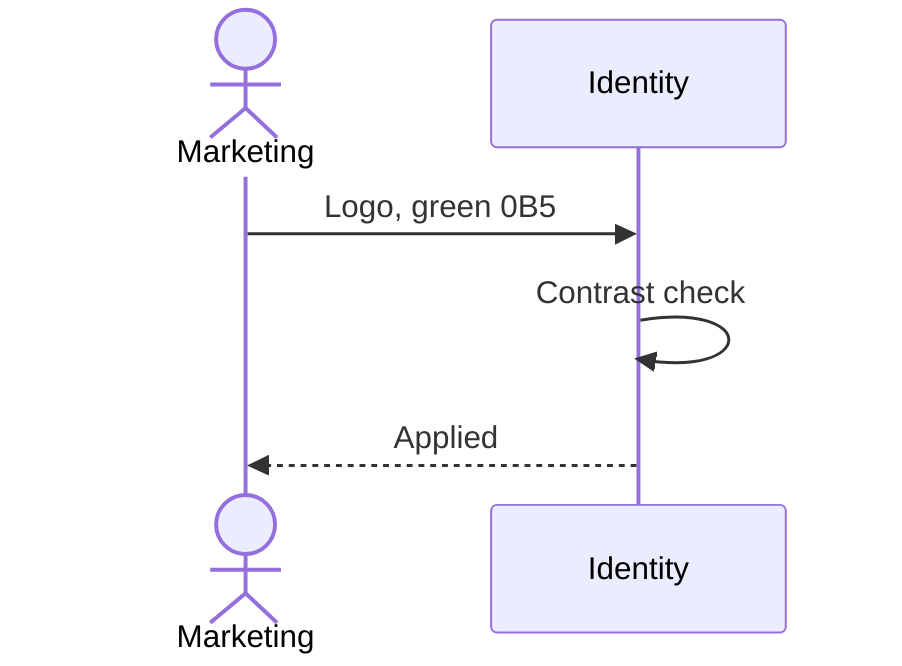

🏠 [Specs](../../../../README.md) › 🧩 [Functional capabilities](../../../README.md) ›
🌐 [F18 Hosted websites and domains (hosted edition)](../../README.md) › 📝 [Use cases](../README.md) ›
📝 [Use cases: FL-F18-01 Build the site](README.md) › 📝 UC-F18-02 Apply the visual identity

# 📝 UC-F18-02 Apply the visual identity

**Status:** ✅ specified

## Summary

Marketing applies the company's visual identity to the site: logo, colours, fonts and tone, with contrast checked.

## Personas

- [U12 Marketing](../../../../01-users/personas/u12-marketing.md)

## Goal

A site that looks like the company and is readable.

## Trigger

The builder; an identity change.

## Frequency

Rare.

## Preconditions

- A logo and colours.

## Postconditions

- Success: identity applied.
- Failure: refused colours.

## Main flow

1. Marketing opens Identity (S-F18-02).
2. They load the logo and choose colours and fonts.
3. SimpleERP checks contrast (BR-F18-06).
4. They apply; the preview updates.

## Alternative flows

- 2a. Colours read from the logo.

## Error flows

- 3e. Contrast below AA: refused.
- Any step: a service does not answer; the call is retried first (BR-F3-32), then the message follows the error pattern
  (D122) and what was typed stays on the screen.

## Business rules

- [BR-F18-06 Visual identity applied consistently](../../business-rules/br-f18-06-identity-applied-consistently.md)

## Entities

- [E-F18-03 Identity](../../data/e-f18-03-identity.md)

## Permissions

Marketing.

## Notifications

- None.

## Audit events

Identity changes.

## AI involvement

The AI assistant proposes a palette from the logo.

## API, MCP and A2A exposure

Through T5 and T6 with the caller's rights (BR-F3-34).

## Screens

- [S-F18-02 Identity](../../screens/01-build-the-site/s-f18-02-identity.md)

## Flowchart

See [FL-F18-01 Build the site](../../flows/fl-f18-01-build-the-site.md#flowchart).

## Sequence diagram

## Acceptance criteria

1. **Given** a green with contrast 3.1 on white **when** applied **then** it is refused.
2. **Given** a logo **when** loaded **then** colours are proposed.
3. **Given** applied **when** saved **then** the preview updates.

## Non-functional notes

D408's targets ([Performance](../../../../05-non-functional/performance.md)): 95 % of screens within 1 second; lists
paged on the server, the first page within 1 second; reports within 5 seconds or in the background.

## Regulatory references

Website rules of the France country pack:
[CR-FR-069 Website legal notices](../../../../10-country-packs/france/consumer/cr-fr-069-website-legal-notices.md),
[CR-FR-070 Consent before cookies and trackers](../../../../10-country-packs/france/data-protection/cr-fr-070-cookie-consent.md),
[CR-FR-072 Accessible online shops](../../../../10-country-packs/france/consumer/cr-fr-072-web-accessibility-eaa.md),
[CR-FR-194 Rules for job offers](../../../../10-country-packs/france/labour/cr-fr-194-job-offer-rules.md),
[CR-FR-195 Candidates' personal data](../../../../10-country-packs/france/data-protection/cr-fr-195-candidate-data.md),
[CR-FR-197 Who may hold a .fr domain](../../../../10-country-packs/france/digital/cr-fr-197-fr-domain-eligibility.md),
[CR-FR-058 AI in recruitment and work is high-risk](../../../../10-country-packs/france/ai-and-recording/cr-fr-058-high-risk-ai-in-employment.md),
[CR-FR-063 Consent for email and SMS marketing](../../../../10-country-packs/france/consumer/cr-fr-063-electronic-marketing-consent.md).

## Related use cases

- [UC-F18-01 Build the site with the guide](uc-f18-01-build-the-site-with-the-guide.md)

## Open questions

None.

---

⬅️ [UC-F18-01 Build the site with the guide](uc-f18-01-build-the-site-with-the-guide.md) · ⬆️ [Up](README.md) ·
➡️ [UC-F18-03 Generate pages from the ERP's data](uc-f18-03-generate-pages-from-the-erp-s-data.md)
